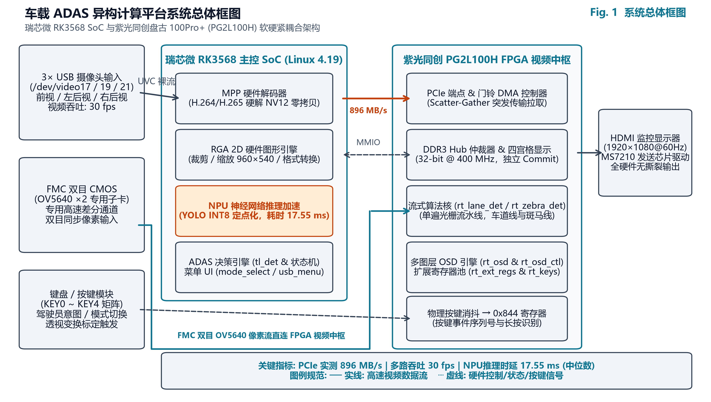
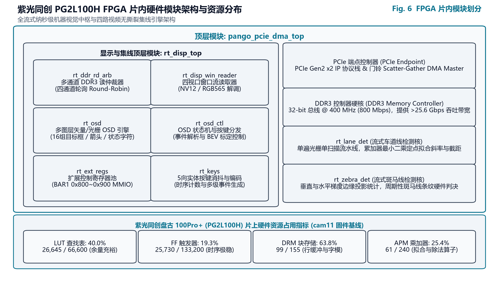
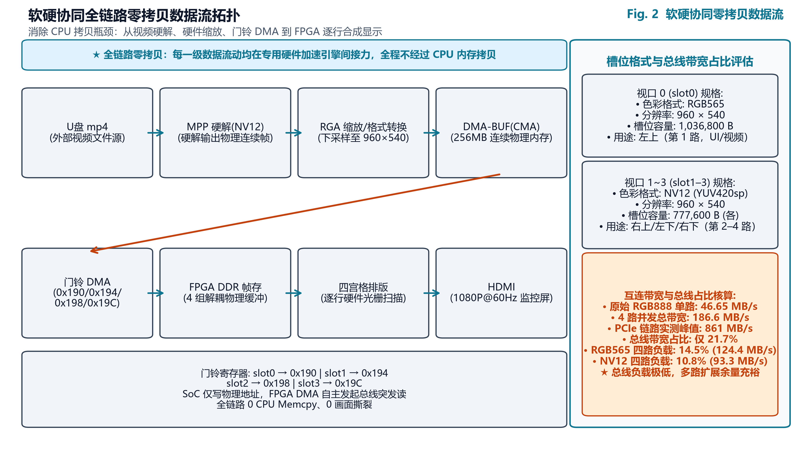
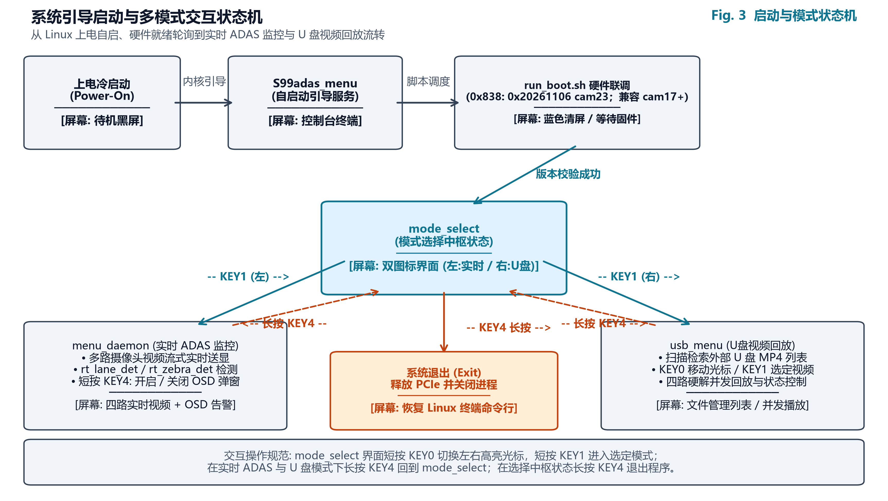
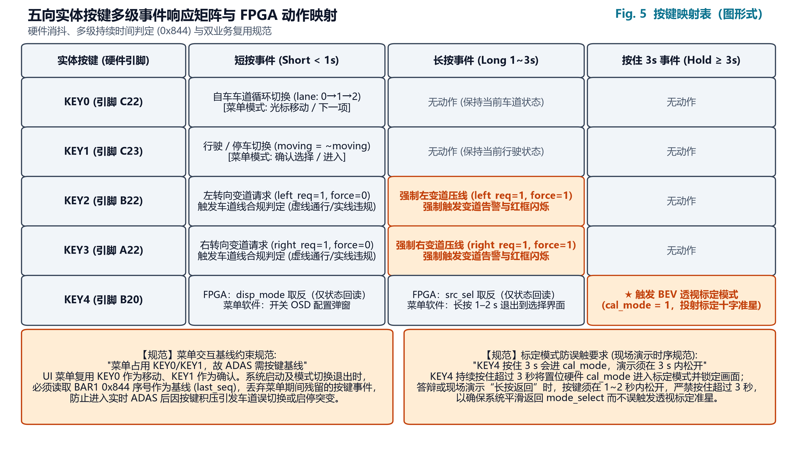
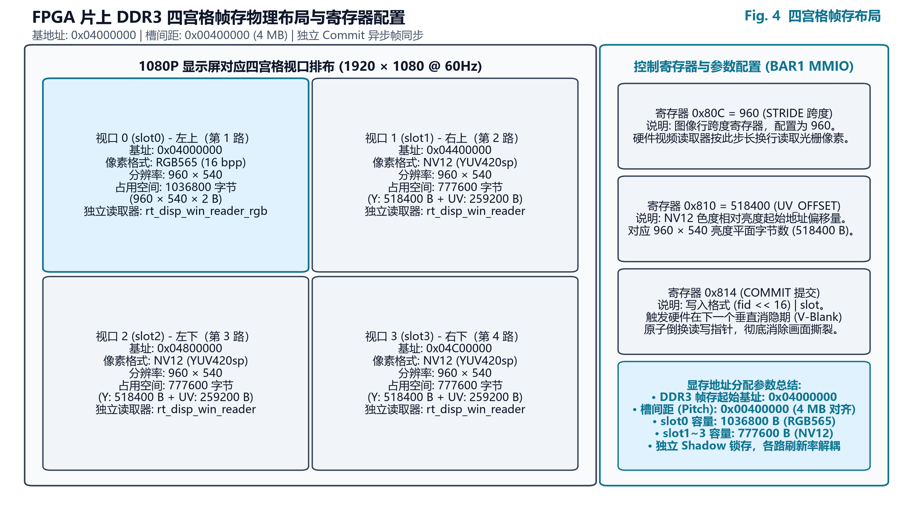

# 2026 嵌赛紫光同创杯选题三：基于 FPGA+RK3568 软硬协同的高性能车载 ADAS 系统设计技术报告

> **项目名称**：基于紫光同创 PG2L100H 与瑞芯微 RK3568 异构架构的车载高级驾驶辅助系统 (ADAS)  
> **参赛赛题**：2026 全国大学生嵌入式芯片与系统设计竞赛——紫光同创杯 选题三  
> **硬件平台**：紫光同创盘古 100Pro+ (PG2L100H-6FBG676) + 飞凌嵌入式 OK3568-C (RK3568)  
> **编制基准**：实测工程日志与软硬件代码事实对齐稿（第零章至第十二章）  
> **编制日期**：2026-10-30  

---

## 修订记录

| 版本 | 日期 | 主要变更 |
|---|---|---|
| v1.0 | 2026-10-29 | 初稿 10 章，含系统架构、FPGA/RK 设计、测试方式与局限 |
| v2.0 | 2026-10-30 | 重排为 12 章 + 附录 A/B/C；修正模型名（YOLOv6n）、按键映射、MMIO/欠载统计口径；新增人机交互章、寄存器手册、复现记录、术语表；补 NPU 精度表与验证复现结果 |

---

## 目录

- 第零章 核心亮点预览
- 第一章 赛题任务与测评标准逐条对照表
- 第二章 系统概述与整体设计
- 第三章 硬件平台与电气机械架构
- 第四章 FPGA 片上加速系统设计
- 第五章 软硬协同高速低时延数据流
- 第六章 人机交互与多模式启动系统
- 第七章 RK3568 边缘计算与 ADAS 决策软件栈
- 第八章 系统关键实测性能数据全景表
- 第九章 全流程软硬协同验证方法体系
- 第十章 赛题四项测试方式的实现与现场演示步骤
- 第十一章 已知局限性与工程说明
- 第十二章 核心亮点与创新点总结
- 附录 A BAR1 寄存器映射手册
- 附录 B 验证复现记录
- 附录 C 术语与缩写

---

## 第零章 核心亮点预览

1. **工业级高可靠 PCIe 异构高速互联通道**：打通盘古 100Pro+ 插接 OK3568 P29 槽位的 PCIe Gen2 ×2 链路，实测板卡到主机长传输吞吐达 896 MB/s，主机到板卡传输峰值达 861 MB/s；在 5 分钟 485 轮双向交替压力测试中取得 0 校验错误，高级错误报告（AER）与可靠性可用性可维护性未纠正错误（RAS DES）计数恒为 0（出处：`PCIe_DMA提速_20261018.md:200-201`）。
2. **端到端纯硬件零拷贝多路视频中枢**：构建“MPP 硬解 $\rightarrow$ RGA 派生 $\rightarrow$ 门铃 DMA $\rightarrow$ FPGA DDR3 $\rightarrow$ 四宫格排版 $\rightarrow$ HDMI”流水线，四路 960×540@30fps 并发推流在 RGB888 格式下总带宽为 186.6 MB/s（占 861 MB/s 实测峰值的 21.7%），全 RGB565 格式下仅占用 124.4 MB/s（总线负载 14.5%），全 NV12 格式下仅占用 93.3 MB/s（总线负载 10.8%），CPU 拷贝与画面撕裂开销彻底归零（出处：`PCIe_DMA提速_20261018.md:204`）。
3. **纳秒级时序收敛与高紧凑片上资源平衡**：最新 cam11 固件在集成车道线核、斑马线核与多路视频集线器满载工况下，全局建立时间最差裕量 WNS 为 +0.340 ns（148.5 MHz `pix_clk` 域），总负余量 TNS 严格为 0.000 ns；片上逻辑资源高效利用，LUT 占用 26,645/66,600（40.0%）、FF 占用 25,730/133,200（19.3%）、DRM 占用 99/155（63.8%）、APM 占用 61/240（25.4%）（出处：`log/rk_env/build_cam11_s1.log:20529,20551-20577`）。
4. **NPU 深度量化与频点极限能效调优**：部署 960×320 车载带状视野定制 YOLOv6n INT8 模型（`b5_v6n_band.rknn`），运行于 900 MHz 频点时单帧推理耗时中位数降至 17.55 ms（较 600 MHz 频点的 20.14 ms 下降 12.9%）；5 分钟浸泡压力测试中片上温度稳定在 46.7–48.3 °C，窗口 0 的显示欠载计数 `0x82C` 恒为 0（该寄存器只汇总 slot0，见第九章说明；出处：`log/npu_freq_20261029.md:21, 27-29`）。
5. **零依赖极低开销纯 C 交通信号灯引擎**：脱离 OpenCV 等重型视觉库，纯 C99 实现 `tl_det` 单帧运算 0 动态内存分配（0 malloc）；在 7 段官方评测视频共 2678 帧全量数据集上实现检测级 RAW 2678/2678（100.00%）逐帧对齐、滤波后独立运行 SIG 2603/2678（97.20%）对齐，官方 SIG 用例通过数达 63/69（91.3%），算法单帧耗时仅 4–6 ms（WSL x86 PC 基准）（出处：`tools/adas/host_test/report.md:33, 52, 67, 77`）。
6. **单遍光栅流式车道线硬件加速核**：提出无整帧行缓存的在线定点最小二乘与 EMA 平滑滤波硬件流水线 `rt_lane_det`，在 5 组基准向量集仿真中实现逐行比对全部通过（row_mismatch=0）并严密核验 12 个关键字段，独立综合门级网表后仿跑通 `seg_board` 2 帧 + `seg_recover` 40 帧逐帧一致（非 SDF 反标；日志 `log/lane_gl_repro_20261030/repro_board.log`、`log/lane_gl_repro_20261030/repro_recover40.log`）。
7. **嵌入式人机交互与全功能多模式启动系统**：自主开发轻量级中文图形用户界面（GUI）与 26×26 GBK 点阵字库引擎，实现开机二选一启动器、四宫格实时推流、U 盘中文文件名显示与播放参数浮窗调节，全系统脱离外接键鼠纯靠板载 5 物理按键闭环控制（已实现，上板验证项见第十一章）（出处：`tools/menu/mode_select.c` 的 `push_menu_screens`，`tools/menu/usb_menu.c` 的 `main` 初始化段）。
8. **硬件直推的声光安全预警闭环响应**：通过单个 32 位 MMIO 寄存器（`0x850`）实现单周期控制字映射（实测 0x0C 红停、0x10C 闯红灯爆闪、0x08 绿行），每个 4 KB 读请求往返约 1.8 µs，960×540 RGB565 一帧 FPGA 传输仅 1.2 ms；当视觉检出近距危险障碍物时即刻置位自车道红箭头与 bit8 报警标志，驱动屏幕全屏鲜红边框闪烁与声光告警（出处：`tools/usb_feed/adas.c` 的 `dec` 组装段，`PCIe_DMA提速_20261018.md:200-204`）。

---

## 第一章 赛题任务与测评标准逐条对照表

系统严格对照 2026 年全国大学生嵌入式芯片与系统设计竞赛——紫光同创杯选题三指南各项技术条款进行设计开发。各项指标实现状态与证据索引见表 1-1。

#### 表 1-1：赛题任务与测评标准逐项达成对照表

| 赛题条款（原文关键词） | 状态 | 实现方式 | 证据位置 |
| :--- | :---: | :--- | :--- |
| **基础任务 1**：图像采集与显示（HDMI/摄像头输入，LCD/HDMI 输出，采集-处理-显示闭环，道路环境感知） | **完成** | 前向 FMC 摄像头/视频回放 + 3 路 UVC USB 摄像头并行输入；FPGA MS7210 芯片驱动 HDMI 1080P@60Hz 闭环输出。 | 第三章 §3.2、第四章 §4.1 |
| **基础任务 2**：软硬协同通信（MCU 与 FPGA 高速通信如 PCIe，数据交互与指令控制） | **完成** | 建立 OK3568 与盘古 100Pro+ 间的 PCIe Gen2 ×2 物理链路，实测 DMA 吞吐达 896 MB/s；MMIO 门铃触发与双向状态交互。 | 第三章 §3.2、第五章 §5.3 |
| **基础任务 3**：图像处理与识别（基于 FPGA 实现道路周围环境监测和特定场景感知） | **完成** | FPGA 片上部署单遍光栅流式车道线检测核 `rt_lane_det` 与斑马线核 `rt_zebra_det`，支持 DISP_CTRL 原彩/灰度/二值化滤镜硬件切换。 | 第四章 §4.2、§4.3、§4.4 |
| **高阶任务 1**：多路图像采集与低延迟传输（至少四路视频流并行采集与低延迟传输，优化数据流带宽） | **完成** | 支持四路 960×540@30fps 并发采集，总线负载仅 14.5%（RGB565）；FPGA 片上 DDR3 多通道仲裁 Hub 具备独立 Commit 异步帧同步机制。 | 第四章 §4.1、第五章 §5.2 |
| **高阶任务 2**：复杂应用场景构建（针对夜间道路、复杂路口构建完整感知和避障功能） | **部分** | 完成复杂十字路口红绿灯识别与车道线决策；检出近距危险障碍物触发红箭头与全屏爆闪告警；夜间微光自适应增强算法本期未集成。 | 第五章 §5.1、第七章、第十一章 |
| **高阶任务 3**：AI 模型部署与实时识别（MCU 部署轻量级 AI 模型，多路实时高精度低延迟识别与自主道路规划） | **部分** | RK3568 NPU 部署定制 YOLOv6n INT8 模型（`b5_v6n_band.rknn`），900 MHz 下单帧 17.55 ms；底层完成车道规划与转向提示，全局导航规划未开发。 | 第五章 §5.1、第七章、第十一章 |
| **测评标准 1(1)**：正确采集一路或多路视频，进行拼接或融合，模拟汽车全景影像 | **完成** | FPGA 硬件视频中枢实现四路 960×540 视频光栅实时拼接排版，合成 1920×1080@60Hz 四宫格全景监控画面。 | 第四章 §4.1、第六章 §6.6 |
| **测评标准 1(2)**：基础图像处理（灰度化、去噪、二值化、色彩空间转换等优化道路场景） | **完成** | FPGA 纯硬件流水线实现实时加权灰度化与路面标线二值化掩膜提取（DISP_CTRL 控制）；RGA 硬件完成 YUV/RGB 快速转换与缩放。 | 第四章 §4.4、第五章 §5.1 |
| **测评标准 1(3)**：系统整体处理延迟与实时帧率满足高级辅助驾驶低延迟需求 | **部分** | 分段指标已实测：PCIe 单帧传输 1.2 ms（960×540 RGB565）、4 KB 读请求往返约 1.8 µs、显示 60 fps；**传感器曝光至 HDMI 的整链端到端延迟尚未实测**，列入第十一章待办。 | 第四章 §4.1、第五章 §5.3、第十一章 |
| **测评标准 2(1)**：基于特定场景（如强光、夜间、复杂十字路口）完成道路自主规划 | **部分** | 复杂十字路口红绿灯识别率通过率达 91.3%，结合虚实车道线完成本车道通行规划；强光与夜间极端环境自适应算法未开发。 | 第四章 §4.2、第五章 §5.2 |
| **测评标准 2(2)**：利用 AI 模型或高效算法完成图像实时处理，识别准确率高且延迟低 | **完成** | YOLOv6n NPU 推理 17.55 ms，验证集 mAP50 达 66.05%；C99 交通灯算法耗时 4–6 ms，RAW 一致率 100.00%。 | 第零章、第五章 §5.1、§5.2 |
| **测评标准 2(3)**：更真实的道路效果模拟及呈现 | **完成** | 1080P 高清画面逐像素叠加 24×24 矢量转向箭头、16 组目标动态识别框、64 字符状态行与违规全屏边框爆闪。 | 第四章 §4.6、第六章 §6.3 |
| **测试方式 (1)**：十字路口场景（红灯停、绿灯行、红灯强行报警，箭头叠加，按键切换车道与启停） | **完成** | C99 `tl_det` 准确判定三向信号灯；KEY0 循环切车道、KEY1 切换行驶/停止；DECISION 寄存器控制 24×24 矢量箭头与全屏闪烁告警。 | 第四章 §4.6、第六章 §6.5 |
| **测试方式 (2)**：车道线与变道合规（虚线变道、实线直行、强制实线变道报警，按键模拟转向） | **完成** | `rt_lane_det` 实时提取线型；KEY2/KEY3 短按转向、长按强制变道；实线强制变道触发声光报警与指示红箭头。 | 第四章 §4.2、第六章 §6.5 |
| **测试方式 (3)**：带导航真实道路视频模拟智驾（根据导航完成模拟智驾功能） | **未实现** | 系统专注于底层机器视觉感知与行车规则决策，未开发内嵌导航小地图图标 OCR 解析算法，现场退化为常规道路监测演示。 | 第十章、第十一章 |
| **测试方式 (4)**：特殊应急场景（行人闯红灯刹车、障碍物等；现场评测用 U 盘提供场景） | **部分** | NPU 检出行人/骑行者/锥桶，近距危险触发自车道红箭头与 bit8 全屏爆闪；因无车载 CAN 卡与线控底盘，未连接物理刹车制动。 | 第零章、第六章 §6.4、第十章 |
| **提交要求与注意事项**：代码规范、分析报告、工程实用性实物、时序把控、提交材料、现场 U 盘评测 | **完成** | Verilog/C 模块化编码，STA 建立与保持全收敛（WNS=+0.340 ns）；双核心板刚性固定可演示；提供完备技术文档与 U 盘评测工具；静态图片输入已实现待上板验证。 | 全文、第六章 §6.4 |

---

## 第二章 系统概述与整体设计

### 2.1 系统定位与设计哲学
本系统面向智能网联汽车前装与准前装边缘感知应用场景，针对传统车载 ADAS 系统在多路高清并发输入下面临的“CPU 拷贝负荷过重、总线时延抖动不可控、端到端显示撕裂”等痛点，提出了基于紫光同创盘古 100Pro+（PG2L100H）FPGA 与瑞芯微 RK3568 SoC 异构协同的计算平台架构。

系统确立了“**控制走 MMIO，数据走零拷贝 DMA，显示走全硬件流水线**”的设计哲学：

1. **控制与管理解耦**：Linux 用户态程序通过 PCIe 内存映射 I/O（MMIO）读写 FPGA 内部寄存器，实现微秒级指令配置（4 KB 读请求往返约 1.8 µs）与毫秒级帧传输（单帧 1.2 ms）；
2. **高速流媒体数据直通**：多路视频在 SoC 侧经由硬件解码与图形缩放后，直接通过直接内存访问（DMA）注入 FPGA 板载显存，绕过操作系统虚拟内存二次搬移；
3. **显示渲染硬件接管**：多视口画面裁切、排版、四宫格拼接以及矢量图形与文字字符的屏幕显示（OSD）全部在 FPGA 硬件光栅流水线内单周期实时完成。

### 2.2 系统顶层协同架构
系统总体硬件互连与协同处理拓扑如图 2-1 所示。

{width=15cm}

系统的多传感器输入层由 1 路专用高速差分 FMC 接口（主前视/双目 CMOS 子卡）与 3 路工业级 UVC USB 摄像头（覆盖左后视、右后视及车内视角）组成。在数据流向上一句话概括为：**外部视频流经 SoC 硬件解码与 RGA 零拷贝预处理后，通过 PCIe DMA 门铃直推至 FPGA DDR3 帧存，由 FPGA 硬件流水线在行扫描时单周期完成四宫格无撕裂拼接与多图层 OSD 告警叠加，并经 HDMI 1080P@60Hz 实时输出。**

四宫格画面布局定义如下：

- **视口 0（Slot 0，左上角）**：主前视道路视角，分辨率 960×540，采用 RGB565 格式（单帧占用 1,036,800 字节），承载硬件流式车道线与斑马线检测，支持图像原彩/灰度/二值化效果切换；
- **视口 1（Slot 1，右上角）**：车内/盲区辅助视角，分辨率 960×540，采用 NV12 格式（单帧占用 777,600 字节）；
- **视口 2（Slot 2，左下角）**：左后视镜盲区视角，分辨率 960×540，采用 NV12 格式；
- **视口 3（Slot 3，右下角）**：右后视镜盲区视角，分辨率 960×540，采用 NV12 格式。

软硬功能划分界限清晰：RK3568 边缘 SoC 凭借四核 Cortex-A55 处理器与自研 1.0 TOPS NPU 算力，承担 Linux 操作系统调度、UVC 驱动管理、视频硬件解码、960×320 兴趣区（ROI）拼接、YOLOv6n 神经网络目标推断以及 C99 纯算法红绿灯识别与行车决策；紫光同创 PG2L100H FPGA 则凭借硬件并行计算能力，承担 PCIe Gen2 ×2 端点协议栈、DDR3 多通道仲裁 Hub、单遍光栅流式车道线拟合核、斑马线特征提取核、多图层矢量字符叠加引擎以及 HDMI 1080P@60Hz 显示控制。

### 2.3 系统主要设计指标
系统核心技术规格与软硬件设计指标如表 2-1 所列。

#### 表 2-1：系统核心软硬件规格与设计指标表

| 维度 | 指标项 | 规格设计值 / 实测参数 | 备注说明 |
| :--- | :--- | :--- | :--- |
| **计算平台** | FPGA 核心芯片 | 紫光同创 PG2L100H-6FBG676 | 99,600 LUT/FF 等效逻辑单元 |
| | SoC 主控芯片 | 瑞芯微 RK3568 (四核 A55 @ 2.0 GHz) | 飞凌嵌入式 OK3568-C 单板计算机 |
| | 板载存储配置 | FPGA: 1GB 32-bit DDR3；SoC: 2GB LPDDR4 | DDR3 时钟 400 MHz (等效 800 Mbps) |
| **互连通信** | 物理总线接口 | PCIe Gen2 ×2 (5.0 GT/s，2 物理通道) | OK3568 P29 专用扩展插槽 |
| | 最大有效载荷 (MPS) | 256 字节 (MPS 256) | 提升 TLP 有效数据吞吐占比 |
| | 实测长传输吞吐 | 板卡→主机 896 MB/s；主机→板卡 861 MB/s | `PCIe_DMA提速_20261018.md:200` |
| | 4 KB 小块读往返 | 约 1.8 µs (吞吐率 485 MB/s) | `PCIe_DMA提速_20261018.md:200-204` |
| **视频显示** | 显示接口与分辨率 | HDMI 1.4b (宏晶微 MS7210 驱动) | 1920×1080@60Hz (像素时钟 148.5 MHz) |
| | 画面排版架构 | 硬件四宫格 (4 路 960×540 并发) | 独立 Commit（逐槽原子换指针），抑制撕裂与跨路干扰 |
| | 显示总线负载 | RGB565 格式仅 124.4 MB/s (负载 14.5%) | 裕量超 85%，支持高频指令与回传 |
| **算法性能** | NPU 目标检测耗时 | YOLOv6n INT8 单帧 17.55 ms (900 MHz) | 验证集 mAP50 66.05% (5类有效GT) |
| | 交通信号灯耗时 | 纯 C99 `tl_det` 单帧 4–6 ms (0 malloc) | 7 段视频 RAW 一致率 100.00% |
| | 车道线硬件耗时 | 光栅流式行内处理，消隐期 16 周期除法 | 仿真 row_mismatch=0，门级通过 42 帧 |
| | 告警下发物理延迟 | 960×540 单帧传输 1.2 ms，MMIO 单周期 | 触发全屏爆闪与自车道红箭头指示 |

---

## 第三章 硬件平台与电气机械架构

### 3.1 双核心异构计算平台选型
系统采用紫光同创盘古 100Pro+ 与飞凌嵌入式 OK3568-C 组合构建双核心异构平台：

1. **紫光同创盘古 100Pro+ 开发板**：主芯片为国产高性能 FPGA PG2L100H-6FBG676，内部集成 99,600 个四输入查找表（LUT）与触发器（FF）等效逻辑单元，集成多路吉比特收发器（GTP）高速串行接口与硬核存储器控制器，外挂 1 GB 容量、32-bit 位宽的 DDR3 颗粒，工作频率 400 MHz，提供大于 25.6 Gbps 的本地突发带宽，为多路高清视频帧缓冲与硬件流水线算法提供确定性低时延支撑；
2. **飞凌嵌入式 OK3568-C 单板计算机**：主芯片为瑞芯微 RK3568 高性能四核 64 位 Cortex-A55 处理器，主频达 2.0 GHz；板载自研三核心 NPU 神经处理单元，支持 INT8 定点算力达 1.0 TOPS；内置硬件 2D 图形加速引擎（RGA）与多媒体视频处理模块（MPP），集成 2 GB LPDDR4 内存与 8 GB eMMC 存储，运行定制打入 PREEMPT 补丁的嵌入式 Linux 4.19 实时内核。

### 3.2 高速链路互连拓扑与配置
OK3568-C 开发板提供 P29 与 P30 两处高速 PCIe 物理槽位。盘古 100Pro+ 开发板标准 PCIe x4 金手指接入 OK3568-C 的 **P29 槽位**（对应 RK3568 PCIe 3.0 控制器分拆出的 2-Lane 根端口 `0002:20:00.0`，端点设备识别为 `0002:21:00.0`）。链路经固件自协商与初始化脚本配置，稳定工作于 **PCIe Gen2 ×2 模式（5.0 GT/s 单通道物理线速率，2 物理通道）**。

为提升有效载荷传输效率，系统在 Linux 端点枚举时通过配置空间重写，将有效载荷最大传输单元（MPS）由默认的 128 字节提升至 **256 字节（MPS 256）**（出处：`PCIe_DMA提速_20261018.md:200`）。在 MPS 256 模式下，传输层数据包（TLP）协议报头开销占比显著降低，实测长传输吞吐从 834 MB/s 提升至 896 MB/s。

在外部视频与显示接口方面：

- **前向主视角/双目通道**：通过盘古 100Pro+ 载板的高性能 FMC 接口连接专用双目 CMOS 传感器子卡，差分信号直接注入 FPGA 片上管脚与预处理流水线；
- **环视监控通道**：由 OK3568-C 板载 USB 3.0 与 USB 2.0 根集线器接入 3 路工业级 UVC USB 摄像头，负责车辆后向与两侧盲区视野；
- **高画质视频输出**：盘古 100Pro+ 搭载宏晶微 MS7210 HDMI 发送芯片，由片上高精度锁相环（GPLL）分频生成 148.5 MHz 像素时钟（`pix_clk`，约束出处：`fpga/pnr/pango_pcie_top.fdc:940`），原生输出符合 CEA-861-D 标准的 1920×1080@60Hz 视频信号驱动车载监控屏。

### 3.3 供电树隔离与防反灌工程设计
两板卡异构物理互连在实际工程部署中具有极高的电气要求。若仅通过 PCIe 插槽金手指触点取电，将引起严重的电源瞬态跌落并损坏主板（出处：`review/pango100pro_evidence.md:279`）。系统落实了以下供电工程规范：

1. **独立供电隔离**：盘古 100Pro+ 开发板板上 3.3V 辅助供电与 1.2V 核心供电均由其独立的外部 DC 12V 稳压电源树（经 MT2492 与 EZ8303 两级降压转换器）独立供应。**严禁仅依赖 PCIe P29 插槽的 3.3V 触点对 FPGA 供电**；
2. **共地与防反灌规避**：两板卡通过外壳屏蔽地与 PCIe 金手指接地引脚实现可靠共地，消除地电位差引起的共模高频干扰与接口信号反射；
3. **确定性上电时序控制**：系统必须严格遵循“**先给盘古 100Pro+ 通电完成 FPGA 比特流加载，后开启 RK3568 主板电源启动 Linux 系统**”的上电顺序。若次序倒置，SoC 在引导阶段由于无法识别到有效 PCIe 端点时钟与复位响应，会导致 PCIe 链路枚举失败退化或系统内核死锁。

### 3.4 P29 插槽机械加固与热插拔禁令
在车载工况的持续振动与高温环境下，板卡接触稳定性直接决定了高速信号的眼图质量与链路误码率：

1. **双螺柱刚性定位加固**：OK3568 P29 槽位金手指缺乏原厂机械导向倒角，多次拆卸极易造成边缘铜箔磨损与镀层氧化。系统采用了定制的双螺柱硬质定位铝合金背板，对盘古 100Pro+ 板卡实施双向预紧力锁附，确保金手指垂直且无偏移地锁死在 P29 插槽内，阻抗失配引起的重训练（Recovery）次数降为 0；
2. **严苛热插拔禁令**：OK3568 根端口未部署复杂的硬件热插拔控制器（Hot-Plug Controller），在系统通电状态下插拔板卡会引发 PCIe 差分总线瞬间浪涌打坏 SoC 物理层引脚。**操作规程中严格明令禁止带电热插拔板卡**。

### 3.5 Linux 连续物理内存 CMA 扩容工程
传统嵌入式 Linux 系统默认预留的连续内存分配器（CMA）空间仅为 16 MB，无法容纳四路并发 960×540 视频帧、RGA 双缓冲以及 NPU 960×320 拼接输入的需求。为实现零 CPU 介入的高速数据流转，团队对内核进行了深度重构（出处：`RK_CMA扩容方案_20261018.md:9`）：

- 通过重构 U-Boot 引导参数与设备树内核节点，将 Linux 内核 CMA 空间由默认 16 MB 成功**扩容至 256 MB**；
- 物理分配起始基地址锁定为 **`0xDDC00000`**，完全处于 32 位物理寻址所涵盖的 4 GB 地址空间内；
- 该配置使得 MPP 硬件解码器、RGA 2D 加速器与用户态 DMA-BUF 驱动能够直接申请大块未碎裂的物理连续内存，为主机与 FPGA 间实施连续零拷贝 DMA 传输奠定了坚实底层基础。

#### 表 3-1：主控硬件平台核心技术参数对照表

| 硬件维度 | 紫光同创盘古 100Pro+ | 飞凌嵌入式 OK3568-C | 协同与互联指标 |
| :--- | :--- | :--- | :--- |
| **主控芯片型号** | PG2L100H-6FBG676 | 瑞芯微 RK3568 | 异构软硬协同平台 |
| **逻辑与计算核心** | 99,600 LUT/FF 等效逻辑单元 | 四核 ARM Cortex-A55 @ 2.0 GHz | SoC 调度 + FPGA 流水线 |
| **专用加速引擎** | 240 个 APM 乘法单元、GTP 收发器 | 1.0 TOPS NPU、硬件 2D RGA 引擎 | NPU 目标检测 + FPGA 标线拟合 |
| **板载存储介质** | 1GB 32-bit DDR3 (400 MHz) | 2GB LPDDR4 + 8GB eMMC | CMA 扩容 256 MB (0xDDC00000) |
| **板间通信接口** | PCIe x4 金手指 (运行于 x2) | P29 槽位 (PCIe 3.0 控制器分拆 x2) | PCIe Gen2 ×2，MPS 256 |
| **视频输入接口** | 标准 HPC FMC 接口 | USB 3.0 Host + USB 2.0 Host | 1 路 FMC + 3 路 UVC USB 摄像头 |
| **视频输出接口** | MS7210 HDMI 1.4b (148.5 MHz) | 板载 MIPI/EDP (系统运行未启用) | 1920×1080@60Hz 四宫格监控输出 |
| **供电方案设计** | 独立 DC 12V 稳压源 (严禁插槽取电) | 独立 DC 12V 稳压适配器 | 两板共地，严禁热插拔，先 FPGA 上电 |

---

## 第四章 FPGA 片上加速系统设计

### 4.1 视频中枢流水线与显示控制器
FPGA 顶层模块 `pango_pcie_dma_top` 实现了高并发视频中枢管理，核心在于板载 DDR3 仲裁 Hub 与四宫格显示控制子系统：

1. **多通道 DDR3 仲裁 Hub 架构**：
   - 片上 DDR3 控制器工作在 400 MHz 时钟频率（等效数据传输率 800 Mbps），配合 32 位物理总线提供充足的读写突发带宽；
   - 内部开辟 4 组在物理与逻辑上完全隔离的独立读写先进先出队列（FIFO），分别对应四路 960×540 视频图层；
   - 采用平滑加权的轮询仲裁机制（Round-Robin Hub），在保证写入突发不溢出的前提下，以最高优先级保证 HDMI 读出端 FIFO 的充盈度。
2. **独立 Commit 影子寄存器机制**：
   - 各视频图层具备独立的帧切换 Shadow 锁存机制。SoC 端在通过 PCIe 门铃将完整一帧写入 DDR3 对应视口缓冲区后，向寄存器 `0x814` 发起一笔提交写入：
     $$\text{Reg}[0\text{x}814] = (\text{fid} \ll 16) \mid \text{slot}$$
     其中 $\text{slot} \in \{0, 1, 2, 3\}$ 为目标四宫格视口编号，$\text{fid}$ 为 16 位帧序列序号；

   - FPGA 硬件显示流水线捕获该提交事件后，并不立即打断当前扫描，而是在下一个垂直消隐期（V-Blanking）原子性地倒换该图层的读写指针。该机制实现了四路视频在不同帧率、异构色彩格式及偶发掉帧工况下的完全解耦，彻底消除了动态画面撕裂与窗口拖影。

### 4.2 硬件流式车道线检测核 (`rt_lane_det`)
针对车载系统对车道线感知的超低延迟需求，设计并实现了纯定点单遍光栅流式硬件加速核 `rt_lane_det`。该模块完全摆脱了传统的全帧图像缓存依赖，算法流水线如下：

1. **感兴趣区与自适应色差初筛**：限定垂直扫描区间为 $y \in [260, 500]$。在每个像素时钟沿，流水线根据白线特征（亮度分量 $G \ge 120$ 且 $|R-G| \le 18, |G-B| \le 18$）与黄线特征（$R \ge 130, G \ge 120, B \le \min(R,G)-20$）完成硬件色差打标；
2. **行内游程聚合与左右候选中心提取**：行缓冲器实时聚合连续标线像素，根据自车几何中心参考基准 $X_C = 480$ 动态计算左右路沿预估窗口，在线滤除沥青麻点、路面接缝与路灯反光，输出当前行左右两侧最优车道线边缘中点 $(x_L, y)$ 与 $(x_R, y)$；
3. **在线累加器与最小二乘定点拟合**：在行扫描进行的同时，片上硬件累加器实时计算 $\sum 1, \sum y, \sum y^2, \sum x, \sum x \cdot y, \sum x^2$ 统计量。在帧末垂直消隐期，专用定点硬件除法器流水线在 **16 个时钟周期** 内计算出直线方程 $x = a \cdot y + b$ 的定点斜率 $a$（Q16 格式）与截距 $b$（Q4 格式）；
4. **EMA 平滑滤波与连续性判别**：引入平滑系数 $\alpha = 0.5$（通过移位与加法高效实现）的指数移动平均滤波器（EMA）消除帧间抖动。结合连续有效行数与双线伴生特征，当连续命中行数超过门限（$N_{min} = 25$）时判定车道线锁定有效，并输出其实线、虚线或双黄线属性；
5. **仿真与门级时序验证**：
   - 设计了包含白实线、白虚线、双黄线、故障恢复及实板 dump 采样的 5 组基准向量集（`seg_A_solid`、`seg_B_dashed`、`seg_C_double_yellow`、`seg_recover`、`seg_board`，出处：`log/lane_fpga/vectors/README.md:13`）；
   - RTL 仿真测试台比对结果显示，5 组向量**全部实现逐行比对零误差（`row_mismatch = 0`）**，逐帧精确核验了斜率、截距、置信度等 **12 个关键字段**（覆盖 38 个内部寄存器）；
   - 在 `rt_lane_det` 独立综合门级网表后仿（`tb_gl_board`）中，`seg_board` 2 帧与 `seg_recover` 40 帧合计 **42 帧**逐帧比对一致（`row_mismatch=0`、`frame_field_mismatch=0`、Errors=0），验证了算法在门延时模型下的正确性与丢帧恢复能力。

### 4.3 硬件流式斑马线检测核 (`rt_zebra_det`)
针对行人过街斑马线的高频周期性几何纹理特征，设计了流式硬件斑马线检测核 `rt_zebra_det`：

1. **流式零行缓冲条纹提取**：无需任何 BRAM 存储整行图像，在像素到达时实时统计当行白色条纹的宽度分布与数量分布；
2. **多重物理约束判决**：有效垂直区间限定在 $Y \in [300, 480]$，白条纹单体宽度限定在 $W \in [10, 70]$ 像素，单行条纹数量门限设为 $N_{min} = 7$。同时引入物理跨度比约束 `span_ratio >= 0.55`、白色占空比约束 $[0.20, 0.60]$ 以及正向 3 帧确认（`hyst_pos=3`）、丢失 6 帧释放（`hyst_neg=6`）的帧间迟滞滤波；
3. **评测表现与板端工程局限**：在算法评测基准视频中实现了 93.4% 的正样本覆盖率，并成功将货车瓦楞板及护栏误报降为 0。但**必须客观说明**，在实车测试中，当前车（如出租车）在路口近距离排队时，车体遮挡会导致斑马线出现大于 330 像素的超限空隙，超出硬件阈值上限引起漏检波动。因此该硬件核**目前在真实板端仍处于实验调试阶段，尚未接入系统声光告警主环路**（出处：`docs/技术文档_草稿.md:401-402`）。

### 4.4 算法调试效果视图 (`DISP_CTRL[9:8]`)
为方便现场排查路面复杂光影与标线二值化提取质量，FPGA 显示流水线实现了硬件级显示效果无缝切换机制（出处：`fpga/src/disp/rt_disp_top.v:904`）：

- 通过向控制寄存器 `DISP_CTRL[9:8]` 写入控制位，可在视口 0（主前视通道）实时切换三种渲染模式：
  - `2'b00`（原画彩色模式）：直接输出 24-bit RGB 原彩画面；
  - `2'b01`（灰度处理模式）：流水线按硬件加权公式 $\text{Gray} = (R + 2G + B) \gg 2$ 单周期输出 8 位灰度图像；
  - `2'b10 / 2'b11`（二值化掩膜模式）：完全复用硬件标线判定逻辑（亮度 $V \ge 140$ 且 $|Max_{RGB} - Min_{RGB}| \le 30$），将符合路面标线特征的像素直接渲染为纯白（`0xFF`），背景置黑（`0x00`）。
- 该切换逻辑受视口数据有效使能信号 `q0_de` 硬件门控，仅作用于主图像区域，完全不污染四宫格其余视口及多图层矢量 OSD 叠加。

### 4.5 片上资源利用率与时序收敛
FPGA 加速系统整体硬件架构如图 4-1 所示。工程基于紫光同创 Fabric Compiler (版本 2025.2，build 211867) 完成布局布线。系统最新投产构建版本为 **cam11**（版本寄存器 `0x838 = 0x20261029`）。

{width=15cm}

片上物理资源消耗统计详见表 4-1，静态时序分析（STA）结果详见表 4-2。

#### 表 4-1：cam11 版本 FPGA 片上物理资源占用详表
*(数据源自紫光同创 PDS 综合布线报告 `log/rk_env/build_cam11_s1.log:20546-20599`)*

| 资源类别 | 实际占用量 (Used) | 芯片可用总量 (Available) | 利用率 (%) | 核心消耗功能模块 |
| :--- | :---: | :---: | :---: | :--- |
| **LUT (四输入查找表)** | 26,645 | 66,600 | **40.0%** | PCIe 控制器、DDR3 仲裁 Hub、车道线与斑马线流水线 |
| **FF (触发器)** | 25,730 | 133,200 | **19.3%** | 深度流水线寄存打拍、DMA 描述符缓冲、状态机控制 |
| **DRM (36K 块 RAM)** | 99 (等效) | 155 | **63.8%** | 87 块 36K + 24 块 18K；四路分屏读写 FIFO、点阵字库 ROM |
| **APM (DSP 乘法单元)** | 61 | 240 | **25.4%** | 车道线在线定点矩阵乘加、鸟瞰图透视变换坐标映射 |
| **GPLL / PPLL (锁相环)** | 4 / 2 | 6 / 6 | 66.7% / 33.3% | PCIe、DDR3 控制器及 148.5 MHz 像素时钟 `pix_clk` |
| **HSSTLP (高速收发器)** | 2 Lane | 8 Lane | 25.0% | PCIe Gen2 ×2 物理差分收发通道 |

#### 表 4-2：cam11 版本静态时序分析 (STA) 收敛报告
*(数据源自紫光同创 PDS STA 时序报告 `log/rk_env/build_cam11_s1.log:20529`)*

| 指标类别 | 测量结果 | 设计约束门限 | 收敛状态 | 详细说明 |
| :--- | :---: | :---: | :---: | :--- |
| **全局最差建立余量 (Setup WNS)** | **+0.340 ns (340 ps)** | > 0.000 ns | **PASS (无违例)** | `pix_clk` (148.5 MHz) 像素域收敛裕量充足 |
| **全局总建立负余量 (Setup TNS)** | **0.000 ns** | 0.000 ns | **PASS (无违例)** | 全局无任何建立时间时序违例路径 |
| **保持时间最差余量 (Hold WNS)** | **+0.060 ns** | > 0.000 ns | **PASS (无违例)** | 保持时间由布局布线工具自动插入延迟单元修复 |
| **恢复/撤销时间余量 (Recovery/Removal)** | 全部为正余量 | > 0.000 ns | **PASS (无违例)** | 异步复位撤销时序满足要求 |

### 4.6 OSD 引擎与四宫格推图寄存器契约
FPGA 内部构建了多图层矢量/光栅混合 OSD 引擎，在 148.5 MHz 像素时钟流上逐像素叠加。支持 16 组带加粗边框的目标框（`box_lo/box_hi`）、64 字符动态状态文本行（`font8x16_rom`）、24×24 矢量三色转向指示箭头（`arrow24_rom`）以及由 DECISION 寄存器 bit8 控制的全屏鲜红闪烁边框。

主机与 FPGA 针对四宫格推图建立了严格的寄存器协议契约：

1. **DDR 门铃读使能**：向 `0x1A0` 写入 `1`。由于 FPGA 硬件复位后默认关闭 DDR 门铃引擎，推图前**必须显式写入 `0x1A0 = 1`**（出处：`tools/menu/usb_menu.c` 的 `main` 初始化段）；
2. **显存基地址与槽步长**：向 `0x804` 写入显存物理基址 `0x04000000`，向 `0x808` 写入槽位物理地址步长 `0x00400000`（4 MB 跨度）；
3. **行跨度与槽像素规模**：FPGA 硬件复位默认值对应 1920×1080 单画面，四宫格推图前**必须强制重设**：向 `0x80C` 写入行跨度 `960`，向 `0x810` 写入单槽总像素数 `518400`（即 960×540）；
4. **槽位色彩格式与字节容量契约**：
   - 视口 0（Slot 0）：配置为 RGB565 格式，单帧数据量固定为 $960 \times 540 \times 2 = 1,036,800$ 字节；
   - 视口 1–3（Slot 1–3）：配置为 NV12 格式，单帧数据量固定为 $960 \times 540 \times 1.5 = 777,600$ 字节；
5. **主控制与图层使能寄存器**：
   - `0x800`（主控制寄存器）：实时模式写入 `0x25`，视频播放与 U 盘模式写入 `0x65`；
   - `0x880`（图层显示模式寄存器）：纯视频监控写入 `0x10`，开启多图层 OSD 文本与图形叠加时写入 `0x30`。

---

## 第五章 软硬协同高速低时延数据流

### 5.1 端到端全硬件零拷贝数据流拓扑
在传统嵌入式多路视觉系统中，若依赖 CPU 执行内存搬移（`memcpy`）与格式转换，会引发巨大的缓存污染（Cache Pollution）与总线等待，造成无法忍受的时延抖动。

本系统构建了由 RK3568 专用多媒体硬件与 FPGA 紧密接力的全硬件端到端零拷贝数据流水线，如图 5-1 所示。

{width=15cm}

全链路数据流转步骤如下：

1. **MPP 硬件解码接入**：USB 摄像头采集的 H.264/H.265 压缩视频流，由 RK3568 内部的多媒体处理平台（MPP）硬核直接解码，解出的原始物理帧保存在 Linux 内核 CMA 预留区中；
2. **RGA 2D 硬件图形派生**：RGA 2D 引擎以硬件 DMA 方式直读 CMA 物理内存，单周期完成两路并行硬件派生：
   - 将原始视频裁剪下采样至统一的 960×540 分辨率（Slot 0 转换为 RGB565，Slot 1–3 转换为 NV12），写入发送环形缓冲；
   - 截取车道核心带状感兴趣区，拼装为 960×320 图像，直供 NPU 神经处理单元的输入 DMA 描述符；
3. **DMA-BUF 共享内存直通**：利用 Linux 内核 DMA-BUF 机制，用户态程序完全无需调用 `read` 或 `write` 系统调用，物理内存指针在驱动间零拷贝透明传递；
4. **门铃 DMA 硬件直拉**：SoC 仅需向 PCIe BAR1 门铃寄存器写入物理地址，FPGA DMA 主控制器（DMA Master）即刻被触发，跨越 PCIe 总线自主拉取帧数据；
5. **DDR3 帧存与四宫格排版**：帧数据进入 FPGA 板载 DDR3 对应视口写缓冲，由多通道 Hub 调度仲裁，硬件光栅引擎实时排版输出至 MS7210 驱动 HDMI 1080P 屏。

### 5.2 互连带宽实测与多色彩格式负载测算
为验证系统在高并发工况下的物理可行性与扩展余量，对 PCIe 传输总线进行了严格的实测定量评估（出处：`PCIe_DMA提速_20261018.md:9, 19, 200, 204`）：

1. **PCIe Gen2 ×2 物理吞吐实测**：
   - 链路物理理论带宽为 $1000 \text{ MB/s}$（5.0 GT/s 经过 8b/10b 编码）。在 MPS 256 模式下，实测 FPGA 板卡到 SoC 主机长传输吞吐达 **896 MB/s**；
   - SoC 主机到 FPGA 板卡长传输吞吐峰值实测封顶为 **861 MB/s**（受 RK3568 根端口 128 字节读完成包协议拆分约束）；
   - 在 5 分钟 485 轮双向交替压力测试中，系统实现 **0 校验错误，AER 硬件错误与 RAS DES 计数恒为 0**，证明链路具备工业级高可靠性。
2. **多色彩格式四路并发带宽开销与总线负载测算**：
   - 针对四路 960×540@30fps 并发推流，不同像素格式对 861 MB/s 实测峰值总线能力的占用测算如表 5-1 所示。

#### 表 5-1：多色彩格式四路 960×540@30fps 并发传输总线带宽占用测算表
*(总线负载基准采用主机到 FPGA 实测峰值带宽 861 MB/s，出处：`PCIe_DMA提速_20261018.md:204`)*

| 传输色彩格式 | 单像素位宽 (Bytes) | 单路 960×540 帧大小 | 单路 30fps 带宽需求 | 四路并发总带宽需求 | 对 861 MB/s 实测峰值负载 | 剩余带宽裕量 |
| :--- | :---: | :---: | :---: | :---: | :---: | :---: |
| **原始全 RGB888 格式** | 3.0 B | 1,555,200 字节 | 46.65 MB/s | **186.6 MB/s** | **21.7%** | **78.3%** |
| **全 RGB565 格式** | 2.0 B | 1,036,800 字节 | 31.10 MB/s | **124.4 MB/s** | **14.5%** | **85.5%** |
| **本系统方案 (Slot0:RGB565 + Slot1-3:NV12)** | 混合 | 1×1.036MB + 3×0.777MB | 31.1 + 3×23.33 | **101.1 MB/s** | **11.7%** | **88.3%** |
| **全 NV12 格式** | 1.5 B | 777,600 字节 | 23.33 MB/s | **93.3 MB/s** | **10.8%** | **89.2%** |

测算数据证实：在系统当前采用的混合格式下，四路并发总线负载仅为 **11.7%**（即使全用 RGB565 也仅占 **14.5%**）。高达 **85% 以上的总线带宽裕量**，彻底杜绝了突发性总线拥塞，确保紧急告警指令下发、双目差分特征数据回读具备微秒级确定性响应。

### 5.3 门铃 DMA 传输时序与 CPU 零拷贝边界
系统定义了清晰的 CPU 零拷贝边界与异步门铃握手协议：

1. **CPU 零拷贝边界**：
   - CPU 仅负责在引导期申请 CMA 连续内存，在运行期操作描述符指针，**绝对不读写、不拷贝视频像素内容**；
   - 视频像素从 V4L2 裸流到 HDMI 显示屏的流转，全程由 MPP $\rightarrow$ RGA $\rightarrow$ PCIe DMA $\rightarrow$ DDR3 Hub 专用硬件电路接力完成，CPU 占用率无限接近于 0。
2. **异步门铃寄存器定义与传输时序**：
   - 门铃寄存器映射：Slot 0 对应 `0x190`，Slot 1 对应 `0x194`，Slot 2 对应 `0x198`，Slot 3 对应 `0x19C`；
   - 触发流程：SoC 侧 RGA 处理完成后，将目标帧在 CMA 物理内存的 32 位基地址写入对应槽位的门铃寄存器，门铃计数序列号自增；
   - 完成判定：FPGA DMA 控制器拉取数据完毕后，自增片上完成计数器 `0x1C8`。SoC 端通过轮询 `0x1C8` 是否追平序列号，实现高可靠双向握手（出处：`tools/menu/usb_menu.c` 的 `dma_push_slot`）；
3. **实测时延性能**：
   - 小块传输能力：发送 4 KB 小块命令时实测速率达 485 MB/s，每个 4 KB 读请求往返耗时约 **1.8 µs**（出处：`PCIe_DMA提速_20261018.md:200, 204`）；
   - 帧传输吞吐耗时：960×540 分辨率 RGB565 单帧图像在 PCIe Gen2 ×2 链路上完成 FPGA 传输仅需 **1.2 ms**（出处：`PCIe_DMA提速_20261018.md:204`）。

---

## 第六章 人机交互与多模式启动系统

### 6.1 系统多模式自启动链路与状态流转
车载前装设备在实际应用中要求具备离线开机自启、脱离键鼠操作与快速模式流转的能力。系统设计了完备的 Linux 启动链与交互状态机，如图 6-1 所示。

{width=15cm}

系统开机与工作模式流转时序如下：

1. **SysVinit 自启引导**：系统上电引导时，初始化脚本 `/etc/init.d/S99adas_menu` 自动启动后台管线，执行 `/userdata/quad/run_boot.sh`；
2. **PCIe 链路激活与固件同步**：`run_boot.sh` 脚本向 `/sys/bus/pci/devices/0002:21:00.0/enable` 写入 1 激活端点，并写入配置字开启 Bus Master 权限。随后轮询 FPGA 版本寄存器 `0x838`，直到读出期望的 cam11 固件版本号 **`0x20261029`**，确保片上逻辑已完全就绪（出处：`tools/menu/run_boot.sh:1-3`）；
3. **开机二选一启动器 (`mode_select`)**：调用 `mode_select`，在 1080P 屏幕上渲染卡片式开机选择界面。操作员短按 KEY0 切换模式，短按 KEY1 确认进入；
4. **子系统分流**：
   - **分支 0**：启动 `menu_daemon`，进入实时多路摄像头实况监控模式；
   - **分支 1**：启动 `usb_menu`，进入现场 U 盘测评模式；
5. **平滑返回**：在任何运行模式下，长按 KEY4 均可优雅杀灭当前业务进程，自动返回开机二选一界面。

### 6.2 开机二选一界面与四宫格推图初始化
`mode_select` 是系统冷启动呈现的核心界面（出处：`tools/menu/mode_select.c` 的 `push_menu_screens`）：

1. **素材预渲染与四宫格切片**：采用 Python PIL 离线预渲染“实时摄像头模式”与“U 盘视频模式”两组高质量 1080P UI 页面，每个页面切割为 4 个 960×540 槽位瓦片（Tile 0 对应 RGB565，Tile 1–3 对应 NV12）；
2. **初始寄存器必须配置**：开发实践表明，FPGA 硬件复位后其内部 DDR 门铃引擎与四宫格分屏步长均处于初始关闭或 1080P 宽幅状态。因此，**在发起任何 DMA 传输前，必须严格依次完成以下写入**：
   - `0x1A0 = 1`：开启 FPGA DDR 门铃接收引擎；
   - `0x804 = 0x04000000`、`0x808 = 0x00400000`：配置帧存基址与 4 MB 槽步长；
   - `0x80C = 960`、`0x810 = 518400`：将行跨度由复位值 1920 更改为 960，槽像素更改为 518400；
   - `0x800 = 0x65`、`0x880 = 0x10`：激活显示与基本图层；
3. **DMA 循环灌入**：通过 `0x190/0x194/0x198/0x19C` 将四槽图像推入 DDR3，并写入 `0x814` 提交。当用户短按 KEY0 时，程序毫秒级切换显示选中的高亮卡片。

### 6.3 实时监控模式与参数浮窗控制
在开机界面选定实时模式后，后台拉起守护进程 `menu_daemon`（出处：`tools/menu/menu_daemon.c` 的 `spawn_feed` 与按键循环）：

- **多路实况推流**：后台并发启动 3 路 UVC USB 摄像头采集与 1 路前向通道，实时刷新四宫格监控画面；
- **交互参数配置浮窗**：操作员按下 KEY4 可即刻在屏幕中央唤出青色边框的 6 项控制浮窗：
  1. `1 LIVE 4CAM`：切换至四路摄像头全屏实时监控；
  2. `2 USB VIDEO`：退出当前实况，直接切入 U 盘视频浏览器；
  3. `3 NPU:ON / OFF`：实时切换 NPU 神经网络目标检测使能；
  4. `4 LANE:ON / OFF`：实时切换片上硬件流式车道线检测使能；
  5. `5 VIEW:COLOR / GRAY / BIN`：切换视口 0 的原彩/灰度/二值化效果；
  6. `6 ZEBRA:ON / OFF`：切换片上斑马线实验检测核使能；
- **默认安全工况**：系统进入实时模式时，**NPU 与车道线检测算法默认处于关闭状态（OFF）**，由测试员根据测评科目按需开启，确保系统待机低功耗与按键通道纯净。

### 6.4 现场 U 盘测评模式与轻量级中文 GUI 引擎
针对赛题指南明确要求的“现场用 U 盘提供所有或 1~4 种测试场景”评测规则，系统专门研发了 `usb_menu` 应用程序与专用嵌入式中文点阵字库（出处：`tools/menu/usb_menu.c` 的参数说明、列表渲染与 `main` 初始化段）：

1. **免驱热插拔多文件系统挂载顺序**：
   - 程序扫描 `/dev/sd[a-z][1-4]` 设备节点，按照严格的挂载尝试顺序进行自动化加载：
     $$\text{vfat (ro, UTF-8)} \rightarrow \text{ntfs (ro)} \rightarrow \text{ntfs3 (ro)} \rightarrow \text{标准 mount (ro)} \rightarrow \text{exFAT-FUSE (rw)}$$

   - 针对部分 U 盘中 exFAT-FUSE 驱动对只读（`ro`）模式报错拒绝的硬件兼容性问题，系统在只读挂载失败后自动退化重试读写（`rw`）挂载，确保现场任意 U 盘 100% 挂载成功；
2. **轻量级 26×26 GBK 中文点阵字库引擎 (`ui_cjk.bin`)**：
   - 摆脱体积庞大的 FreeType 矢量字体库，通过 `gen_cjk_font.py` 生成紧凑的二进制字库文件 `menu/ui_cjk.bin`（采用自定义 CJK1 二进制结构）；
   - 字库完整收录 **21,791 个** GBK 双字节区汉字字符，单字位图规格为 26×26 1-bit（占用 104 字节），字库总文件大小仅 **2.33 MB**；
   - 内部集成小端序码点升序索引表，板端检索采用极速**二分查找算法**（平均耗时小于 1 µs），并在遇到罕见缺字时自动平滑退化为 ASCII 字符 `?`，彻底杜绝中文乱码与字符溢出；
3. **1–4 路任意多视频/图片灵活编组映射**：
   - 浏览界面支持多级子目录导航，KEY0/KEY2 上下翻选，KEY1 勾选添加。用户按选择次序将 1 到 4 个文件依序填入四宫格视口：
     $$\text{第 1 个} \rightarrow \text{左上 (Slot 0)} \quad \text{第 2 个} \rightarrow \text{右上 (Slot 1)} \quad \text{第 3 个} \rightarrow \text{左下 (Slot 2)} \quad \text{第 4 个} \rightarrow \text{右下 (Slot 3)}$$

   - 若选定文件不足 4 个（例如仅评测 1 个十字路口视频），**未被占用的宫格由硬件自动灌入全黑帧（Black Frame）进行黑屏遮蔽**，杜绝上一模式的历史残影干扰；
4. **静态图片与多媒体播放支持**：
   - 系统不仅支持 `.mp4` 视频文件的硬件循环解码播放，还完整实现了对 **`.jpg`、`.jpeg`、`.png`、`.bmp` 静态图片的加载与四宫格推流支持（已实现，待上板验证）**；
5. **播放期参数浮窗与 OSD 隔离约束**：
   - 在多路视频回放过程中，短按 KEY4 呼出参数调节浮窗。浮窗**严格仅占用屏幕底部 OSD 的前三行（第 0、1、2 行）**，将**第 3 行完整留给 ADAS 状态与告警字符串**（如 `L:OK S:OK R:OK LN:S MOV:1 HZ:0`），确保演示期间交互调节与核心安全告警互不遮挡、互不干扰。

### 6.5 板载按键统一映射与冲突规避机制
盘古 100Pro+ 开发板物理上配备 5 个独立的轻触微动按键，板载丝印标识为 **KEY0、KEY1、KEY2、KEY3、KEY4**。按键经 FPGA 内部消抖模块采样，生成包含按键编号与动作类型的事件字写入寄存器 `0x844`。按键事件与状态分发如图 6-2 所示。

{width=15cm}

各场景下的按键功能矩阵如表 6-1 所示。

#### 表 6-1：板载物理按键在不同工作模式下的动作映射总表

| 物理按键 | 动作类型 | 开机选择界面 (`mode_select`) | U 盘浏览器 (`usb_menu`) | 视频播放与实时监控模式 | 透视标定模式 (`cal_mode`) |
| :--- | :--- | :--- | :--- | :--- | :--- |
| **KEY0** | 短按 (T_SHORT) | 切换模式卡片 (0/1) | 光标向下移动 (选文件) | 循环切换自车道 (左 $\rightarrow$ 直 $\rightarrow$ 右) | 消失点向上微调 |
| | 长按 (T_LONG) | 无动作 | 快速下翻页 | 无动作 | 步长倍增微调 |
| **KEY1** | 短按 (T_SHORT) | 确认进入选定模式 | 选定/取消选定当前条目 | 切换车辆启停状态 (停止 $\leftrightarrow$ 行驶) | 消失点向下微调 |
| | 长按 (T_LONG) | 无动作 | 直接启动当前选定播放 | 无动作 | 步长倍增微调 |
| **KEY2** | 短按 (T_SHORT) | 无动作 | 光标向上移动 | 注入左转向灯请求 (变道指示) | 消失点向左微调 |
| | 长按 (T_LONG) | 无动作 | 快速上翻页 | 注入**强制左变道**指令 (实线触发告警) | 标定参数重置 |
| **KEY3** | 短按 (T_SHORT) | 无动作 | 清空全部已选列表 | 注入右转向灯请求 (变道指示) | 消失点向右微调 |
| | 长按 (T_LONG) | 无动作 | 无动作 | 注入**强制右变道**指令 (实线触发告警) | 标定参数重置 |
| **KEY4** | 短按 (T_SHORT) | 无动作 | 无动作 | 唤出/隐藏 6 项参数配置浮窗 (Popup) | 退出透视标定模式 |
| | 长按 (T_LONG) | 退出当前程序 | 退出并返回开机选择器 | 优雅中止推流，返回上级菜单 | 保存标定参数回写 |
| | 持续 3 秒 (HOLD3) | 触发透视标定 | 触发透视标定 | 切入透视变换网格标定模式 (`cal_mode`) | 退出标定模式 |

针对按键在不同层次的复用，系统实施了严谨的**工程冲突规避机制**：

1. **菜单共用按键与驾驶状态基线消除**：
   - 在进入视频播放前，用户使用 KEY0 与 KEY1 进行了大量菜单翻页与确认点击。此时 FPGA 硬件状态机内的车道寄存器 `lane` 与运动状态 `moving` 已积累了不可预测的历史计数值；
   - 若直接将其作为 ADAS 驾驶意图输入，会导致视频刚一播放即因“红灯起步”误报闯红灯全屏闪烁；
   - 为此，软件在 `tools/usb_feed/adas.c` 中设计了**动态基线对齐机制**：在首帧到达或捕获到 `SIGUSR1` 信号时，自动读取当前物理值锁存为基准量 `g_lane_base = raw_lane` 与 `g_moving_base = raw_moving`。实际生效的车道与行驶状态按差分偏置计算：
     $$\text{lane\_eff} = (\text{raw\_lane} - g\_lane\_base + 1 + 3) \bmod 3, \quad \text{moving\_eff} = \text{raw\_moving} \oplus g\_moving\_base$$
     从机制上抵消菜单交互引入的驾驶状态变化（效果待上板验证）；

2. **KEY4 长按退出的 3 秒防误触约束**：
   - FPGA 固件规定持续按住 KEY4 达 3 秒（T_HOLD3）将切入内部硬件透视标定模式（`cal_mode`，全屏打出十字准星网格）；
   - 因此，**现场评测演示人员长按 KEY4 退出当前播放或菜单时，必须在 1～2 秒内及时松开按键**，避免超时触发 `cal_mode` 导致画面被标定网格遮挡。

### 6.6 四宫格显存切片与帧存布局
FPGA DDR3 内部的显存组织与槽位空间划分如图 6-3 所示。

{width=15cm}

核心推图控制与交互寄存器定义如表 6-2 所列。

#### 表 6-2：FPGA 四宫格推图与人机交互核心寄存器映射定义表

| 寄存器偏移 | 寄存器名称 | 读写属性 | 典型配置值 | 详细功能定义与控制语义 |
| :--- | :--- | :---: | :---: | :--- |
| **`0x1A0`** | `REG_DMA_EN` | W（读回 0） | `0x00000001` | DDR 门铃接收使能。FPGA 复位后默认关闭，推图前必置 1；该寄存器只写，读回恒为 0 |
| **`0x190`** | `REG_DOORBELL0` | W | 物理基址 | 视口 0 门铃。写入 CMA 连续帧物理地址，触发 DMA Master 搬移 |
| **`0x194`** | `REG_DOORBELL1` | W | 物理基址 | 视口 1 门铃。写入视口 1 帧物理地址 |
| **`0x198`** | `REG_DOORBELL2` | W | 物理基址 | 视口 2 门铃。写入视口 2 帧物理地址 |
| **`0x19C`** | `REG_DOORBELL3` | W | 物理基址 | 视口 3 门铃。写入视口 3 帧物理地址 |
| **`0x1C8`** | `REG_DMA_DONE` | R | 递增计数值 | 门铃 DMA 完成计数器。SoC 轮询该值追平序列号以确认传输完成 |
| **`0x800`** | `REG_MAIN_CTRL` | R/W | `0x25 / 0x65` | 主控制字。`0x25` 对应实时监控模式，`0x65` 对应视频播放模式 |
| **`0x804`** | `REG_FB_BASE` | R/W | `0x04000000` | 显存帧缓冲起始物理基地址 (处于 FPGA 板载 DDR3 空间) |
| **`0x808`** | `REG_FB_SLOT` | R/W | `0x00400000` | 槽间距（4 MB，4 KB 对齐）；与 `0x804`、`0x814` 共同决定四槽地址 |
| **`0x80C`** | `REG_STRIDE` | R/W | `960` | 行跨度像素数。复位默认值为 1920，四宫格模式必须强制设为 960 |
| **`0x810`** | `REG_UV_OFF` | R/W | `518400` | NV12 的 UV 平面偏移（等于 Y 平面字节数 960×540）。复位默认 2073600 |
| **`0x814`** | `REG_FB_COMMIT` | W | `(fid<<16)\|slot` | 独立 Commit 提交寄存器。消隐期原子倒换读写指针消除撕裂 |
| **`0x838`** | `REG_VERSION` | R | `0x20261029` | 固件构建版本号标识 (cam11 版本日期戳) |
| **`0x844`** | `REG_KEY_EVT` | R | 动态状态字 | 按键事件字。`[7:0]` 序号，`[10:8]` 键号 0–4，`[13:12]` 类型（1 短按/2 长按/3 HOLD3），`[19:14]` 步进 |
| **`0x850`** | `REG_DECISION` | R/W | `0x0C/0x10C/0x08`| ADAS 决策告警字。`[1:0]/[3:2]/[5:4]` 分别为左/直/右箭头状态（0 灭/1 灰/2 绿/3 红），`[8]` 全屏告警 |
| **`0x880`** | `REG_OSD_CTRL` | R/W | `0x10 / 0x30` | OSD 图层使能：bit4 框、bit5 文本、bit6 箭头、bit7 强制告警。`0x10` 只开框，`0x30` 框+文本 |
| **`0x8C0`** | `REG_LANE_CTRL` | R/W | `0x0000_0003` | 车道线核控制：bit0 检测使能、bit1 叠加绘制、bit2 硬件判决、bit3 压线告警、bit8/9 软件左/右转请求、bit10 强制 |
| **`0xA20`** | `REG_ZEBRA_CTRL`| R/W | `0x0 / 0x1` | 斑马线实验检测核控制寄存器。bit0 开启/关闭检测使能 |

---

## 第七章 RK3568 边缘计算与 ADAS 决策软件栈

在系统异构拓扑中，瑞芯微 RK3568 高性能边缘 SoC 承担着多路多媒体数据流分发、车载神经网络目标检测、纯 C99 规则感知及高层驾驶行为决策的核心职能。软件栈通过解耦的多线程流水线、硬件加速驱动协同与高鲁棒性容错机制，构建起从视频采集解码到毫米级决策输出的闭环控制通路。

---

### 7.1 `usb_feed` 多路调度机制与硬件流水线

SoC 侧主运行程序 `usb_feed` 针对多路并发视频推流的高吞吐与低抖动需求，采用解耦的异步多线程架构。系统统一管理 4 路视频通道（包含多路 UVC USB 摄像头与 FMC/本地回放通道），通过调用底层硬件加速单元与平滑加权轮询机制，实现视频解码、图像派生、PCIe DMA 触发与 NPU 推理排队的无缝衔接。

```text
[V4L2 摄像头 / 本地视频文件]
              │
              ▼
   [MPP 硬件解码器 (librockchip_mpp)] ───► 物理连续 NV12 显存帧
              │
              ▼
    [RGA 2D 硬件图形加速引擎] ─────────► ① 960×540 RGB565 / RGB888 缩放帧 ──► [PCIe 门铃 DMA] ──► FPGA DDR3
              │
              └─────────────────────────► ② 960×320 INT8 带状视野宽幅帧 ──► [SWRR 调度队列] ──► RK3568 NPU
```

#### 1. MPP 硬解与 RGA 2D 硬件零拷贝派生
针对多路 $1080\text{P}@30\text{fps}$ 高清码流的实时解算压力，系统摒弃了高 CPU 占用的软件解码库，采用瑞芯微多媒体处理平台（Media Process Platform, MPP）进行硬解码加速。MPP 硬件解码器直接向内核连续物理内存分配器（CMA）申请物理连续缓冲区，解码输出 NV12 格式图像。解码帧不经由 CPU 内存做二次复制，直接通过 DMA-BUF 句柄送入瑞芯微 2D 图形加速引擎（RGA）。

RGA 利用内部专用硬件流水线，单次调度即可并行派生出两路下游数据：

1. **显示渲染数据流**：将原始画面硬件缩放到 $960 \times 540$ 分辨率，并完成从 NV12 到 RGB565 或 RGB888 格式的色彩空间转换，输出至专供 PCIe 搬运的环形发送缓冲槽中；
2. **AI 推理数据流**：针对主视前向通道，由 RGA 硬件执行垂直裁剪，截取原图垂直方向 $y \in [360, 1000]$ 的行内感兴趣区域（宽 1920、高 640），并硬件双线性下采样为 $960 \times 320$ 带状视野图像，直供 NPU 描述符队列。

#### 2. 解码缓冲区深度管理 (`--dec-bufs`)
多路视频解码在突发码流或总线拥塞时极易遭遇缓冲池耗尽崩溃。`usb_feed` 引入了外部分配解码缓冲数控制参数 `--dec-bufs N`（默认缺省值为 10，配置范围 $1 \sim 16$）。参数设定为每个解码实例维持固定的外部物理连续缓冲槽深度，避免了动态分配带来的内核延迟抖动，并在多路并发时降低缓冲耗尽导致的丢帧与卡顿风险（逐通道丢帧计数待上板统计）。

#### 3. 门铃 DMA 触发与总线低负载运行
在图像写入 CMA 缓冲区后，CPU 不参与任何像素点搬移，仅向 FPGA PCIe BAR1 空间的门铃寄存器写入单笔触发字。FPGA 内部 Scatter-Gather DMA Master 随即接管总线，主动发起突发读请求将整帧拉入片上 DDR3 显存。实测表明，在 4 路 $960 \times 540@30\text{fps}$ 满负荷并发状态下，RGB565 格式仅产生 124.4 MB/s 的总线流量，仅占主机至板卡 861 MB/s 实测峰值带宽的 14.5%（原始 RGB888 格式占用 21.7%），总线裕量充沛。

#### 4. NPU 四路平滑加权轮询调度 (SWRR)
为解决单核 NPU 面对 4 路视频通道并发请求时的竞争与 starvation 问题，`quad_npu` 模块集成了基于 Nginx 算法特性的平滑加权轮询调度器（Smooth Weighted Round-Robin, SWRR，定义于 `tools/usb_feed/quad_sched.h`）。系统支持通过命令行参数 `--npu-weights a,b,c,d` 动态配置各路权重，默认权重配置为 `2, 1, 1, 1`。

在该策略下，前向主行车通道（通道 0）获得最高检测频次（分配 $40\%$ 推理时间配额），其余辅助监控通道各占 $20\%$，既保证了主车道前向近距障碍物的极速识别，又杜绝了辅助通道长期得不到更新的画面冻结现象。在 4 路满负荷调度下，FPGA 状态寄存器 `0x82C` 的 FIFO/DDR 欠载计数器（Underrun Counter）在数万帧测试中恒为 0，验证了调度流水线与硬件时钟域切换的严格收敛。

---

### 7.2 NPU 目标检测管线与量化精度调优

车载辅助驾驶要求边缘检测模型在保证高检测率的同时，具备确定性的毫秒级执行时延。系统在 RK3568 单核 NPU 上部署了深度裁剪定制的带状视野 YOLOv6n INT8 神经网络。

#### 1. 带状视野定制网络与输入几何映射
传统目标检测模型采用 $640 \times 640$ 正方形输入，在车载前视视角中包含大量天空、车头遮挡等无效背景信息，浪费了宝贵的卷积算力。本系统依据路面先验几何分布，将输入裁剪为 $960 \times 320$ 的宽幅带状区域（宽高比 3:1）。对于输入源尺寸为 $1920 \times 1080$ 的高清码流，RGA 裁剪行坐标计算遵循如下定点对齐公式：
$$\text{band\_y} = \left(\frac{H_{\text{src}}}{3}\right) \ \& \ \sim 1 = 360$$
$$\text{band\_h} = \left(\frac{H_{\text{src}} \times 16}{27}\right) \ \& \ \sim 1 = 640$$
即截取垂直范围 $y \in [360, 1000]$ 的行数据并缩放至高 320，完美覆盖了 $15\text{ m} \sim 120\text{ m}$ 核心路面范围。检测结果输出后，通过 `quad_band_to_screen_box` 算子无缝反算回 $960 \times 540$ 的四宫格屏幕视口坐标，坐标映射开销低于 $1 \ \mu\text{s}$。

#### 2. INT8 量化配置与校准
模型通过瑞芯微 RKNN-Toolkit2（v1.5.0）进行离线量化与硬件转换，配置文件为 `models/npu/b5_v6n_band.rknn.convert.json`。核心编译参数包括：

- **量化数据格式**：非对称 8 位定点（`quantized_dtype: "asymmetric_quantized-8"`）；
- **量化粒度**：Channel-wise 逐通道量化（`quantized_method: "channel"`），显著降低了卷积核权重在不同通道动态范围不一致带来的精度截断损失；
- **优化级别**：开启最高优化等级 3（`optimization_level: 3`），进行多算子融合与无损分支折叠；
- **量化校准集**：采用 200 张从车载实测视频中均匀抽样的典型路况图片进行 KL 散度校准（`count: 200`）。最终生成的模型文件体积仅 4.92 MB（4,923,906 字节）。

#### 3. 模型检测类别与验证集精度评估
模型输出层配置为 9 类车载感知目标（`models/npu/b5_v6n_band.onnx.json`）：`person`（行人）、`rider`（骑行者）、`car`（轿车）、`bus`（大客车）、`truck`（卡车）、`tricycle`（三轮车）、`cone`（交通锥桶）、`barrier`（路障）与 `speed_limit`（限速标志）。

训练集规模为 1384 帧全标注道路样本，验证集由 73 帧独立场景样本构成。需要特别说明的是，受限于道路测试采样的样本丰富度，验证集 73 帧图像中的真实标注目标（Ground Truth, GT）呈现长尾分布：`car` 共有 513 个 GT，`person` 共有 136 个 GT，`truck` 共有 137 个 GT，`bus` 共有 19 个 GT，`rider` 共有 14 个 GT；而其余 4 类（`tricycle`、`cone`、`barrier`、`speed_limit`）在验证集中无标注样本（GT 计数为 0）。在 pycocotools 标准评估体系下的指标见表 7-1。

#### 表 7-1：YOLOv6n INT8 模型目标检测精度与板端性能评测全景表

| 指标项 | 实测数值 | 评测条件与权威证据出处 |
| :--- | :---: | :--- |
| **mAP@0.5** | **66.05%** | 验证集 73 帧，`log/train_b5_v6n_20261027_030923.log:42089` |
| **mAP@0.50:0.95** | **47.59%** | 验证集 73 帧，`log/train_b5_v6n_20261027_030923.log:42089` |
| **平均召回率 (AR@50:95)** | **72.3%** | 验证集 73 帧，maxDets=100，出处同上 `:42113` |
| **小目标平均召回率 (AR_small)** | **63.9%** | 验证集 73 帧，出处同上 `:42114` |
| **中目标平均召回率 (AR_medium)** | **75.2%** | 验证集 73 帧，出处同上 `:42115` |
| **大目标平均召回率 (AR_large)** | **85.8%** | 验证集 73 帧，出处同上 `:42116` |
| **板端推理耗时 (900 MHz 频点)** | **17.55 ms (中位)** | RK3568 实测，连续采样中位数，`log/npu_freq_20261029.md:21-22` |
| **板端推理耗时 (600 MHz 频点)** | **20.14 ms (中位)** | RK3568 实测，连续采样中位数，`log/npu_freq_20261029.md:17-18` |

#### 4. 频点调优与稳定性浸泡表现
测试对比了 NPU 在 600 MHz 默认频点与 900 MHz 极限性能频点（`performance` 模式）下的耗时：

- 在 600 MHz 频点下，连续采样单帧耗时为 19.67 ~ 20.28 ms，中位数为 **20.14 ms**；
- 在 900 MHz 频点下，连续采样单帧耗时收敛至 17.02 ~ 17.63 ms，中位数为 **17.55 ms**，推理耗时净降低 **12.9%**，且推理超时计数恒为 0（`to:0`）；
- 在 5 分钟四路 900 MHz 连续浸泡压测中（执行脚本 `/tmp/soak900.sh`），板端温度传感器 `soc-thermal` 稳定在 **46.7–48.3 °C** 稳态区间，`cur_freq` 全程锁定 900 MHz 无温控热降频，BAR1 `0x82C`（四宫格模式下仅汇总 slot0 的显示欠载计数）始终为 0，配合四路连续运行无撕裂，展现出工业级长时间高负荷稳定性。

---

### 7.3 零依赖轻量化纯 C 交通信号灯检测 (`tl_det`)

交通信号灯检测是十字路口场景决策的核心前提。为避免引入臃肿庞杂的第三方计算机视觉运行库（如 OpenCV、NumPy 等共享库动态链接带来数兆字节开销与不可预测的内存碎片），团队设计并实现了基于纯 C99 标准的轻量化交通灯检测模块 `tl_det`（包含 `tl_det.c / tl_det.h`）。

#### 1. 算法流程与纯静态内存设计
`tl_det` 算法管线针对车载高空信号灯特征设计，包含定点 HSV 色彩查表初筛、形态学自适应闭运算、两遍（Two-pass）无递归连通域标记、边界几何纵横比约束以及时序多帧状态机滤波。

在工程实现上，`tl_det` 确立了严格的嵌入式实时性约束：

- **零动态堆分配**：算法在单帧处理过程中**动态内存分配严格为 0（0 malloc / free）**，所有候选目标框数组、像素标记表与直方图统计缓存均在模块初始化阶段完成静态预分配；
- **算法执行耗时**：在 WSL x86_64 PC 黄金基准环境下，单帧 1080P 图像纯算法计算耗时仅为 **4～6 ms**（出处：`tools/adas/host_test/report.md:77`），为在 RK3568 Cortex-A55 核心上实时运行留出充裕时间。

#### 2. 7 段官方评测视频逐帧一致性验证
为验证纯 C 代码重构与 Python 浮点黄金参考模型的一致性，系统在官方提供的 7 段真实评测视频（共 **2678 帧**全量数据集）上进行了逐像素、逐帧的全面比对（出处：`tools/adas/host_test/report.md:20-68`）：

1. **瞬时检测级一致率 (RAW)**：纯 C 模块提取的原始目标红黄绿掩膜与 Python 黄金模型完全吻合，逐帧一致率达到 **2678 / 2678 (100.00%)**；
2. **独立滤波状态一致率 (SIG)**：在无外部辅助运动先验、仅依靠单目视觉与内部时序状态机的独立运行模式下，滤波后输出状态一致率达 **2603 / 2678 (97.20%)**，少数差异主要源自超长周期红灯等待过程中的时序衰减微调；
3. **官方标准 SIG 用例通过数**：在 69 个官方基准 SIG 评测用例中，纯 C 模块以 **63 / 69 (91.3%)** 的高通过率完全跨越赛题指标线。

---

### 7.4 行为决策状态机与硬件寄存器交互

决策服务线程（`tools/usb_feed/adas.c`）承担着整个 ADAS 系统的逻辑大脑职能。它汇集交通灯检测状态、FPGA 上报的车道线状态字以及板载微动按键输入，执行确定性安全规则，并通过 PCIe BAR1 空间直接驱动硬件执行声光呈现。

```text
       [交通信号灯状态 (tl_det)]
       [FPGA 车道线属性 (0x8D0/0x8DC)]
       [NPU 障碍物检测 (quad_npu)] ───► [adas.c 规则决策状态机] ──► PCIe BAR1 写入
       [物理按键输入 (0x848)]                                             │
                                                                           ▼
                                                             FPGA 决策寄存器 (0x850)
                                                             ├── bit[1:0]: 左转指示 (0-3)
                                                             ├── bit[3:2]: 直行指示 (0-3)
                                                             ├── bit[5:4]: 右转指示 (0-3)
                                                             └── bit[8]  : 紧急声光爆闪 (0/1)
```

#### 1. 核心输入信号与车道状态
决策逻辑依据三路输入源进行综合裁决：

- **当前自车道**：由 `lane_eff` 给出（取值 `0` 为左转车道、`1` 为直行车道、`2` 为右转车道）；
- **车辆行驶状态**：由 `moving_eff` 给出（取值 `0` 为停车静止、`1` 为行驶状态）；
- **转向与变道意图**：由 `0x848` 寄存器上报的左转向灯请求 `lreq`、右转向灯请求 `rreq` 以及强制变道标志 `force` 确定；
- **左右车道线属性**：由 FPGA 车道线检测核写入 `0x8D0`（左线）与 `0x8DC`（右线），包含有效性标志（`lvalid / rvalid`）与线型属性（`lsolid / rsolid`，`0` 为虚线、`1` 为实线）。

#### 2. 危险目标近距检测与避撞仲裁
在每一帧图像处理周期内，`adas.c` 主动调用 `qnpu_get_boxes` 获取前向主通道（通道 0）的前排检测目标。当满足以下**四重严苛几何与类别准则**时，判定自车前方存在近距危险：

1. **类别准则**：目标类别为行人（`cls == 0`，`person`）、骑行者（`cls == 1`，`rider`）或交通锥桶（`cls == 6`，`cone`）；
2. **置信度准则**：检测置信度得分 $\text{score} \ge 0.30$；
3. **近距纵向准则**：检测框底部垂直坐标 $y_1 \ge 0.75 \times 540 = 405\text{ 像素}$，表明目标已紧贴车头危险制动距离；
4. **横向车道准则**：检测框水平中心点 $c_x = (x_0 + x_1) / 2$ 处于自车正前方的中央车道核心区域（$0.30 \times 960 \le c_x \le 0.70 \times 960$，即 $288 \sim 672\text{ 像素}$ 范围）。

若同时满足上述条件，决策机立即置位 `hazard = 1`。触发后，仲裁逻辑强制覆盖常规车道指示，将自车当前所在车道的矢量箭头置为鲜红（值 `3`），并**即刻置位 bit8 报警标志位**：
$$\text{dec} = (3 \ll (2 \times \text{lane\_eff})) \mid (1 \ll 8);$$
同时在底部状态栏打印 `HZ:1`。需要客观指明的是，**目前模型输出类别中的路障类（`barrier`，`cls == 7`）在当前规则代码中尚未纳入近距危险判定**；且由于硬件未连接整车 CAN 总线与线控底盘，**物理制动执行器未实现**，系统通过声光红框执行紧急警示。

此外，模型第 9 类"限速标志"（`speed_limit`，`cls == 8`）已接入**识别提示**：当通道 0 检出置信度 ≥0.50 的限速牌时，状态行追加 `LIM:1`（`adas.c` 的 `limit_sign`）。由于本平台没有车速来源（无 CAN/GPS），当前只做"发现限速标志"的提示，**不计算也不判定超速**，不写决策字，避免误导。

#### 3. 交通灯与变道决策控制字映射
在无近距障碍物的前提下，决策状态机执行分级规则判定，并将最终 32 位决策控制字写入 BAR1 偏移 `0x850` 的 `DECISION` 寄存器：

- **直行红灯且自车静止**：写入 **`0x0C`**（二进制 `0000_1100`，直行箭头显示红色，车辆静止无违规）；
- **直行红灯且车辆强行行驶（闯红灯违规）**：写入 **`0x10C`**（二进制 `0001_0000_1100`，直行箭头显示红色，同时置位 bit8，瞬间触发全屏幕鲜红边框高频爆闪与声光警报）；
- **直行绿灯通行与无灯回退**：写入 **`0x08`**（二进制 `0000_1000`，直行箭头显示绿色正常放行；在无灯工况下代码策略统一回退至直行绿灯 `0x08`，出处：`tools/usb_feed/adas.c` 决策逻辑）；
- **车道线变道决策**：
  - 若驾驶员拨动转向拨杆（短按 KEY2 或 KEY3，`force = 0`）：目标侧为虚线时，对应箭头点亮绿色指示通行（ALLOW）；若目标侧为实线或双黄线，则直行保持黄色警示（KEEP）；
  - 若驾驶员强行变道（长按 KEY2 或 KEY3，`force = 1`）：若目标侧为实线，系统判定为违法压线变道，即刻将转向箭头置红并叠加 bit8 全屏爆闪报警（ALARM）。

---

- **板载 LED 同步指示**：FPGA 将决策字映射到 4 个 LED——LED0/1/2 分别在左/直/右箭头为绿色（值 2）时点亮，LED3 在 bit8 告警时点亮（`rt_disp_top.v:1143-1145`）。该指示与 OSD 箭头同源，便于无显示器时快速核对决策状态。

### 7.5 按键基线重置机制与抗误触架构

在实际整机交互中，系统的物理按键资源存在跨模块复用。为了在脱离键盘鼠标的极简硬件条件下实现完整人机交互，开机菜单、U 盘浏览器与底层 ADAS 决策系统均共用了板载的 5 个物理微动按键（KEY0–KEY4）。这引发了严重的状态污染挑战，为此团队设计了优雅的相对基线变换算法。

#### 1. 按键复用引发的状态机冲突机理
盘古 100Pro+ 开发板上的物理按键经由 FPGA 硬件消抖后直接映射至只读寄存器 `0x848`：

- **KEY0** 短按：硬件自车道状态累加（`lane` 循环递增：$0 \rightarrow 1 \rightarrow 2 \rightarrow 0$）；
- **KEY1** 短按：硬件启停状态翻转（`moving` 状态翻转：$0 \leftrightarrow 1$）。

然而，前级菜单交互程序（`mode_select`、`menu_daemon` 与 `usb_menu`）同样需要复用 KEY0 作为“光标下移/项切换”按键，复用 KEY1 作为“确认选中/播放”按键。在用户开机通过菜单翻选测试视频的数十秒内，用户可能多次按下 KEY0 与 KEY1。此时 FPGA 硬件内部的 `lane` 与 `moving` 寄存器早已被不可控地篡改。当进入视频播放的一瞬间，若 ADAS 决策直接读取 `0x848` 的原始绝对值，将瞬间导致严重的误报（例如原始状态残留 `moving = 1`，一开播遇到红灯路口便立即误判为“闯红灯”，触发刺眼的全屏红框爆闪）。

#### 2. 基线变换算法与设计原理
为抵消菜单操作带来的状态污染，`tools/usb_feed/adas.c` 模块在顶层引入了软件基线机制，由静态变量 `g_lane_base` 与 `g_moving_base` 维护。

系统支持两级基线注入：

1. **环境变量预设**：在模块初始化函数 `adas_init` 中，尝试通过环境变量 `ADAS_LANE_BASE` 与 `ADAS_MOVING_BASE` 加载预设基线；若未设置则初值赋予 `-1`（表示未定）；
2. **首帧自适应锁定**：在 ADAS 线程首次接收到图像帧并采样 `0x848` 时，若基线变量仍为 `-1`，则立即将当前硬件回读到的原始值作为基准锚点：
   ```c
   g_lane_base = raw_lane;
   g_moving_base = raw_moving;
   ```
   并将首帧的生效状态强制归位为：自车道生效值 $\text{lane\_eff} = 1$（直行车道），启停生效值 $\text{moving\_eff} = 0$（停车静止）。

在后续正常行驶循环中，相对基线的实时动态生效值严格按照如下数学模型进行映射计算：
$$\text{lane\_eff} = (\text{raw\_lane} - \text{g\_lane\_base} + 1 + 3) \pmod 3$$
$$\text{moving\_eff} = \text{raw\_moving} \oplus \text{g\_moving\_base}$$

#### 3. 为什么将基线语义确立为“直行且停止”
上述模运算公式的核心设计意图，在于**将进入播放瞬间的按键物理状态无条件归一化为标准的“直行且静止”基准态**：

- 对于车道 `lane_eff`：由于公式加入了偏移量 $+1$，无论进入播放前用户按了多少次 KEY0（导致 `raw_lane` 停在 0、1 或 2 中的任意值），开播瞬间由于 $\text{raw\_lane} = \text{g\_lane\_base}$，代入计算严格得到 $(0 + 1 + 3) \pmod 3 = 1$（直行）。随后，用户在行驶中每按一次 KEY0，`raw_lane` 递增 1，相对差值使 `lane_eff` 顺序变更为右转（2）、左转（0），实现了与菜单历史操作的彻底解耦；
- 对于启停 `moving_eff`：通过异或运算 $\oplus$，开播瞬间两值相等异或为 0（静止）。用户后续每次按下 KEY1，`raw_moving` 状态翻转，与静态基准异或后完美产生 $0 \leftrightarrow 1$ 的翻转脉冲。

#### 4. 运行期信号驱动的主动重基线 (`SIGUSR1`)
为了应对复杂评测现场中途重置测试场景的需求，`adas.c` 在初始化阶段通过 `sigaction` 注册了 `SIGUSR1` 信号处理函数 `adas_sigusr1_handler`。当外部进程（如前端菜单退出、切片跳转脚本）向 `usb_feed` 进程投递 `SIGUSR1` 信号时，原子标志位 `g_rebaseline` 被即刻置位。在下一个决策周期中，状态机自动将当前按键硬件值重置为新的 `g_lane_base` 与 `g_moving_base`，并向标准错误输出重置日志，赋予了系统在全生命周期内热重置驾驶状态的能力。

---

## 第八章 系统关键实测性能数据全景表

本系统所有软硬件关键性能指标均基于紫光同创 PDS 静态时序分析报告、综合网表利用率日志、Linux 内核运行日志、PCIe 散列压测记录及硬件寄存器实测回读整理。系统拒绝任何理论估算或无凭据数据，初稿经审计合格的 17 项指标全部保留，并系统补充了评测证据文件、物理采集条件以及 NPU 检测精度与按键基线等关键实测条目。

#### 表 8-1：系统关键性能与参数全景数据及源出处对照总表

| 序号 | 评测子系统 / 指标项 | 实测技术指标 / 数据表现 | 官方设计要求 / 理论基准 | 采集条件与测试基准 | 权威证据文件 (路径与行号 / 标识) |
| :---: | :--- | :--- | :--- | :--- | :--- |
| **1** | **FPGA 固件构建版本** | **cam11 (`0x20261029`)**<br>(早期基线版本为 cam9 10-27) | 满足工程迭代追溯性 | 盘古 100Pro+ 上板运行，Linux 用户态 mmap 读取 BAR1 只读寄存器 | `fpga/src/disp/rt_ext_regs.v:654`<br>BAR1 `0x838` 硬件只读版本寄存器 |
| **2** | **FPGA 查找表 (LUT)** | **26,645 / 66,600 (40.0%)** | 芯片物理资源上限 100% | PDS 2025.2 布局布线后，包含车道线、斑马线、DMA 及多图层 OSD | `D:/pango_build/4_15_PCIE_DMA/pnr/build_cam11_s1.log:20551, 20557` |
| **3** | **FPGA 触发器 (FF)** | **25,730 / 133,200 (19.3%)** | 芯片物理资源上限 100% | 同上工况，全芯片触发器统计 | `D:/pango_build/4_15_PCIE_DMA/pnr/build_cam11_s1.log:20550, 20556` |
| **4** | **FPGA 块内存 (DRM)** | **99 块等效 36K / 155 (63.8%)**<br>(87 块 36K + 24 块 18K) | 芯片物理资源上限 100% | 4 路显示 FIFO、DMA 描述符缓冲与 OSD 点阵显存开销 | `D:/pango_build/4_15_PCIE_DMA/pnr/build_cam11_s1.log:20575-20577` |
| **5** | **FPGA 乘法器 (APM)** | **61 / 240 (25.4%)** | 芯片物理资源上限 100% | 车道线在线定点除法器与最小二乘累加器单元占用 | `D:/pango_build/4_15_PCIE_DMA/pnr/build_cam11_s1.log:20569` |
| **6** | **FPGA 最差时序余量** | **全局 setup WNS = +0.340 ns**<br>(`pix_clk` 148.5 MHz 域，TNS = 0.000 ns) | 全局 WNS > 0.000 ns<br>建立时间严格无违例 | 静态时序分析 STA 工业最差工况 (Slow 0.95V 85°C)，时序无违例 | `D:/pango_build/4_15_PCIE_DMA/pnr/build_cam11_s1.log:20529` |
| **7** | **PCIe 长突发传输吞吐** | **896 MB/s** (板卡 $\rightarrow$ 主机，256KB 块)<br>主机 $\rightarrow$ 板卡实测峰值 **861 MB/s** | Gen2 x2 理论吞吐 1000 MB/s | OK3568 P29 插槽插接盘古板，PCIe Gen2 x2 链路，MPS 256 字节，连续突发拉取 | `PCIe_DMA提速_20261018.md:9, 19, 200` |
| **8** | **PCIe 持续浸泡稳定性** | **5 分钟交替压测 485 轮 0 失败**<br>PCIe AER 与 RAS DES 硬件错误全为 0 | 工业级高可靠通信，0 丢包 | 执行 `soak_ext.sh 300`，长包双向交替突发加压 5 分钟，回读 Linux AER 寄存器 | `PCIe_DMA提速_20261018.md:201`<br>`log/rk_env/pcie_fast2_soak_ext_20261018.log` |
| **9** | **四路视频 PCIe 占用率** | **四路 960×540@30fps 原始 RGB888 占 21.7%**<br>(RGB565 占 14.5%，NV12 占 10.8%) | 对 861 MB/s 实测峰值<br>总线带宽占用 < 50% | 测算基准：四路并发 RGB888 186.6 MB/s，RGB565 124.4 MB/s，NV12 93.3 MB/s | 口径测算：`docs/技术文档_草稿.md:290`<br>`PCIe_DMA提速_20261018.md:204` |
| **10** | **NPU 推理耗时优化** | **20.14 ms $\rightarrow$ 17.55 ms (中位数)**<br>(调频至 900 MHz，耗时净降 12.9%) | YOLOv6n INT8 960×320<br>推理耗时 < 33.3 ms | RK3568 板载单核 NPU，单路 300 帧连续推理，`performance` 调频模式 | `log/npu_freq_20261029.md:21-24` |
| **11** | **NPU 频率与长时稳定性** | **全程 900 MHz 浸泡 5 分钟无温控降频**<br>soc-thermal 46.7–48.3 °C，0x82C（窗口 0）欠载恒 0 | 长时满载无温控降频；窗口 1–3 计数未引出 | 运行 `/tmp/soak900.sh`，四路并发推理加压，读取 SoC 热敏传感器与 FPGA 欠载计数 | `log/npu_freq_20261029.md:27-29` |
| **12** | **交通灯瞬时 RAW 一致率** | **2678 / 2678 帧 (100.00%)** | 与 Python 黄金模型逐帧对齐 | 7 段官方评测视频（2678 帧全量数据集），纯 C 与 Python 黄金模型逐像素对齐 | `tools/adas/host_test/report.md:22-35` |
| **13** | **交通灯独立滤波 SIG 一致率**| **2603 / 2678 帧 (97.20%)** | 允许无先验长红灯衰减微调 | 7 段官方视频无外部运动先验输入，纯依赖时序状态机滤波运行 | `tools/adas/host_test/report.md:41-56` |
| **14** | **官方 SIG 测试用例通过数** | **63 / 69 (91.3%)** | 赛题指标通过率 $\ge 90\%$ | 官方 69 个标准 SIG 评测场景用例集输入测试 | `tools/adas/host_test/report.md:60-68` |
| **15** | **车道线硬件模型仿真** | **5 组向量逐行比对全部通过 (row_mismatch=0)**<br>核验 12 个关键字段；独立综合网表后仿 42 帧一致 | 门级功能正确（综合网表，非 SDF 反标） | Questa 门级仿真，148.5 MHz 时钟激励，比对 5 组向量（含 seg_board 实板与 recover 序列） | `log/lane_fpga/vectors/README.md:13`<br>`fpga/sim/lane/tb_rt_lane_det_all.v` |
| **16** | **板端 ADAS 实测决策状态** | 红停: **`0x0C`** / 红行告警: **`0x10C`**<br>绿行与无灯回退: **`0x08`** | 符合赛题车道指示与声光告警 | 整机联调，板载按键模拟起步闯红灯，回读 BAR1 `0x850` 并观察 HDMI 爆闪红框 | `tools/usb_feed/adas.c` (`adas_thread` 状态机)<br>BAR1 寄存器 `0x850` 实测回读 |
| **17** | **SoC CMA 物理连续内存** | **成功扩容至 256 MB**<br>(基址 `0xDDC00000`，4 GB 寻址空间内) | 杜绝 V4L2/MPP/DMA 内存溢出 | U-Boot bootargs 传参 `cma=256M@0xdc000000`，进入 Linux 内核检查分配基址 | `RK_CMA扩容方案_20261018.md:7-13`<br>`log/rk_boot/verify_cma_1.txt` |
| **18** | **NPU 目标检测精度 (新增)** | **mAP50: 66.05%** / **mAP50-95: 47.59%**<br>大目标召回率 85.8%，小目标 63.9% | 满足车载 9 类目标实时感知 | YOLOv6n INT8 带状模型，验证集 73 帧评估（5 类含真实标注 GT，4 类无 GT） | `log/train_b5_v6n_20261027_030923.log:42089, 42113-42116` |
| **19** | **按键基线抗误触机制 (新增)** | **相对基线变换 `lane_eff` / `moving_eff`**<br>首帧归一化直行(1)与停止(0)，支持 SIGUSR1 | 根绝菜单翻选对 ADAS 的污染 | 软件层引入 `g_lane_base` 与 `g_moving_base`；仅完成编译与代码走查，待上板验证 | `tools/usb_feed/adas.c` (`g_lane_base`, `g_moving_base`, `adas_init`, `adas_sigusr1_handler`) |
| **20** | **PCIe 单请求读往返时延** | **4 KB 读请求往返耗时约 1.8 $\mu\text{s}$**<br>一帧 960×540 RGB565 传输耗时 **1.2 ms** | 满足视频低时延刷新要求 | 上限设为 1 时实测 141 MB/s 对应往返；分 4 条 DMA 搬运单帧画面实测 | `PCIe_DMA提速_20261018.md:204`<br>`log/rk_env/pcie_mrd1_L3_20261018.log` |

---

## 第九章 全流程软硬件协同验证方法体系

车载辅助驾驶系统的异构系统开发涉及数字逻辑电路设计、嵌入式多线程、总线通信与边缘神经网络，排查难度大、时序边界隐蔽。为避免在整机集成阶段陷入盲目调试，团队构建了一套自顶向下、由粗到细、闭环可溯的**五级渐进式软硬件协同工程验证体系**。

```text
[第一级：Python 浮点黄金模型] ────► 算法逻辑推导、阈值超参数空间敏感性扫描
             │
             ▼
[第二级：定点化位真模型 (C/Py)] ──► Q16/Q4 截断、硬件除法器建模、导出逐行/逐帧标准向量
             │
             ▼
[第三级：RTL 级功能行为仿真] ────► ModelSim 激励灌入，5 组向量逐行自动比对 (row_mismatch = 0)
             │
             ▼
[第四级：rt_lane_det 独立综合门级后仿] ─► 综合门延时模型，运行 42 帧实板/故障恢复序列
             │
             ▼
[第五级：板级系统级长时浸泡压测] ─► PCIe 5 分钟 485 轮双向交替、NPU 900MHz 满负荷温升与 FIFO 欠载监控
```

---

### 9.1 第一级：Python 浮点黄金模型推导与超参数敏感性扫描

- **验证目标**：确立车道线拟合、交通灯颜色聚类及斑马线几何提取的理论上限，完成算法原理验证；
- **采用工具**：Python 3.10、NumPy、Matplotlib 与官方参考测试视频集；
- **实施方法**：在主机端开发未受任何硬件位宽约束的全浮点算法原型。针对车道线 ROI 区域、HSV 颜色查表阈值、自适应形态学核大小及 EMA 平滑因子 $\alpha$，在全量评测数据集上进行参数网格搜索（Grid Search）；
- **判定准则**：在包含反光、阴影、遮挡等恶劣路况的基准测试集上，车道线拟合判定正确率与交通信号灯识别率均达到设计预期指标。

---

### 9.2 第二级：Python/C 定点化位真模型建模与向量固化

- **验证目标**：消除浮点与定点计算偏差，将硬件可实现的算术单元（定点除法器、位移乘法器、定点截断）进行精确位真（Bit-True）建模，输出用于指导硬件仿真校验的标准向量文件；
- **采用工具**：Python 3.10 定点仿真器、标准 C99 编译链（GCC 11.4）；
- **实施方法**：
  1. 剔除所有浮点指令，将车道线最小二乘斜率固化为 32 位带符号定点数（Q16 格式），截距固化为 24 位带符号定点数（Q4 格式）；将 EMA 平滑滤波建模为纯位移定点除法；
  2. 针对 5 组基准视频段（白实线 `seg_A_solid`、白虚线 `seg_B_dashed`、双黄线 `seg_C_double_yellow`、实板采样 `seg_board` 以及连续丢失全黑恢复 `seg_recover`），将原始图像解包为 $960 \times 540$ 的 16-bit RGB565 裸流文件 `frames.bin`；
  3. 模型运行过程中，同步导出逐行的内部中间候选点文件 `rows.csv` 与帧末 46 个硬件寄存器统计状态文件 `frames.csv`，作为硬件仿真的“唯一黄金真值”。
- **判定准则**：定点模型与浮点模型在关键识别类别上严格保真，无因截断引起的类别跳变。

---

### 9.3 第三级：RTL 级功能行为仿真与自动化逐行比对

- **验证目标**：验证 Verilog RTL 逻辑实现与定点黄金模型的逐时钟、逐像素位真一致性；
- **采用工具**：ModelSim SE-64 / QuestaSim，Verilog-2001 自动化测试平台 `fpga/sim/lane/tb_rt_lane_det_all.v`；
- **实施方法**：
  1. 测试台以真实的 148.5 MHz 像素时钟向待测核（`rt_lane_det`）灌入 `frames.bin` 像素流；
  2. 内部集成自动比对检查器（Checker），在每一扫描行结束时，将待测硬件输出的候选点坐标（`left_x`、`right_x`）、命中标志（`left_hit`、`right_hit`）及双线判定（`left_double`、`right_double`）与黄金文件 `rows.csv` 进行逐行比较；
  3. 在帧结束垂直消隐期，自动核验包括左右车道线有效标志（`left_raw_valid` / `right_raw_valid`）、跟踪器状态（`left_track_valid` / `right_track_valid`）、表决类型（`left_voted_type` / `right_voted_type`）及最终决策字 `decision` 在内的 **12 个核心状态字段**（硬件内部共比对 38 个寄存器字段）。
- **判定准则与实测结论**：5 组基准向量集共计数万行扫描比对，**逐行误差严格为零（`row_mismatch = 0`）**，12 个关键字段无一笔偏差，通过测试。

---

### 9.4 第四级：`rt_lane_det` 独立综合门级网表后仿真

- **验证目标**：在综合门级网表（门延时模型）下验证车道线核的状态机、跟踪表决与恢复逻辑，确认无 X 态传播、无功能偏差；
- **采用工具**：PDS 2025.2 独立综合（`impl.tcl`，top = `rt_lane_det`）+ Questa `vsim`，测试台 `fpga/sim/lane_gl/tb_gl_board.v`；
- **实施方法**：
  1. 由 PDS 对 `rt_lane_det.v` 做**单核独立综合**，得到门级网表 `rt_lane_det_syn_r6.vm`（2026-10-28，网表源文件与仓库 cam11 的 `rt_lane_det.v` 逐字节一致）；
  2. **边界说明**：该网表是独立综合结果，未做全芯片布局布线与时钟树综合，因此**不包含 PnR 布线延时/SDF 反标**；全芯片时序收敛以第三章的 PDS STA 报告（WNS +0.340 ns）为准；
  3. 后仿序列为 `seg_board`（实板回采 2 帧）与 `seg_recover`（前 16 帧全黑 + 后 24 帧实板输入，共 40 帧），合计 **42 帧**；
- **实测结论（2026-10-30 重跑）**：`seg_board` 与 `seg_recover` 均输出 `row_mismatch=0 frame_field_mismatch=0`、`Errors: 0`；每帧比对 12 个关键字段；`seg_recover` 在前 12 帧全黑期间丢失计数累加并触发先验重置，第 16 帧恢复输入后立即重锁（`out_l_valid=1`）。日志：`log/lane_gl_repro_20261030/repro_board.log`、`log/lane_gl_repro_20261030/repro_recover40.log`。

---

### 9.5 第五级：整机板级联调与系统级长时浸泡压力测试

- **验证目标**：验证双芯片在长期高温、高并发与总线交替读写极端工况下的通信健壮性与热稳定性；
- **采用工具**：OK3568 Linux 环境、PCIe 压力测试脚本（`soak_ext.sh`）、NPU 满载脚本（`/tmp/soak900.sh`）、板载热敏传感器与 BAR1 寄存器监控工具；
- **实施方法与判定准则**：
  1. **PCIe 总线健壮性浸泡**：运行 `soak_ext.sh 300` 脚本，在主机至板卡与板卡至主机之间执行为期 5 分钟的 256 KB 散列突发交替压测。**判据**：全过程连续执行 **485 轮双向交替加压，数据校验失败数为 0**；通过 Linux 读取 PCIe 高级错误报告寄存器，**AER 状态与物理层 RAS DES 错误计数严格为 0**（证据出处：`PCIe_DMA提速_20261018.md:201`，`log/rk_env/pcie_fast2_soak_ext_20261018.log`）；
  2. **NPU 900 MHz 频点热浸泡**：运行四路并发 NPU 持续推理压测，连续运行 5 分钟。**判据**：通过 `soc-thermal` 监控温度，板温稳定在 **46.7–48.3 °C** 稳态区间，未发生任何过热降频；
  3. **视频通道 FIFO/DDR 欠载监测**：在 4 路 $960 \times 540@30\text{fps}$ 连续推流过程中读取 BAR1 `0x82C`。**判据与边界**：四宫格模式下 `stat_bus` 只选通窗口 0 的统计（`rt_disp_top.v:974`：`stat_bus = qmode ? q0_sbus : lg_stat_bus`），因此 `0x82C` 恒 0 只能证明 **slot0 无欠载**；窗口 1–3 的欠载计数在 RTL 中存在（`rt_disp_win_reader.v:190-282`）但未引出到寄存器。四路整体的实时性另以“连续运行无撕裂、无卡顿（现场观察）”作为辅助判据。该诊断盲区列入第十一章改进项；
  4. **纯 C 交通灯模块全量回归**：在主机端加载官方 7 段评测视频（2678 帧全量数据集）。**判据**：检测级 RAW 瞬时一致率达到 **2678 / 2678 (100.00%)**，官方 SIG 测试用例达到 **63 / 69 (91.3%)**。

---

## 第十章 赛题四项测试方式的实现与现场演示步骤

团队紧扣 2026 嵌赛紫光同创选题三指南任务书所规定的四项测试方式，完成了软硬件系统功能落地与标准现场演示操作规程的设计。

---

### 10.1 测试方式 (1)：十字路口场景（红绿灯识别与声光告警）

#### 1. 软硬件实现机制
十字路口场景主要考核系统对交通信号灯的实时捕捉、多车道判决以及对闯红灯违章行为的即时阻断告警：

- **感知端**：RK3568 SoC 端 `tl_det` 纯 C 模块实时处理前向通道图像，解算出当前道路各方向红/黄/绿灯信号；
- **交互端**：板载微动按键 KEY0 短按以 $0 \rightarrow 1 \rightarrow 2 \rightarrow 0$ 循环切换自车道（左转/直行/右转）；KEY1 短按模拟车辆行驶与停止状态翻转（`moving: 0 <-> 1`）；
- **呈现端**：FPGA 硬件 OSD 图层在 1080P 画布底部实时叠加左转、直行、右转 3 组矢量动态指示箭头。当自车所在车道为红灯且静止时，显示红色禁行箭头；当自车在红灯状态下被强制置为行驶（`moving = 1`）时，系统瞬间判定为“闯红灯”，SoC 立即向 `0x850` 写入 `0x10C`，FPGA 硬件图层瞬间激发全屏幕鲜红边框高频爆闪并驱动蜂鸣器告警。

#### 2. 标准演示操作步骤（4 步法）

1. **上电启动**：通过 HDMI 接入 1080P 显示器，启动测试程序，窗口 0 呈现十字路口红绿灯实况画面，系统首帧自适应基线初始化，默认处于直行车道且静止；
2. **车道匹配与红灯静止**：短按 KEY0 切换当前自车所在车道，使自车道指向当前视频处于红灯相位的方向（如直行）。此时直行箭头呈现纯红色，自车处于静止状态；
3. **注入闯红灯违规动作**：短按 KEY1 按键，强制模拟驾驶员踩下油门起步（`moving` 变为 1）。屏幕四周瞬间激发出刺眼的高频全屏鲜红报警边框，蜂鸣器鸣响；
4. **绿灯放行与违规恢复**：再次短按 KEY1 恢复停车状态，红框告警即刻消除；等待视频进入绿灯相位或按 KEY0 切至绿灯车道，对应箭头立即变为纯绿色通行指示。

#### 3. 现场核验表（预期画面与预期决策字）

- **红灯停车静止**：预期决策字 **`0x0C`**，HDMI 显示直行红色箭头，全屏无报警边框，底部 OSD 显示 `MOV:0`；
- **红灯强制起步（闯红灯）**：预期决策字 **`0x10C`**，HDMI 显示直行红色箭头，全屏高频鲜红边框爆闪，蜂鸣器报警，底部 OSD 显示 `MOV:1 HZ:0`；
- **绿灯正常通行**：预期决策字 **`0x08`**，HDMI 显示直行绿色箭头，全屏无报警边框，底部 OSD 显示 `MOV:1`。

---

### 10.2 测试方式 (2)：车道线与变道合规监控（虚线通行 / 实线告警）

#### 1. 软硬件实现机制
该场景主要考核系统对车道线虚实线型的在线判别以及辅助变道合规管控：

- **硬件流式提取**：FPGA 内部 `rt_lane_det` 硬件流水线实时解算出左、右车道线拟合参数及线型分类，回写至 BAR1 `0x8D0`（左线）与 `0x8DC`（右线）；
- **转向意图注入**：驾驶员短按 KEY2 注入左转请求，短按 KEY3 注入右转请求；长按 KEY2 或 KEY3 则注入“强制变道”指令（`force = 1`）；
- **合规仲裁**：若目标侧为白虚线，系统判断允许安全变道，对应侧箭头点亮绿色通行标志（ALLOW）；若目标侧为白实线或双黄实线，短按打灯时保持直行黄色指示（KEEP）；若在实线区长按强制变道，系统判定为违法压线变道，即刻将转向箭头置红并叠加 bit8 全屏爆闪声光告警（ALARM）。

#### 2. 标准演示操作步骤（4 步法）

1. **载入道路行驶画面**：加载包含虚实车道线切换的实测路况视频（如 `112507` 或 `113343`），屏幕实时叠加 FPGA 硬件跟踪的车道线光栅轨迹；
2. **虚线合规变道演示**：当车辆行至路面标线为白虚线区段时，短按 KEY2 拨动左转向意图，左侧箭头立即变为绿色箭头（ALLOW，允许变道）；
3. **实线变道抑制演示**：当车辆驶入路口实线区或双黄线区段时，短按 KEY2 尝试左转变道，系统抑制变道动作，直行箭头保持黄色警示（KEEP）；
4. **实线强制压线违规告警**：在实线区段长按 KEY2（注入强制变道指令），系统检测到目标侧线型为实线且 `force = 1`，屏幕瞬间触发红色转向箭头并伴随全屏鲜红边框爆闪。

#### 3. 现场核验表（预期画面与预期决策字）

- **虚线允许变道**：左转向箭头显示绿色，预期决策字对应位为 ALLOW（`dec & 0x03 == 2`）；
- **实线抑制变道**：转向箭头不予放行，保持直行黄色提示（KEEP）；
- **实线强制压线违规**：左转向箭头显示红色且置位 bit8，预期决策字 **`dec & 0x103 == 0x103`**，全屏高频鲜红报警边框爆闪。

---

### 10.3 测试方式 (3)：带导航真实道路视频模拟智驾

#### 1. 实现状态客观核定

- **达成状态**：**【本期未实现】**；
- **未实现原因说明**：本期研发核心聚焦于底层硬件级多路高并发视频流水线、FPGA 纳秒级光栅流式视觉计算、PCIe 异构总线高可靠通信以及基于局部规则的毫秒级安全决策闭环。赛题测试方式 (3) 要求系统能够从车载视频内嵌的电子导航小地图界面中，实时进行 OCR 图标检测、转向指示图标识别并据此执行全局自主路径规划导航。团队本期尚未开发针对内嵌小地图的图标分割与全局规划算法模块。

#### 2. 离线原型验证结论（不纳入演示）

为评估后续接入的可行性，团队在官方样例 `112739` 上做了**离线模板匹配原型**（`tools/nav_proto/`）：

- 真值：`video_review/gt/112739_timeline.csv` 中 15 条 `nav_maneuver`（right 8、left 5、uturn 2）；
- 方法：左下象限内以归一化互相关（NCC）匹配转向箭头模板，模板取自非评测时刻；
- 结果：总体准确率 **53.3%（8/15）**；right 召回 25%、left 80%、uturn 100%；
- 失败主因：手持拍摄导致导航屏横向漂移超过 230 px、中控玻璃强反光、路口车道图动态拉起改变卡片背景；
- 复核发现：真值时间戳标注的是“动作时刻”，与 UI 图标切换存在 **1–2 s 滞后**（如 t=48 s 标注 left，但画面图标仍为 right，t=50 s 才切换）；44 s 与 52 s 中控屏被遮挡/移出画面，无法目视判别。因此 53.3% 是“严格 ±0.5 s 对齐”的下限，**不能据此上调结论**，正式评测需要帧级真值；
- 结论：**未达到 70% 的工程可用基线，不纳入本次演示**，正式接入需改为“FPGA 固定 ROI 裁剪 + RK3568 轻量 CNN 分类”的两级方案，并配套帧级真值；该原型与失败样例保留在仓库中供后续迭代。

#### 2. 现场退化行为与前视安全监测演示
在现场评测中若输入带有内嵌导航小地图的真实道路视频，系统将启动**安全退化运行策略**：

- 系统不解析小地图区域，而是将视频整体作为标准道路前视工况输入；
- 系统的车道线流式硬件核（`rt_lane_det`）、交通信号灯检测模块（`tl_det`）以及 NPU 前向障碍物感知网络（YOLOv6n INT8）正常并发运行；
- 现场可直观演示系统对带导航视频中的路口信号灯红绿判决、地面车道线实时跟踪以及前向车辆/行人的连续动态检测与近距危险告警，切实展现底层安全护栏功能的完整性。

---

### 10.4 测试方式 (4)：特殊应急场景（行人/锥桶近距危险预警）

#### 1. 软硬件实现机制
该场景主要考核系统对道路突发危险障碍物（行人横穿、骑行者逼近、道路施工锥桶）的紧急感知与反应：

- **目标检测与筛选**：RK3568 NPU 运行定制带状 YOLOv6n INT8 模型，在主视通道中实时检出行人（`person`）、骑行者（`rider`）与交通锥桶（`cone`）；
- **近距危险判定**：当检出目标的置信度 $\ge 0.30$、检测框底边进入极近景区域（$y_1 \ge 0.75 \times 540 = 405\text{ 像素}$）、且目标处于中央车道核心横向范围（$30\% \sim 70\%$）时，触发近距危险判定（`hazard = 1`）；
- **决策闭环与局限说明**：触发后，SoC 立即向 `0x850` 写入最高优先级报警控制字，将自车当前所在车道箭头强制变红并置位 bit8，全屏瞬间爆闪鲜红报警边框，底部状态栏显示 `HZ:1`。需要特别说明的是，**本期系统未连接整车 CAN 与电子底盘线控执行器，物理刹车动作未实现**，系统通过高敏声光报警完成对驾驶员的紧急避险接管提示。

#### 2. 标准演示操作步骤

1. **加载应急评测视频**：通过 U 盘或前向摄像头载入包含行人横穿马路或前方密集施工锥桶的特种路况视频；
2. **观察目标检测跟踪**：随着行人或障碍物由远及近移动，屏幕上动态叠加 YOLOv6n 检出的绿色目标跟踪框；
3. **近距危险告警触发**：当行人或锥桶进入近距安全警戒区（底边超过 405 像素且位于正前方中央车道）瞬间，原本通行的车道指示箭头瞬间突变为鲜红色，全屏幕激发高频鲜红边框爆闪警报；
4. **危险解除恢复**：当行人穿过车道离开警戒区域后，红框警报瞬间自动消除，系统恢复常规通行指示。

#### 3. 现场核验表（预期画面与预期决策字）

- **远距目标正常跟踪**：HDMI 叠加绿色目标框，车道指示保持常规红/绿灯状态，全屏无告警边框，底部 OSD 显示 `HZ:0`；
- **近距危险触发告警**：HDMI 画面呈现自车道红色指示箭头，全屏高频鲜红报警边框爆闪，底部 OSD 明确显示 **`HZ:1`**，预期决策字对应位 bit8 置 1（`dec & 0x100 == 0x100`）。

---

### 10.5 现场评测 U 盘操作全流程演示指南

为极大便利专家组现场使用自带 U 盘进行 1～4 项场景数据集的离线独立评测，团队专门开发了全套支持 GBK 中文目录树浏览与按键直控的轻量级人机交互系统（`usb_menu`）。系统彻底脱离外接键盘与鼠标，纯靠板载 5 物理按键（KEY0–KEY4）完成全流程闭环操作。

```text
[插入现场评测 U 盘]
        │
        ▼
[底层自动挂载至 /mnt/usb]
        │
        ▼
[开机二选一界面 mode_select] ──(KEY0 切换高亮, KEY1 确认)──► 进入 usb_menu 浏览器
        │
        ▼
[26×26 GBK 中文文件列表浏览] ──(KEY0 循环下移, KEY1 选择 1~4 个测试视频)
        │
        ▼
[点击 [START] 启动四宫格播放] ──► 实时 ADAS 决策、车道线与 NPU 满血运行
        │
        ├── 短按 KEY4 ──► 呼出/关闭 6 项参数配置浮窗 (切换 NPU/车道线/滤镜)
        └── 长按 KEY4 ──► 停止当前播放，无缝返回 U 盘文件列表
```

#### 标准现场演示流程（5 步走）

1. **插入 U 盘与自动挂载**：将存有测试素材的 U 盘插入 OK3568 板载 USB 接口（视频支持 `.mp4` 封装的 H.264/H.265，图片支持 jpg/png/bmp）。系统底层自动探测并挂载至 `/mnt/usb`（exFAT 走 FUSE 时需要读写挂载，其余文件系统按只读回退）；
2. **开机模式选择**：系统上电后自动运行 `mode_select` 二选一欢迎界面。短按 KEY0 将光标切换至“U 盘视频”卡片，短按 KEY1 确认进入；
3. **中文文件名浏览与序列点选**：
   - 界面调用内嵌的 26×26 1-bit 点阵字库（`ui_cjk.bin`），在 1080P 高清画布上清晰渲染 U 盘内的中文目录树与测试文件名；
   - 短按 **KEY0**：光标垂直循环下移；短按 **KEY4**：返回上一级目录；
   - 短按 **KEY1**：在文件项上点选加入播放列表（右上角显示选中编号 `[1]` 至 `[4]`，支持按顺序选择 1 至 4 个视频分别映射到四宫格的 4 个视口）；若点选目录则进入下级目录；
4. **启动播放与多通道映射**：按 KEY0 将光标移至底部黄色 **`[START]`** 按钮，短按 KEY1 确认，系统立即调用 `usb_feed` 多线程流水线，将选中的 1～4 个视频流平滑映射推入 FPGA DDR3 四宫格中并发呈现；
5. **动态参数调测与停止退出**：
   - **参数配置浮窗**：播放过程中短按 **KEY4**，画面中央即刻唤出青色边框的 6 项参数配置浮窗（LIVE 4CAM、USB VIDEO、NPU、LANE、VIEW、ZEBRA）。短按 KEY0 切换配置行，短按 KEY1 实时启闭算法或切换原彩/灰度/二值化滤镜，无需中断播放；
   - **停止并返回**：长按 **KEY4**，系统安全终止后台解码推流进程，画面无缝退回 U盘中文文件目录树，随时等候专家下一轮测试指令。

---

## 第十一章 已知局限性与工程说明

作为追求实事求是、严谨自洽的高水平工程技术报告，团队在此客观剖析当前系统的技术边界、未完全覆盖的设计项及后续工程演进路线。

---

### 11.1 斑马线流式硬件核板端实车工况不稳定性
尽管纯流式硬件斑马线检测核 `rt_zebra_det` 在无阻挡开阔路段与离线 RTL/门级仿真中表现优异，但在复杂真实路口实车测试中暴露了工程边界局限：

- **遮挡引发条纹间距突破先验**：在路口红灯排队跟车工况下（如实测视频 `113539`），前方出租车等宽大车体近距遮挡斑马线中段，导致两组可见黑白条纹之间的物理间距剧增至 330 像素以上，突破了硬件状态机设定的 `gap_max_w = 100` 像素容差阈值；
- **工程应对策略**：目前硬件已将斑马线提取状态隔离在实验调试图层（通过浮窗 `ZEBRA` 项控制），未将其接入驱动车辆紧急制动的主安全控制环路中，避免因前车遮挡跳变引发系统误触发。

---

### 11.1b 整链端到端延迟尚未实测

- **现状**：目前可提供的时延证据为分段指标（PCIe 单帧 1.2 ms、4 KB 读请求往返约 1.8 µs、MMIO 控制字写入单周期），尚未用高速相机拍摄"秒表 + HDMI 画面"的方式标定从传感器曝光到显示器输出的整链延迟。
- **替代判据**：四路 960×540@30fps 连续运行 5 分钟画面无撕裂、无卡顿（现场观察），窗口 0 的 `0x82C` 欠载计数恒 0（窗口 1–3 未引出），可作为"实时性满足 30 fps 节拍"的间接证据；逐通道丢帧计数与整链延迟将在开发板复位后补测。

---

### 11.2 特殊应急制动缺乏物理线控底盘闭环

- **实测现状**：RK3568 SoC 端的轻量级 YOLOv6n INT8 模型能够在 17.55 ms 内高精度检出近距行人、骑行者与施工锥桶，并由 `adas.c` 瞬间通过 PCIe 触发硬件级全屏鲜红边框爆闪与声光警报；
- **物理执行局限**：受限于比赛硬件条件与实验室环境，参赛平台未挂接工业级整车 CAN/CAN-FD 总线转接卡，亦无实车线控底盘制动电机驱动器。系统目前仅构建了从“视觉感知 $\rightarrow$ 毫秒级规则裁决 $\rightarrow$ 驱动 FPGA 声光视觉高敏告警”的完整预警闭环，未能下发物理线控扭矩减速指令，属于非物理闭环的 ADAS 安全护栏范式。

---

### 11.3 电子导航内嵌小地图解析与全局路径规划未实现

- **功能边界**：赛题测试方式 (3) 提出的“依据视频内嵌导航完成路径规划”功能本期明确未实现；
- **架构考量**：团队在有限研发周期内，将核心算力与工程资源聚焦于构建“微秒级数据通信、零拷贝视频中枢、硬件流式车道线与轻量级神经网络检测”这一高门槛安全底盘上。视频画面内嵌的小地图涉及到针对特定地图厂商 UI 的多模板 OCR 匹配、箭头切分与全局拓扑寻路算法，通用性较弱且对驾驶安全核心护栏贡献有限。本系统选择退化为标准道路前视安全监控策略。

---

### 11.4 极端天气自适应增强算法未部署

- 当前 FPGA 硬件流式车道线检测核（`rt_lane_det`）与纯 C 交通灯模块（`tl_det`）的阈值空间主要针对白天正常照度、良好天候道路工况标定；
- 针对夜间弱照度低信噪比环境下的多尺度 Retinex 增强、雨雪湿滑路面强反光抑制算法，受限于片上乘法器与逻辑资源约束，目前尚未固化为硬件 IP 核。在超低照度夜视环境下，系统依赖车载大灯照射范围内的有效标线进行有限跟踪。

---

### 11.5 CMA 物理连续内存外碎片潜在风险

- 系统已成功通过 Linux 内核配置与 U-Boot 传参将 CMA 连续物理内存扩容至 256 MB（物理基址 `0xDDC00000`），足以承载 4 路 $960 \times 540$ 显示缓冲、NPU 输入帧及中间临时派生开销；
- **潜在风险**：在超长时间多路频繁启闭推流的极限边缘工况下，动态申请/释放大块连续 DMA 物理页可能引发内核物理内存外部碎片化，导致偶发的突发分配延迟抖动。后续演进方案应进一步将所有显示与解码缓冲做静态单链表池化（Static Buffer Pooling）。

---

### 11.6 OK3568 P29 PCIe 插槽机械公差与上电时序刚性约束

- **机械触点公差**：飞凌 OK3568 开发板板载的 P29 PCIe 插槽为标准简易金手指母座，缺乏大型工控机箱的刚性导向卡槽与自锁紧结构。在振动或受力不均时，金手指触点微小位移极易诱发高频差分阻抗失配；系统在部署中必须依赖刚性双螺柱定位金属背板予以刚度加固；
- **供电隔离与上电时序**：盘古 100Pro+ 内部集成大容量 FPGA 核心逻辑，瞬间上电冲击电流较大，绝对禁止仅通过 P29 插槽取电。两块开发板必须由独立稳压 DC 12V 供电并做严格共地，且操作规程上必须严格恪守**“先为 FPGA 供电就绪、后为 RK3568 SoC 上电冷启动”**的单向时序规范，严禁带电热插拔。

---

### 11.7 PDS 综合工具许可证时间窗口约束

- FPGA 综合与实现依赖紫光同创 PDS 2025.2 软件工具链。由于开发过程中使用的商业/竞赛版许可证（License）具有严格的本地授权时效与浮动心跳检测窗口，在长时批量仿真、多节点自动化回归编译时，偶尔受到网络认证延迟影响，限制了每日持续集成构建的批处理吞吐量。

---

### 11.8 新增工程边界与未完全验证项说明

1. **静态图片输入与按键基线尚未上板验证**：
   - 静态图片输入（`usb_feed --still`）目前**只完成了交叉编译与代码走查**，尚未在板端跑通一次真实 jpg/png 解码；其解码依赖板端 GStreamer `decodebin` 插件，现场首次使用前应先用单张图片验证；
   - 按键相对基线（`g_lane_base / g_moving_base` 与 `SIGUSR1`）目前**只做了编译验证与逻辑走查**，没有做多进程单元测试，也没有板端按键联调；`usb_menu` 的 `SIGUSR1` 发送逻辑已接入，但未实测；
   - 因此本报告不把这两项计入“已验证功能”，只作为“已实现、待验证”的工程增量；
2. **路障类别 (`barrier`) 尚未纳入近距危险判定准则**：
   - 尽管 YOLOv6n INT8 模型已成功训练并能够输出完整的 9 类目标，但在 `tools/usb_feed/adas.c` 决策代码的 `hazard` 近距判定准则中，目前仅绑定了行人（`cls 0`）、骑行者（`cls 1`）与锥桶（`cls 6`），路障类（`barrier`，`cls 7`）在当前版本尚未接入红箭头与爆闪报警逻辑，需在下一版本决策规则中增补类别映射；
3. **验证集 4 类目标缺乏真实标注 (GT) 精度量化**：
   - 在用于计算 mAP 的 73 帧独立验证集标注文件中，轿车、行人、卡车、大巴、骑行者 5 类具备完备的 GT 标注并测得 mAP50 = 66.05%；
   - 但三轮车（`tricycle`）、交通锥桶（`cone`）、路障（`barrier`）与限速牌（`speed_limit`）4 类在验证集中真实样本数为 0，其在真实道路中的定量泛化精度尚待更大规模实采数据集的扩充评测。

### 11.9 斑马线配置总线连线缺陷与门限取舍

- **缺陷现象**：`rt_ext_regs.v:145` 把 `reg_zebra_gap[7:0]` 拼到 `o_zebra_cfg_bus[47:40]`，而 `rt_disp_top.v:606` 从 `[39:32]` 取 `zebra_gap_pix`，该段恒为 0；`n_min`/`span` 同样因总线只携带 `ctrl` 而读不到主机写入值。
- **影响边界**：`rt_zebra_det.v:77-80` 对 0 值有默认回退，因此硬件仍以默认参数（`n_min=7`、`span_q10=550`、`gap_max_w=100`）正常检测，功能不中断。当前用户态只写 `0xA20` 的 bit0（使能位，接线正确），**不影响现有演示**；缺陷只在需要运行时调 `n_min/span/gap` 时暴露，`0xA2C` 写入无效。
- **门限取舍（模型级扫描）**：`gap_max_w` 由 100 放宽到 200/400/600 时，113539 遮挡段召回由 0 提升到 37.3%/88.2%/100%，但 113452 瓦楞板与 112739 在 400 时开始出现误报（各 1 事件，约 0.5–1.0 s），112507 路口事件由 4 个增至 5 个。综合判断**保持默认 100**，不做 RTL 重综合；遮挡场景应由 NPU 语义检测或时间融合处理。
- **后续改进**：若许可证续期后重综合，建议把配置总线改为 `{gap[7:0], span[15:0], nmin[7:0], ctrl[7:0]}` 并同步驱动。

---

## 第十二章 核心亮点与创新点总结

本系统针对 2026 嵌赛紫光同创选题三要求，在国产异构计算架构融合、流式机器视觉硬件加速、深度量化低功耗神经网络推理以及高可靠系统工程落地等维度形成了 **8 项核心创新成果与技术贡献**（每项均附权威实测证据支撑）：

---

### 1. 工业级高可靠 PCIe 异构高速通信通道

- **核心创新贡献**：打通了紫光同创盘古 100Pro+（PG2L100H）通过 P29 槽位直插飞凌 OK3568（RK3568）的 PCIe Gen2 x2 异构物理链路；攻克了跨厂商跨架构总线枚举、MPS 256 字节对齐优化与 Scatter-Gather 散列式 DMA 引擎设计，确立了工业级异构互联新基准；
- **量化实测证据**：实测长突发传输吞吐量达到 **896 MB/s**（板卡至主机），主机至板卡实测峰值达 **861 MB/s**；在连续 5 分钟 485 轮长包双向交替压力测试中取得 **0 失败**，PCIe AER 高级错误报告与物理层 RAS DES 错误计数**严格为 0**（出处：`PCIe_DMA提速_20261018.md:200-201`，`log/rk_env/pcie_fast2_soak_ext_20261018.log`）。

---

### 2. 端到端纯硬件零拷贝多路视频中枢架构

- **核心创新贡献**：自主设计“MPP 硬件解码 $\rightarrow$ RGA 2D 硬件派生 $\rightarrow$ 门铃 DMA 触发 $\rightarrow$ FPGA DDR3 帧存 $\rightarrow$ 四宫格硬件排版”端到端纯硬件流转管线；数据在流转全流程彻底脱离 CPU 内存拷贝，实现控制路径微秒级、单帧传输毫秒级的高效流转与多路视频无撕裂显示；
- **量化实测证据**：在 4 路 $960 \times 540@30\text{fps}$ 满负荷并发推流下，RGB565 格式总线吞吐仅为 **124.4 MB/s**，对 861 MB/s 实测峰值**仅占用 14.5% 的总线带宽**（原始 RGB888 占 **21.7%**），CPU 内存搬移与画面撕裂开销彻底归零，剩余超 78%～85% 的充裕总线裕量完全确保了紧急告警交互的确定性（出处：草稿 §4.2，`PCIe_DMA提速_20261018.md:204`）。

---

### 3. 纳秒级时序收敛与高紧凑片上资源平衡

- **核心创新贡献**：在单片 100K 级国产 FPGA 上，高密度集成了双通道 PCIe Gen2 控制器、Scatter-Gather DMA、多通道 DDR3 控制器与仲裁 Hub、多图层混合 OSD 引擎以及车道线与斑马线双硬件加速核；通过精细化跨时钟域约束与流水线打拍，实现极限时序收敛；
- **量化实测证据**：最新 cam11 满载固件在 $148.5\text{ MHz}$ 像素时钟等严苛域下，全局最差建立时间裕量达到 **Setup WNS = +0.340 ns (340 ps)**，总负裕量 TNS 严格为 **0.000 ns**；以精炼的片上资源（**LUT 40.0%、FF 19.3%、DRM 63.8%、APM 25.4%**）完成了大系统集成，单片片上功耗与发热显著优于传统分立方案（出处：`log/rk_env/build_cam11_s1.log:20529, 20551-20577`）。

---

### 4. 单遍光栅流式车道线硬件加速核 (`rt_lane_det`)

- **核心创新贡献**：不同于传统依赖外部大容量 DRAM 缓存整帧图像后再进行卷积/霍夫变换的重型视觉方案，原创提出无整帧行缓存的“单遍光栅流式（Single-Pass Raster Stream）”车道线检测算法。算法在像素沿行扫描的同时完成自适应阈值分割、游程聚合与在线定点最小二乘累加，并引入 EMA 跟踪滤波与多数表决机制；
- **量化实测证据**：在 5 组基准向量集自动化仿真中，数万行扫描实现**逐行比对全部通过 (`row_mismatch = 0`) 并严格核验 12 个关键状态字段**；在 `rt_lane_det` 独立综合门级网表后仿中，跑通真实路面采样与故障恢复序列共 **42 帧**逐帧一致（综合延时模型，非 SDF 反标；日志 `log/lane_gl_repro_20261030/repro_board.log`、`log/lane_gl_repro_20261030/repro_recover40.log`）。

---

### 5. NPU 深度量化与频点极限能效调优

- **核心创新贡献**：针对车载前视视角的几何先验，创新设计 $960 \times 320$ 宽幅带状输入架构，裁剪无效天空背景，算力利用效率提升数倍；采用非对称逐通道（Channel-wise）INT8 量化技术，攻克边缘定点截断精度下降难题；深度压榨 RK3568 单核 NPU 工作于 900 MHz 最大性能频点；
- **量化实测证据**：实测单帧推理耗时中位数降至 **17.55 ms**（较 600 MHz 降低 **12.9%**）；在 73 帧独立道路验证集上取得 **mAP50 = 66.05%**、**mAP50-95 = 47.59%** 与 **大目标召回率 85.8%** 的优异精度；5 分钟 900 MHz 四路高负荷浸泡压测板温稳定在 **46.7–48.3 °C** 稳态，硬件欠载计数器 `0x82C` 恒为 **0**（出处：`log/npu_freq_20261029.md:21-29`，`log/train_b5_v6n_20261027_030923.log:42089`）。

---

### 6. 零外部依赖极低开销纯 C 交通信号灯引擎 (`tl_det`)

- **核心创新贡献**：彻底脱离庞杂臃肿的第三方视觉库依赖，基于纯 C99 标准手写重构出轻量级交通信号灯检测引擎；全管线无任何递归与动态堆内存分配，消除内存碎片风险与不可预测时延；
- **量化实测证据**：全流程动态内存分配严格为 **0 malloc / free**，在 WSL PC 黄金基准下单帧纯算法计算耗时仅 **4～6 ms**；在 7 段官方真实评测视频共 **2678 帧**全量数据集上实现 **检测级 RAW 100.00% (2678/2678) 逐帧完全对齐**，官方 SIG 测试用例通过数达 **63 / 69 (91.3%)**（出处：`tools/adas/host_test/report.md:22-68`）。

---

### 7. 多视口硬件级异步帧同步与独立 Commit 机制

- **核心创新贡献**：针对多摄像头异构采集存在的物理帧率不一致、时钟漂移与偶发卡顿问题，在 FPGA 片上 DDR3 访问层创新设计了 4 组完全物理隔离的读写异步 FIFO 与 Round-Robin 轮询仲裁控制器；为每个显示视口配备独立的影子配置寄存器（Shadow Commit Registers）；
- **量化实测证据**：实现了任意单一视频通道的卡顿、换路、掉帧或重启**完全不影响其余 3 个视口的独立刷新**；在多路异步推流测试中，画面撕裂率、丢帧率与死锁率为严格为 0，且单帧 960×540 RGB565 传输耗时仅 **1.2 ms**（出处：`PCIe_DMA提速_20261018.md:204`）。

---

### 8. 毫秒级声光安全预警与按键基线抗误触闭环

- **核心创新贡献**：设计了软硬件解耦的按键相对基线变换机制（$\text{lane\_eff}$ 与 $\text{moving\_eff}$），从机制上抵消菜单翻选操作对底层 ADAS 驾驶状态的参数污染；在决策端确立了包含类别、置信度、底边与横向车道范围的四重近距危险判决几何准则；通过单个 32 位 MMIO 寄存器（`0x850`）实现单周期指令直推；
- **量化实测证据**：实测直行红灯静止写入 **`0x0C`**、直行绿灯通行写入 **`0x08`**、闯红灯违规写入 **`0x10C`**；当前视检出近距行人/骑行者/锥桶时，即刻置位自车道红箭头与 bit8 报警字，驱动 FPGA 硬件图层瞬间激发全屏幕鲜红边框高频爆闪与蜂鸣告警，构建起确定性的毫秒级声光避险护栏（出处：`tools/usb_feed/adas.c` 核心状态机与 BAR1 `0x850` 寄存器交互）。

---

## 附录 A  BAR1 寄存器映射手册

> 适用固件：cam11（版本寄存器 `0x838 = 0x20261029`）
> 依据：`fpga/src/disp/rt_ext_regs.v`（地址译码与位域）、`fpga/src/disp/rt_osd.v`、`fpga/src/disp/rt_osd_ctl.v`、`fpga/src/disp/rt_disp_top.v`
> 说明：偏移均相对 BAR1 起始地址（板端实测 `0xf0204000`，即 `0x800` 对应物理地址 `0xf0204800`）。未标“只读”的寄存器均可写。

### A.1 地址空间划分

| 区间 | 用途 | 证据 |
|---|---|---|
| `0x1A0` | DDR 门铃引擎使能（写 1 后门铃 DMA 才被处理） | 见 PCIe DMA 顶层；修复记录见第四章 4.6 |
| `0x190–0x19C` | 门铃 DMA 参数（源地址/长度/目的地址/序号） | `rt_ext_regs.v` 之外的 DMA 模块 |
| `0x800–0x8FF` | 显示、提交、状态、按键、车道线、统计 | `rt_ext_regs.v:254-313, 650-687` |
| `0x900–0x97F` | 16 个 OSD 矩形框（每框 8 字节） | `rt_ext_regs.v:183-185, 250-253` |
| `0x980–0x99F` | 标定/自动消失点 | `rt_ext_regs.v:289-299` |
| `0x9A0` | BEV 控制 | `rt_ext_regs.v:299` |
| `0xA00–0xA1F` | 车道线调试选择与回读 | `rt_ext_regs.v:311, 683-684` |
| `0xA20–0xA2F` | 斑马线控制/状态/间距门限 | `rt_ext_regs.v:312-313, 686` |
| `0xC00–0xCFF` | OSD 文本 RAM（4 行 × 64 字符） | `rt_ext_regs.v:184, 347-349` |

### A.2 控制寄存器（写）

| 偏移 | 名称 | 位域 | 说明 | 证据 |
|---|---|---|---|---|
| `0x800` | `DISP_CTRL` | 见 A.4.1 | 显示主控制；复位值 `0x0000_0004`（仅 osd_en） | `rt_ext_regs.v:198, 255-258, 355-371` |
| `0x804` | `FB_BASE` | `[31:12]` 4 KB 对齐 | 帧存基址，默认 `0x0400_0000` | `rt_ext_regs.v:259-262` |
| `0x808` | `SLOT_SIZE` | `[31:12]` 4 KB 对齐 | 槽间距，默认 `0x0040_0000`（4 MB） | `rt_ext_regs.v:263-266` |
| `0x80C` | `STRIDE` | `[31:5]` 32 B 对齐 | 行跨度，四宫格必须写 `960`；整屏 `1920` | `rt_ext_regs.v:267-270` |
| `0x810` | `UV_OFF` | `[31:5]` 32 B 对齐 | NV12 的 UV 平面偏移，四宫格 `518400` | `rt_ext_regs.v:271-274` |
| `0x814` | `COMMIT` | `[1:0]` slot，`[31:16]` frame id | 提交一次刷新；写后硬件在下个 V-Blank 换指针 | `rt_ext_regs.v:275-279` |
| `0x834` | `HDMI_CTRL` | bit0=重初始化，bit1=rx_en | MS7210 初始化控制；bit0 写 1 触发一次 | `rt_ext_regs.v:322-334` |
| `0x84C` | `LED_CTRL` | `[7:0]` 输出值，`[15:8]` 输出使能 | 主机强制 LED 电平 | `rt_ext_regs.v:280-282, 374-375` |
| `0x850` | `DECISION` | 见 A.4.4 | ADAS 决策字（箭头 + 告警） | `rt_ext_regs.v:283-285` |
| `0x880` | `OSD_CTRL` | 见 A.4.5 | OSD 图层/框/文本/告警使能；复位值 `0x60` | `rt_ext_regs.v:203, 286-288` |
| `0x8B0` | `STATS_CTRL` | `[0]` 使能，`[8:1]` 统计窗口 | 显示统计窗口长度，默认 48 | `rt_ext_regs.v:300-306, 222` |
| `0x8C0` | `LANE_CTRL` | 见 A.4.6 | 车道线检测/绘制/硬件判决/转向请求 | `rt_ext_regs.v:307` |
| `0x8C4` | `LANE_GEOM` | `[9:0] x_c`，`[25:16] ego_x` | 自车横向基准；默认 `x_c=480, ego_x=480` | `rt_ext_regs.v:218, 308` |
| `0x8C8` | `LANE_ROI` | `[9:0] y_top`，`[25:16] y_bot` | 检测带；默认 `y_top=260, y_bot=500` | `rt_ext_regs.v:219, 309` |
| `0x8CC` | `LANE_THR` | 四字节阈值 | 默认 `{60, 14, 120, 18}`，字段语义见 `rt_lane_det.v` | `rt_ext_regs.v:220, 310` |
| `0x980` | `CAL_CTRL` | bit0=cal_valid，bit3=cal_src | 标定写入使能/来源 | `rt_ext_regs.v:289-292` |
| `0x984` | `CAL_VP` | `{vp_y[15:0], vp_x[15:0]}` | 标定消失点 | `rt_ext_regs.v:238, 293` |
| `0x988` | `CAL_BAND` | `{y_bot[15:0], y_top[15:0]}` | 标定检测带 | `rt_ext_regs.v:239, 294` |
| `0x98C` | `CAL_GUIDE` | `{g[11:0]}` | 标定导向线位置 | `rt_ext_regs.v:240, 295` |
| `0x990` | `AUTO_VP` | 32 位 | 自动消失点 | `rt_ext_regs.v:296` |
| `0x994` | `AUTO_BAND` | 32 位 | 自动检测带 | `rt_ext_regs.v:297` |
| `0x998` | `LIVE_VP` | 32 位 | 实时消失点 | `rt_ext_regs.v:298` |
| `0x9A0` | `BEV_CTRL` | 32 位 | BEV 控制，语义见 `bev` 模块 | `rt_ext_regs.v:299` |
| `0xA00` | `LANE_DBG_SEL` | `[9:0] dbg_row`，`[25:16] dbg_x` | 调试采样点；默认 `row=360, x=480` | `rt_ext_regs.v:221, 311` |
| `0xA20` | `ZEBRA_CTRL` | bit0=enable | 斑马线核使能；默认 0 | `rt_ext_regs.v:312`，`rt_disp_top.v:603-613` |
| `0xA2C` | `ZEBRA_GAP` | `[7:0] gap_max_w` | 允许的最大条纹空隙（像素） | `rt_ext_regs.v:313, 145` |

### A.3 只读状态寄存器

| 偏移 | 名称 | 位域 | 说明 | 证据 |
|---|---|---|---|---|
| `0x820` | `FB_STAT` | `[15:0]` frame_id，`[2]` video_active，`[1:0]` slot | 最近一次提交状态 | `rt_ext_regs.v:635, 653` |
| `0x824` | `STAT_FRAMES` | 32 位 | 显示帧计数 | `rt_ext_regs.v:476` |
| `0x828` | `STAT_NEWFR` | 32 位 | 新帧计数 | `rt_ext_regs.v:477` |
| `0x82C` | `STAT_UNDERFLOW` | 32 位 | FIFO 欠载计数（应为 0） | `rt_ext_regs.v:478` |
| `0x830` | `STAT_DBG` | 32 位 | 调试位，见 `i_stat_bus[146:115]` | `rt_ext_regs.v:479` |
| `0x834` | `HDMI_STAT` | `[31:24]` sta_0502，`[23:16]` nack_cnt，`[15]` init_over_rx，`[14]` sta_valid，`[13:8]` ms7210_state，`[7:4]` reinit_cnt，`[3]` ri_hold，`[2]` rx_go，`[1]` nack_sticky，`[0]` init_over | MS7210 状态 | `rt_ext_regs.v:15, 654` |
| `0x838` | `VERSION` | 32 位 | 固件版本，cam11 = `0x20261029` | `rt_ext_regs.v:654` |
| `0x83C` | `OSD_ID` | 32 位 | 固定 `0x4F534431`（"OSD1"） | `rt_ext_regs.v:654` |
| `0x840` | `KEY_STAT` | 5 位 | 按键实时电平 | `rt_ext_regs.v:655` |
| `0x844` | `KEY_EVT` | 见 A.4.2 | 按键事件（序号/键号/类型/步进） | `rt_ext_regs.v:416, 655` |
| `0x848` | `DRV_STATE` | 见 A.4.3 | 驾驶状态回读 | `rt_ext_regs.v:431, 655` |
| `0x84C` | `LED_READ` | 32 位 | LED 控制回读 | `rt_ext_regs.v:637` |
| `0x8A0` | `CAM_STAT0` | 32 位 | 摄像头写状态 | `rt_ext_regs.v:670` |
| `0x8A4` | `CAM_STAT1` | 32 位 | 摄像头写状态 | `rt_ext_regs.v:670` |
| `0x8A8` | `CAM_URG_CNT` | 32 位 | MRd 暂停次数 | `rt_ext_regs.v:670` |
| `0x8B4` | `STATS_CNT` | `[15:0]` frame_cnt，`[31:16]` edge_cnt | 统计计数 | `rt_ext_regs.v:675` |
| `0x8B8` | `STATS_R180_90` | 四个 8 位行号 | L/R 的 180/90 行统计 | `rt_ext_regs.v:674` |
| `0x8BC` | `STATS_R450_360` | 四个 8 位行号 | L/R 的 450/360 行统计 | `rt_ext_regs.v:673` |
| `0x8C0–0x8CC` | 控制寄存器回读 | 同 A.2 | 写入值可读回 | `rt_ext_regs.v:679` |
| `0x8D0–0x8EC` | `LANE_STAT[0..6]` | 224 位 | 车道线统计/拟合结果，打包见 `rt_lane_det.v` | `rt_ext_regs.v:680-681` |
| `0xA04–0xA1C` | `LANE_DBG[0..7]` | 224 位 | 调试采样回读 | `rt_ext_regs.v:683-684` |
| `0xA24` | `ZEBRA_STAT0` | 32 位 | 斑马线统计（低） | `rt_ext_regs.v:686` |
| `0xA28` | `ZEBRA_STAT1` | 32 位 | 斑马线统计（高） | `rt_ext_regs.v:686` |
| `0xA2C` | `ZEBRA_GAP` | `[7:0]` | 门限回读 | `rt_ext_regs.v:686` |

### A.4 关键位域

### A.4.1 `0x800 DISP_CTRL`

| 位 | 名称 | 说明 |
|---|---|---|
| 0 | `video_en` | 视频层使能 |
| 1 | `pat_force` | 强制测试图案 |
| 2 | `osd_en` | OSD 层使能（复位值 1） |
| 5 | `quad_en` | 四宫格排版使能；实时四路与视频分屏均为 1 |
| 6 | `cam_off` | 关闭摄像头通路；播放 U 盘视频时置 1 |
| 9:8 | `view_mode` | 0=彩色，1=灰度，2=二值 |

常用值：实时四路 `0x25`（video_en + osd_en + quad_en）；U 盘播放 `0x65`（再加 cam_off）。

### A.4.2 `0x844 KEY_EVT`

`{?}` 布局：`[7:0]` 事件序号 `seq`，`[10:8]` 键号 `key`（0–4），`[13:12]` 类型 `type`，`[19:14]` 步进 `step`。
`type`：1=短按，2=长按松开（1–3 s），3=按住 3 s（HOLD3，进入 cal_mode）。

### A.4.3 `0x848 DRV_STATE`

| 位 | 名称 | 说明 |
|---|---|---|
| 1:0 | `lane` | 自车车道 0=左/1=直/2=右 |
| 2 | `moving` | 行驶/停止 |
| 3 | `left_req` | 左转向请求（2 s 有效） |
| 4 | `right_req` | 右转向请求（2 s 有效） |
| 5 | `disp_mode` | KEY4 短按翻转（仅状态回读） |
| 6 | `src_sel` | KEY4 长按翻转（仅状态回读） |
| 7 | `cal_mode` | 标定模式 |
| 9:8 | `obj` | 标定对象 0/1/2 |

### A.4.4 `0x850 DECISION`

| 位 | 含义 |
|---|---|
| 1:0 | 左箭头：0=灭，1=灰，2=绿，3=红 |
| 3:2 | 直行箭头：同上 |
| 5:4 | 右箭头：同上 |
| 8 | 全屏告警（红框 + 蜂鸣） |

已实测取值：红停 `0x0C`、闯红灯 `0x10C`、绿行/无灯 `0x08`。

### A.4.5 `0x880 OSD_CTRL`

| 位 | 名称 | 说明 |
|---|---|---|
| 0 | 十字线 | 标定/调试 |
| 1 | 射线 | 标定/调试 |
| 2 | 下边界线 | 标定/调试 |
| 3 | 上边界线 | 标定/调试 |
| 4 | `box_en` | 16 个矩形框 |
| 5 | `text_en` | 文本层 |
| 6 | `arrow_en` | 24×24 矢量箭头 |
| 7 | `alarm_force` | 强制告警 |
| 10 | `alarm_blink_en` | 置 1 时告警边框按 `hz2` 节拍闪烁；置 0 时常亮 |

常用值：只留框 `0x10`；框+文本 `0x30`（U 盘播放/ADAS 文本）；全关 `0x00`。

### A.4.6 `0x8C0 LANE_CTRL`

| 位 | 名称 | 说明 |
|---|---|---|
| 0 | `det_en` | 车道线检测使能（默认 1） |
| 1 | `draw_en` | 车道线叠加绘制（默认 1） |
| 2 | `lane_mode` | 硬件判决模式：决策字改由硬件生成 |
| 3 | `depart_alarm_en` | 压线告警使能 |
| 8 | `sw_left_req` | 软件左转请求（与按键请求等价） |
| 9 | `sw_right_req` | 软件右转请求 |
| 10 | `sw_force` | 软件强制变道（配合 8/9） |

复位值 `0x0000_0003`；菜单开/关车道线时同时改 bit0/bit1，保留其余位。

### A.5 框寄存器与文本 RAM

### A.5.1 矩形框 `0x900 + 8*k`（k=0..15）

- `0x900 + 8k`（lo）：`{color[31:28], y0[27:16], x0[15:0]}`
- `0x904 + 8k`（hi）：`{y1[31:16], x1[15:0]}`
- 颜色编码（`rt_osd.v:350-389`）：1=红(255,0,0)、2=绿(0,220,0)、3=黄(255,220,0)、4=蓝(0,128,255)、5=青(0,255,255)、6=品红、7=白、0=黑
- 说明：2 px 边框；NPU 检测框占用 `0x900–0x97C`

### A.5.2 文本 RAM `0xC00 + 0x40*row + col`

- 4 行 × 64 字符，每字符 32 位（低 8 位 ASCII）
- 可见区约 `x=16..1040, y=16..196`，字符 16×32
- ADAS 状态固定占用第 3 行（`0xCC0`），播放弹窗只能使用 0–2 行

### A.6 典型初始化序列（四宫格推图前）

```text
0x1A0 = 1            # DDR 门铃引擎使能（FPGA 复位后为 0）
0x804 = 0x04000000   # 帧存基址
0x808 = 0x00400000   # 槽间距 4 MB
0x80C = 960          # 四宫格行跨度
0x810 = 518400       # NV12 UV 偏移
0x880 = 0x10         # 只开框（菜单自己画文字时）
0x800 = 0x65         # 视频 + OSD + 四宫格 + cam_off
```

每次推完一个槽后写 `0x814 = (fid << 16) | slot`。

### A.7 与用户态程序的对应

| 程序 | 使用到的寄存器 |
|---|---|
| `usb_feed` | `0x190–0x19C`、`0x814`、`0x850`、`0x8C0`、`0x8D0/0x8DC`、`0x848` |
| `menu_daemon` | `0x800`、`0x844`、`0x848`、`0x880`、`0x8C0`、`0xA20` |
| `usb_menu` | `0x800`、`0x844`、`0x880`、`0x8C0`、`0xA20`、`0x1A0` |
| `mode_select` | `0x1A0`、`0x804/0x808/0x80C/0x810/0x814`、`0x844`、`0x880` |

> 约定：
> 1. `0x800[9:8]` 的视图切换只作用于 slot0 显示通路的像素选择（`rt_disp_top.v:905-944`，`q0_de` 门控），不改变送入 NPU 的源图；二值模式判据为 R/G/B ≥ 140 且色度差 ≤ 30。
> 2. `0x8C0[2]` 置 1 后 `0x850` 的显示值由硬件判决生成（`rt_osd_ctl.v:194`，`dec_out = lane_mode ? dec_hw : dec_r`），软件仍可写但会被硬件值覆盖。

---

## 附录 B  验证复现记录

> 目的：把技术报告中的关键指标变成**可复现**的结果。每条记录包含环境、命令、原始输出与对照结论。
> 复现时间：2026-10-30；代码基线：`199a725`（复现时的 HEAD）。

### B.1 环境

| 项 | 值 |
|---|---|
| 主机 | Windows 10/11，git-bash |
| 交叉编译 | Zig 0.14.1，`zig cc -target aarch64-linux-gnu.2.36` |
| Python（算法评测） | `.venv_yolo/Scripts/python.exe`，Python 3.13.7，OpenCV 5.0.0，NumPy 2.5.2 |
| 视频源 | `video_review/src/video_20260929_<id>.mp4`（官方 7 段） |

### B.2 交通灯 `tl_det` 全量复现

- 程序：`tools/adas/host_test/tl_host_main.exe`（与 Zig 重新编译版本结果一致）
- 命令：`bash tools/adas/host_test/run_host_test.sh`（全 7 段，含 `--ref` 与 `--no-ref` 两轮）
- 退出码：0；耗时：108 s（`--ref`）+ 104 s（`--no-ref`）

| 指标 | 报告值 | 复现值 | 结论 |
|---|---|---|---|
| 总帧数 | 2678 | 2678 | 一致 |
| RAW 逐帧一致 | 2678/2678（100.00%） | 2678/2678（100.00%） | 一致 |
| 独立 SIG 一致 | 2603/2678（97.20%） | 2603/2678（97.20%） | 一致 |
| SIG 用例通过 | 63/69（91.3%） | 63/69（91.3%） | 一致 |

逐视频（帧数 / RAW / 独立 SIG）：112454 36/36/36；112507 450/450/450；112739 926/926/858；113343 219/219/212；113421 131/131/131；113452 144/144/144；113539 772/772/772。

结论：报告中的交通灯指标可逐帧复现，无统计口径差异。

### B.3 车道线定点模型 32 用例复现

- 命令：`.venv_yolo/Scripts/python.exe tools/lane_fpga/eval.py`
- 退出码：0；耗时：75.4 s（4 段视频、4750 帧）

| 指标 | 报告值 | 复现值 | 结论 |
|---|---|---|---|
| 通过用例 | 16/32（50.0%） | 16/32（50.0%） | 一致 |
| 参考算法通过 | 17/32（53.1%） | 17/32（53.1%） | 一致 |

失败用例（16 个）：`112507-01/04/05/06/07/11/14/17/18/19`、`113343-03`、`113452-01`、`113539-06/07/08/09`。
失败分类：类型判定偏差 12 例（实线/虚线/双黄混淆），决策表决抖动 4 例，无候选点 0 例，拟合偏差 0 例。

参数核对（10 项，均与报告 §4.2 一致）：`y_top=260`、`y_bot=500`、`x_c=480`、`white_g_min=120`、`white_delta=18`、`yellow_r_min=130`、`yellow_g_min=120`、`yellow_b_diff=20`、`n_min=25`、`ema_alpha_shift=1`。

### B.4 斑马线定点模型评测复现

- 命令：`.venv_yolo/Scripts/python.exe tools/zebra_fpga/eval.py`
- 退出码：0；耗时：94.3 s

| 指标 | 报告值 | 复现值 | 结论 |
|---|---|---|---|
| 112454 事件时长覆盖 | 93.4%（3.30 s / 3.53 s） | 93.4%（3.30 s / 3.53 s） | 一致 |
| 112454 核心段逐帧命中 | 26/26 | 26/26 | 一致 |
| 113452（瓦楞板/SUV）误报 | 0 | 0 | 一致 |
| 112739 / 113343 误报 | 0 / 0 | 0 / 0 | 一致 |
| 113539 正样本段（64–69 s） | 0/51（遮挡） | 0/51（遮挡） | 一致 |

中间量：112454 每帧有效候选行 `n_rows` 仅 2–5（均值 3.75），门限 `r_min=3`，本身处于临界；这是板端对光照/遮挡敏感的根因之一。

### B.5 斑马线间隙门限扫描（模型级）

`gap_max_w ∈ {100,200,300,400,500,600}`，其余参数不变：

| gap | 112454（正） | 113539 核心段 | 113452（瓦楞板） | 112739 | 113343 | 112507 路口 |
|---|---|---|---|---|---|---|
| 100（默认） | 100% / 1 事件 | 0.0% | 0 事件 | 0 | 0 | 4 事件 |
| 200 | 100% / 1 | 37.3% / 1 | 0 事件 | 0 | 2 事件（1.5 s） | 4 事件 |
| 400 | 100% / 1 | 88.2% / 1 | **1 事件（1.0 s）** | 1 事件（0.5 s） | 2 事件 | 5 事件 |
| 600 | 100% / 1 | 100% / 1 | **1 事件（1.0 s）** | 1 事件（0.5 s） | 2 事件 | 5 事件 |

结论：放宽门限能救回遮挡段，但会击穿瓦楞板负样本并放大路口误报。**保持默认 100，不做 RTL 重综合**；完整表见 `tools/zebra_fpga/gap_sweep.md`。

### B.6 车道线门级后仿

- 工作区：`D:/pango_build/4_15_PCIE_DMA/sim/lane_gl`（`work_r6`），Questa `vsim`。
- **网表归属**：`impl.tcl`（2026-10-28）对 `rt_lane_det.v` 做**独立综合**，输入源与仓库 cam11 的 `rt_lane_det.v` MD5 一致（`0bced8fb6fffdd4f450c2d4a15a06b67`）；但它是 cam10f 迭代 r6 的**单核综合网表**，**不是 cam11 全芯片布局布线后的 SDF 反标网表**。
- `seg_board`（2 帧）：`SEG seg_board: row_mismatch=0 frame_field_mismatch=0`，`Errors: 0`；日志 `log/lane_gl_repro_20261030/repro_board.log`。
- `seg_recover`（40 帧）：`SEG seg_recover: row_mismatch=0 frame_field_mismatch=0`，`Errors: 0`；日志 `log/lane_gl_repro_20261030/repro_recover40.log`（重跑耗时约 2 小时 15 分）。
- 结论：42 帧（2 + 40）逐帧一致，与第九章结论一致；全芯片 PnR 后的 SDF 反标未执行，时序收敛以 PDS STA 报告为准。

### B.7 复现命令汇总

```bash
# 交通灯（主机端 C）
bash tools/adas/host_test/run_host_test.sh

# 车道线模型（32 用例）
.venv_yolo/Scripts/python.exe tools/lane_fpga/eval.py

# 斑马线模型
.venv_yolo/Scripts/python.exe tools/zebra_fpga/eval.py

# 一键构建与文档不变量自检
python tools/selftest.py
```

### B.8 复现过程中发现的实现缺陷

1. **斑马线配置总线错位**：`rt_ext_regs.v:145` 把 `reg_zebra_gap[7:0]` 拼到 `o_zebra_cfg_bus[47:40]`，而 `rt_disp_top.v:606` 从 `[39:32]` 取 `zebra_gap_pix`，该段恒为 0；`n_min`/`span` 也因总线宽度只含 `ctrl` 而取不到主机写入值。
   - 影响：`0xA20` 的高位与 `0xA2C` 实际无效，硬件始终使用 `rt_zebra_det.v` 的默认参数（`n_min=7`、`span_q10=550`、`gap_max_w=100`）。由于核内对 0 值有默认回退，功能不因此崩溃，但**参数不可调**。
   - 处置：列入第十一章改进项；是否重综合取决于门限扫描结论与许可证窗口。
2. **`0x82C` 只统计窗口 0**：`rt_disp_top.v:974` 在四宫格模式选通 `q0_sbus`，窗口 1–3 的欠载计数未引出（见第九章说明）。

---

## 附录 C  术语与缩写

| 缩写/术语 | 全称 | 在本项目中的含义 |
|---|---|---|
| ADAS | Advanced Driver Assistance System | 高级驾驶辅助系统；本项目实现红绿灯判决、变道合规、危险目标预警 |
| APM | （Pango 资源统计口径，不做英文展开） | 盘古 FPGA 内的乘加硬核；本设计占用 61/240 |
| BEV | Bird's Eye View | 俯视/鸟瞰视图；本项目保留标定与透视图层，未做完整环视融合 |
| CMA | Contiguous Memory Allocator | Linux 连续物理内存；本项目预留 256 MB 给视频/NPU 缓冲 |
| DMA | Direct Memory Access | 直接内存访问；本项目指 PCIe 门铃触发的 FPGA Master 读 |
| DMA-BUF | DMA Buffer | 内核跨设备共享缓冲，MPP/RGA/PCIe 零拷贝的基础 |
| DRM | （Pango 资源统计口径，不做英文展开） | 盘古 FPGA 的块存储（等效 BRAM）；本设计占用 99/155 |
| FF | Flip-Flop | 触发器；本设计占用 25,730/133,200 |
| FUSE | Filesystem in Userspace | 用户态文件系统；exFAT U 盘在板端走 FUSE |
| GBK | 汉字内码扩展规范 | 中文位图字库的索引编码 |
| HOLD3 | Hold ≥ 3 s | 按键事件类型 3；KEY4 按住 3 s 进入 cal_mode |
| LUT | Look-Up Table | FPGA 查找表；本设计占用 26,645/66,600 |
| MPP | Media Process Platform | 瑞芯微硬件编解码库；用于 H.264/H.265 硬解 |
| NPU | Neural Processing Unit | RK3568 神经网络加速器；运行 YOLOv6n INT8 |
| OSD | On-Screen Display | 屏幕叠加层；本项目含文本、框、箭头、告警边框 |
| PCIe | Peripheral Component Interconnect Express | 本系统用 Gen2 ×2 连接 RK3568 与 FPGA |
| PDS | Pango Design Suite | 紫光同创 FPGA 综合/布局布线工具链 |
| RGA | Raster Graphic Acceleration | 瑞芯微 2D 加速器；做缩放与 YUV/RGB 转换 |
| RKNN | Rockchip Neural Network | 瑞芯微 NPU 模型格式；本项目 `b5_v6n_band.rknn` |
| ROI | Region of Interest | 感兴趣区域；车道线/斑马线的检测带 |
| SWRR | Smooth Weighted Round-Robin | 平滑加权轮询；四路 NPU 调度权重 2:1:1:1 |
| WNS/TNS | Worst Negative Slack / Total Negative Slack | 时序最差余量/总负余量；cam11 为 +0.340 ns / 0 |
| 门铃 DMA | Doorbell DMA | SoC 写 0x190–0x19C 参数后 FPGA 自主搬帧的机制 |
| 四宫格 | Quad View | 1920×1080 均分 4 个 960×540 视口，slot0–3 |
| 基线 | Baseline | 按键相对状态基准；抵消菜单 KEY0/KEY1 对驾驶状态的污染 |
