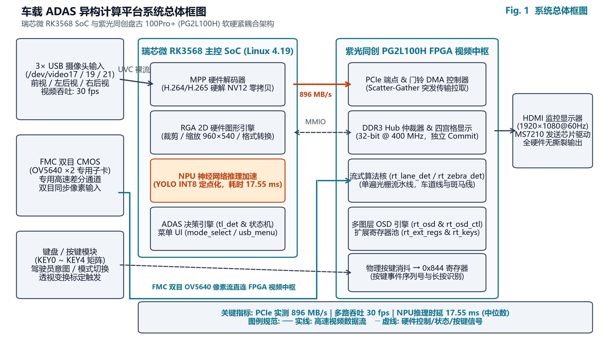
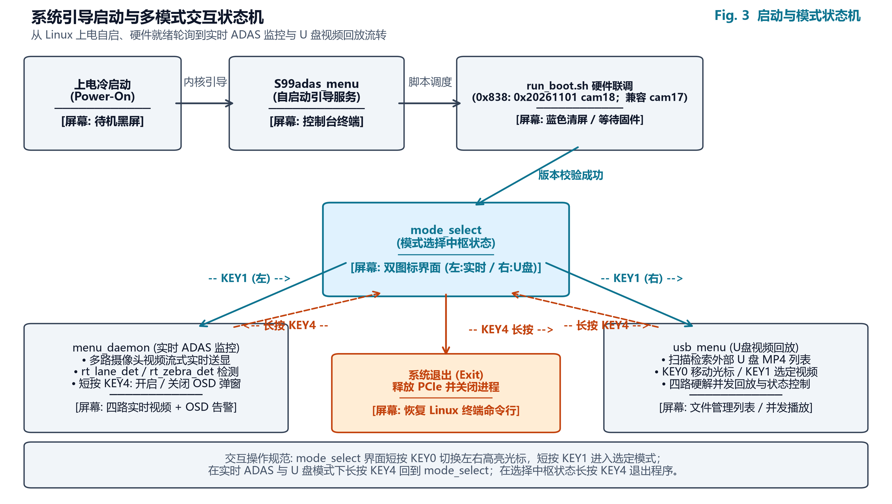
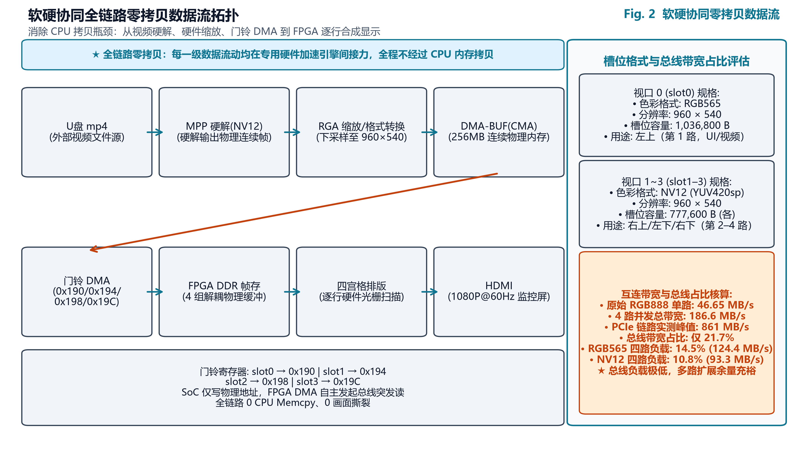
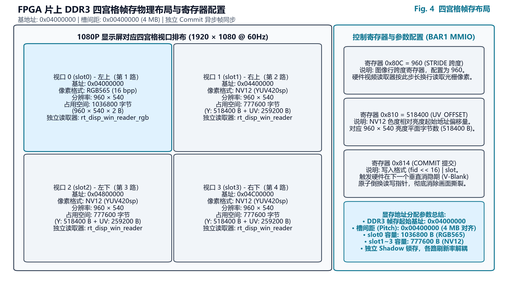
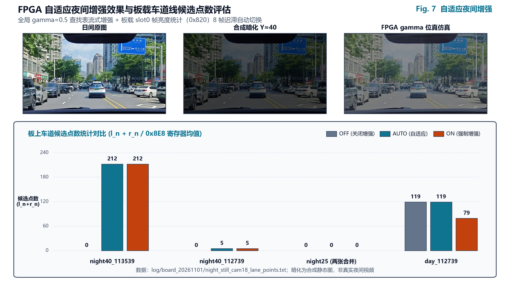
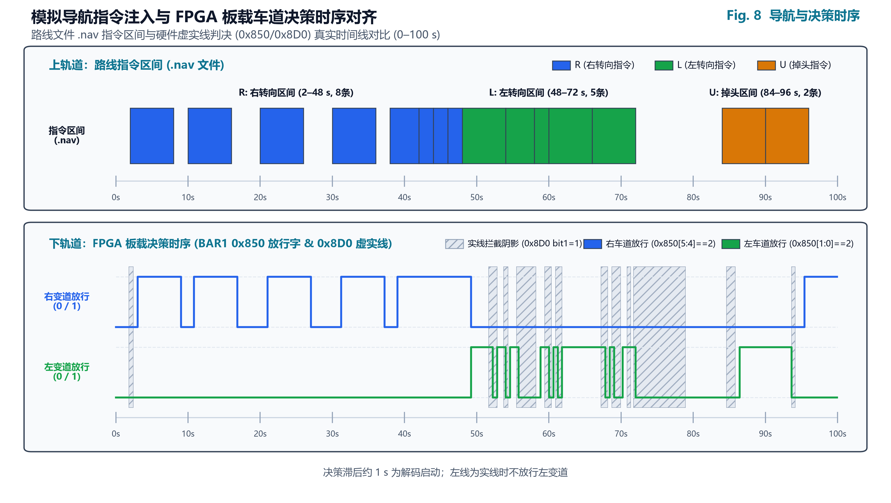
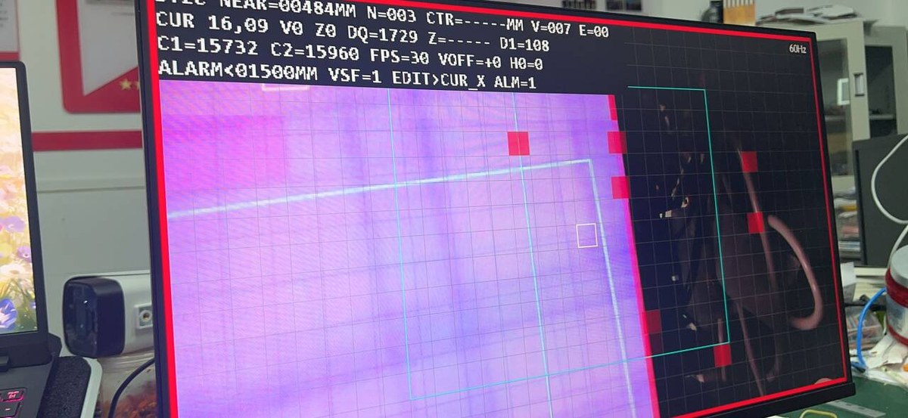

# 2026 嵌赛紫光同创杯选题三：基于 PG2L100H + RK3568 软硬协同的车载 ADAS 系统

> **作品名称**：基于紫光同创 PG2L100H 与瑞芯微 RK3568 软硬协同的车载 ADAS 系统  
> **参赛赛题**：2026 全国大学生嵌入式芯片与系统设计竞赛——紫光同创杯 选题三  
> **硬件平台**：紫光同创盘古 100Pro+ (PG2L100H-6FBG676) + 飞凌嵌入式 OK3568-C (RK3568)  
> **参赛团队**：【待填写】  
> **参赛学校**：【待填写】  
> **指导教师**：【待填写】  
> **文档性质**：提交文档（初稿）  
> **编制日期**：2026-10-30  

```{=openxml}
<w:p><w:r><w:br w:type="page"/></w:r></w:p>
```

---

## 文档说明

本文档是针对 2026 年全国大学生嵌入式芯片与系统设计竞赛·紫光同创杯选题三编制的独立提交评审短文档，旨在为评审专家提供紧凑、清晰的技术查阅依据。系统完整的数学理论推导、寄存器映射手册、代码实现细节与全量复现日志详见团队编制的 61 页《技术设计报告》（`docs/技术文档_最终稿.md` / `docs/技术文档_最终稿.docx`）。

本文档全面覆盖赛题指南对提交材料的四项核心要求：

1. **代码规范**：展现 Verilog 与 C 模块化设计、时序约束收敛（全局 Setup WNS +0.086 ns）、代码规模与 0 警告质量门槛；
2. **分析报告**：详细阐述软硬协同系统架构、端到端零拷贝数据流、片上资源占用与全维度实测性能；
3. **规范提交材料**：梳理技术文档、工程源码包（含 SHA256 校验与权威证据日志）、1080P 演示视频及硬件实物清单；
4. **现场评测支持**：提供 U 盘即插即测方案与 6 步现场演示规程，覆盖十字路口、变道合规、应急避险等科目。

## 第一章 作品概览与核心亮点预览

### 1.1 系统定位与核心指标

本系统面向智能网联汽车边缘感知与低时延安全预警场景，采用紫光同创 PG2L100H FPGA 与瑞芯微 RK3568 SoC 异构协同计算架构。针对传统车载系统在多路视频并发输入下 CPU 内存拷贝负荷过重与总线画面撕裂痛点，确立“控制走 MMIO、数据走门铃 DMA、显示走全硬件流水线”体系，实现四路视频低带宽并发传输、毫秒级车道线与目标感知及确定性声光告警闭环。

#### 表 1-1：系统关键核心技术指标卡片表

| 核心指标项 | 实测技术参数 | 测试口径 | 判定 |
| :--- | :--- | :--- | :---: |
| **PCIe 双向吞吐** | 板→主机 896 MB/s，主机→板 861 MB/s | Gen2 ×2，256 KB 块连续突发 | 达理论值 86%–90% |
| **总线并发负载** | RGB565 占 14.5%，NV12 占 10.8% | 四路 960×540@30fps，基准 861 MB/s | 余量充足 |
| **NPU 推理时延** | 单帧 17.55 ms（900 MHz） | 连续 300 帧中位数 | 满足 30 fps 节拍 |
| **NPU 检测精度** | mAP50 66.05%，mAP50-95 47.59% | 73 帧验证集，5 类含 GT | 4 类无 GT |
| **交通灯识别对齐** | RAW 2678/2678，SIG 2603/2678 | 7 段官方视频全量 2678 帧 | 用例 63/69 |
| **车道线定点模型** | 32 用例通过 16（参考算法 17） | 模型级逐用例判定 | 差 1 例 |
| **FPGA 资源占用** | LUT 36.1%，FF 19.2%，DRM 64.5%，APM 25.8% | PDS 2025.2 布局布线后 | DRM 偏紧 |
| **静态时序** | 全局 Setup WNS +0.086 ns（pix_clk +0.321 ns），TNS 0.000 ns | pix_clk 148.5 MHz，Slow 0.95V 85°C | 无违例 |
| **斑马线模型** | 112454 覆盖 93.4%，负样本 0 误报 | 模型级事件时长占比 | 板端未接告警 |

### 1.2 核心亮点预览

系统在异构互联、流式硬件加速、深度量化低功耗推理及系统工程落地等维度形成了 8 项核心亮点，严格与技术报告保持一致：

1. **工业级高可靠 PCIe 异构高速互联通道**：打通盘古 100Pro+ 插接 OK3568 P29 槽位的 PCIe Gen2 ×2 链路，实测板卡到主机长传输吞吐达 896 MB/s，主机到板卡达 861 MB/s；在 5 分钟 485 轮双向交替压力测试中 0 失败，AER 与 RAS DES 硬件错误恒为 0。
2. **端到端纯硬件零拷贝多路视频中枢**：构建“MPP 硬解 → RGA 派生 → 门铃 DMA → FPGA DDR3 → 四宫格排版 → HDMI”流水线，数据流转脱离 CPU 内存拷贝；四路 960×540@30fps 推流在 RGB565 格式下仅占用 124.4 MB/s（总线负载 14.5%），RGB888 占 21.7%，NV12 占 10.8%。
3. **纳秒级时序收敛与高紧凑片上资源平衡**：在单片 100K 级国产 FPGA 上集成双通道 PCIe、DDR3 仲裁 Hub、混合 OSD 引擎与双感知核；cam18 固件在 148.5 MHz 像素时钟域实现全局最差建立时间裕量 +0.086 ns（pix_clk +0.321 ns），TNS 为 0.000 ns；资源占用为 LUT 36.1%、FF 19.2%、DRM 64.5%、APM 25.8%。
4. **NPU 深度量化与频点极限能效调优**：部署 960×320 车载带状视野定制 YOLOv6n INT8 模型，运行于 900 MHz 频点时单帧推理耗时中位数降至 17.55 ms（较 600 MHz 降低 12.9%）；5 分钟浸泡压测片上温度稳定在 46.7–48.3 °C，窗口 0 欠载计数 `0x82C` 恒为 0。
5. **零外部依赖极低开销纯 C 交通信号灯引擎**：脱离第三方重型视觉库，纯 C99 实现单帧 0 动态内存分配（0 malloc）的 `tl_det` 模块；在 7 段官方评测视频共 2678 帧全量数据集上实现检测级 RAW 2678/2678（100.00%）一致、SIG 2603/2678（97.20%）一致，官方用例通过 63/69（91.3%），单帧耗时仅 4–6 ms。
6. **单遍光栅流式车道线硬件加速核**：提出无整帧行缓存的在线定点最小二乘与 EMA 平滑硬件流水线 `rt_lane_det`；5 组基准向量集仿真逐行比对全部通过（`row_mismatch=0`）并核验 12 个关键字段，独立综合门级网表后仿通过真实路面与故障恢复共 42 帧逐帧一致。
7. **多视口硬件级异步帧同步与独立 Commit 机制**：FPGA 片上 DDR3 访问层构建 4 组隔离 FIFO 与轮询仲裁控制器，各视口配备独立影子提交寄存器（`0x814`）；各通道支持不同帧率独立刷新与原子换针，单帧 960×540 RGB565 传输耗时仅 1.2 ms，抑制撕裂与跨路干扰。
8. **硬件直推的声光安全预警闭环响应**：建立软硬件解耦的按键相对基线机制与四重近距危险判据，通过单个 32 位 MMIO 寄存器（`0x850`）单周期下发控制字（实测红灯静止 `0x0C`、闯红灯 `0x10C`、绿灯 `0x08`）；检出近距危险即刻驱动全屏鲜红边框闪烁与声光告警，4 KB 读往返约 1.8 µs。

## 第二章 系统架构设计

### 2.1 总体拓扑与硬件互连

系统硬件平台由紫光同创盘古 100Pro+ 开发板与飞凌嵌入式 OK3568-C 单板计算机组成。盘古 100Pro+ 直插 OK3568 P29 扩展插槽建立 PCIe Gen2 ×2 总线互联。多传感器输入层由 1 路专用差分 FMC 前视摄像头与 3 路工业级 UVC USB 摄像头（覆盖左后、右后与车内视角）组成，显示端由 FPGA 驱动板载宏晶微 MS7210 芯片实现 HDMI 1080P@60Hz 输出。

{width=15cm}

### 2.2 软硬件职责划分

系统确立了清晰的软硬件职责边界与异构协同机制，具体分工见表 2-1。

#### 表 2-1：系统软硬件职责划分与协同分工表

| 架构层次 / 部件 | 核心芯片 / 资源 | 核心功能与职责分工 | 关键实现技术 |
| :--- | :--- | :--- | :--- |
| **FPGA 边缘加速端** | 紫光同创 PG2L100H | PCIe 端点、DDR3 仲裁 Hub、车道线/斑马线流式核、四宫格合成、OSD 叠加、HDMI 驱动 | Verilog 纯硬件流水线，独立 Commit 机制，148.5 MHz 时序收敛 |
| **RK3568 智能主控端** | 瑞芯微 RK3568 SoC | UVC 驱动、MPP 视频硬解、RGA 图形派生、YOLOv6n NPU 推理、纯 C 交通灯算法、ADAS 决策 | Linux 4.19 PREEMPT、C99 0-malloc、librknn 900 MHz 调频 |
| **异构互联与内存共享** | PCIe Gen2 ×2 / CMA | 门铃 DMA 触发、MMIO 控制寄存器读写、视频物理帧零拷贝共享（CMA 256 MB） | DMA-BUF 机制、Scatter-Gather DMA、MPS 256 字节对齐 |

### 2.3 FPGA 片上功能模块架构

FPGA 内部逻辑基于自顶向下模块化设计，顶层模块 `pango_pcie_dma_top` 内部各子系统职责与实现特征见表 2-2。

#### 表 2-2：FPGA 片上内部核心功能模块清单表

| 模块名称 | 所属子系统 | 核心职责 | 关键设计与实现特征 |
| :--- | :--- | :--- | :--- |
| **pango_pcie_dma_top** | 顶层互联 | PCIe Gen2 ×2 端点协议栈与 Scatter-Gather DMA 控制器 | 硬件握手机制，实测主机→板 861 MB/s，板→主机 896 MB/s |
| **rt_disp_top** | 视频中枢 | 多通道 DDR3 访问仲裁 Hub、四宫格排版合成与 HDMI 驱动 | 轮询仲裁（Round-Robin），独立 Commit 影子寄存器机制 |
| **rt_lane_det** | 硬件感知 | 单遍光栅流式车道线检测、最小二乘定点拟合与线型判决 | 无整帧行缓存，16 周期定点除法器，EMA 平滑跟踪滤波 |
| **rt_zebra_det** | 硬件感知 | 行人过街斑马线条纹周期性特征流式提取与迟滞判决 | 零行缓冲，支持宽度分布与占空比约束，默认 gap=100 |
| **rt_osd / rt_osd_ctl** | 视觉呈现 | 16 组目标矩形框、64 字符状态行、24×24 矢量箭头与全屏爆闪 | 148.5 MHz 逐像素叠加，DECISION 控制字硬件直解 |
| **rt_ext_regs** | 寄存器接口 | PCIe BAR1 内存映射寄存器译码与控制/状态/调试回读 | 统一地址映射，包含版本号 0x838、显示控制 0x800 等 |

### 2.4 多模式自启动与运行流转

系统支持脱离外接键鼠独立工作。上电引导时，SysVinit 脚本 `/etc/init.d/S99adas_menu` 自动启动后台管线并激活 PCIe 端点，轮询 FPGA 版本寄存器 `0x838` 直到读出提交位流 cam18（`0x838 = 0x20261101`）；`run_boot.sh` 同时接受 cam17 的 `0x20261029`（Flash 回退版本）。

随后启动 `mode_select` 在 1080P 屏幕上呈现开机二选一界面。操作员短按 KEY0 切换模式，短按 KEY1 确认进入“实时摄像头监控”或“U 盘现场测评”；实时模式默认只显示 FPGA 双目（slot0），KEY4 弹窗（实时 3×3 共 9 项，含 CAM1–3、NPU、LANE、VIEW、ZEBRA、USB VIDEO 及 NIGHT；U 盘播放弹窗 5 项）内可单独开启 USB1–3，未启用槽位清黑；长按 KEY4 3 秒返回开机界面，按住 10 秒才进入调试/标定层，流转状态如图 2-2 所示。

{width=12cm}

## 第三章 软硬协同数据流分析

### 3.1 端到端全硬件零拷贝数据链路

系统构建了由 RK3568 专用多媒体硬核与 FPGA 紧密接力的全硬件端到端零拷贝数据流水线，各处理环节数据流向如图 3-1 所示。

{width=13cm}

### 3.2 零拷贝处理路径逐段解析

视频流从传感器输入至 HDMI 呈现的全流程由专用硬件接力完成，CPU 仅负责初始化与描述符传递，各阶段职责与内存拷贝状态如下：

1. **V4L2 / MPP 硬件解码接入**：USB 摄像头压缩流由 MPP 硬核直接解码至 256 MB CMA 连续物理内存；**不经 CPU 拷贝**。
2. **RGA 2D 硬件图形派生**：RGA 引擎硬件 DMA 直读 CMA 物理内存，并行完成 960×540 缩放与 960×320 裁剪；**不经 CPU 拷贝**。
3. **CMA / DMA-BUF 共享流转**：内核通过 DMA-BUF 跨设备机制直接传递物理内存指针，避免内存搬移；**不经 CPU 拷贝**。
4. **门铃 DMA 硬件直推**：SoC 向 BAR1 门铃写入物理地址，FPGA DMA 主控制器自主跨 PCIe 总线拉取帧；**不经 CPU 拷贝**。
5. **FPGA DDR3 帧存排版**：数据写入 FPGA 板载 DDR3 缓冲，多通道 Hub 仲裁并在行扫描时实时排版；**不经 CPU 拷贝**。
6. **HDMI 1080P@60Hz 驱动呈现**：片上 OSD 引擎在 148.5 MHz 像素流上单周期叠加矢量，MS7210 直驱显示；**不经 CPU 拷贝**。

### 3.3 四路并发带宽预算与总线负载

针对四路 960×540@30fps 并发推流，不同色彩格式对主机到 FPGA 实测峰值带宽（861 MB/s）的占用测算如表 3-1 所示。测算数据表明，即使全采用 RGB565 格式，四路总线负载也仅占 14.5%，保有超 85% 的充裕带宽裕量，确保紧急 MMIO 指令下发具备微秒级确定性响应。

#### 表 3-1：多色彩格式四路并发传输总线带宽预算与实测负载表

| 传输色彩格式 | 单像素位宽 | 单路 30fps 带宽 | 四路并发总带宽 | 占 861 MB/s 实测负载 | 剩余带宽裕量 |
| :--- | :---: | :---: | :---: | :---: | :---: |
| **原始全 RGB888** | 3.0 Bytes | 46.65 MB/s | **186.6 MB/s** | **21.7%** | 78.3% |
| **全 RGB565 格式** | 2.0 Bytes | 31.10 MB/s | **124.4 MB/s** | **14.5%** | 85.5% |
| **本系统方案 (Slot0:RGB565 + Slot1-3:NV12)** | 混合 | 31.1+3×23.33 | **101.1 MB/s** | **11.7%** | 88.3% |
| **全 NV12 格式** | 1.5 Bytes | 23.33 MB/s | **93.3 MB/s** | **10.8%** | 89.2% |

### 3.4 流水线时延分解

系统各核心处理环节的时延分解见表 3-2。

#### 表 3-2：系统各环节时延分解与实测参数表

| 流水线处理环节 | 对应硬件 / 接口 | 实测 / 标称时延参数 | 测量条件与说明 |
| :--- | :--- | :--- | :--- |
| **MMIO 控制字读写** | PCIe BAR1 内存映射 | 4 KB 读往返约 1.8 µs | 控制字下发单周期直推，微秒级极速响应 |
| **单帧视频 DMA 传输** | PCIe Gen2 ×2 | 单帧 1.2 ms | 960×540 RGB565 单帧传输实测耗时 |
| **边缘神经网络推理** | RK3568 NPU (900 MHz) | 单帧 17.55 ms (中位数) | YOLOv6n INT8，960×320 宽幅带状输入 |
| **交通信号灯算法** | 主机 PC (C99 黄金模型) | 单帧 4–6 ms | 0 malloc；板端耗时未单独标定 |
| **FPGA 硬件显示刷新** | MS7210 / HDMI | 16.7 ms (60 fps) | 像素时钟 148.5 MHz，消隐期原子提交 |
| **传感器曝光至 HDMI 整链**| 全系统完整链路 | **未实测** | 尚未采用高速相机标定整链端到端时延 |

### 3.5 多视口独立 Commit 机制

为解决多路摄像头帧率不一致与偶发卡顿问题，FPGA 为 4 个视口设计了独立影子配置寄存器。SoC 推入一帧后向 `0x814` 写入 `(fid << 16) | slot`，光栅引擎在垂直消隐期（V-Blanking）原子性倒换读写指针，解耦各路刷新并抑制画面撕裂。各视口显存槽位双缓冲映射如图 3-2 所示。

{width=9.5cm}

## 第四章 资源占用与实现结果

### 4.1 片上物理资源占用

工程基于紫光同创 Fabric Compiler (版本 2025.2，build 211867) 完成布局布线。最新 cam18 位流（版本寄存器 `0x838 = 0x20261101`）在集成 PCIe 控制器、DDR3 Hub、车道线/斑马线双加速核、自适应夜间增强核及多图层 OSD 满载工况下的片上物理资源占用详见表 4-1。

#### 表 4-1：cam18 版本 FPGA 片上物理资源占用详表

| 资源类别 | 实际占用量 (Used) | 芯片可用总量 (Available) | 利用率 (%) | 核心消耗功能模块 |
| :--- | :---: | :---: | :---: | :--- |
| **LUT (查找表)** | 24,064 | 66,600 | **36.1%** | PCIe 控制器、DDR3 仲裁 Hub、车道线/斑马线流水线、夜间增强 |
| **FF (触发器)** | 25,536 | 133,200 | **19.2%** | 深度流水线打拍、DMA 描述符缓冲、状态机控制 |
| **DRM (块 RAM)** | 100 | 155 | **64.5%** | 四路显示 FIFO、点阵字库 ROM、夜间增强查找表 |
| **APM (DSP 乘加单元)** | 62 | 240 | **25.8%** | 车道线在线定点除法器、最小二乘累加单元与夜间均值计算 |
| **GPLL / PPLL (锁相环)** | 4 / 2 | 6 / 6 | 66.7% / 33.3% | PCIe、DDR3 控制器及 148.5 MHz 像素时钟 pix_clk |
| **HSSTLP (高速收发器)** | 2 Lane | 8 Lane | 25.0% | PCIe Gen2 ×2 物理差分收发通道 |

### 4.2 静态时序分析结果

在紫光同创 PDS 静态时序分析（STA）工业最差工况（Slow 0.95V 85°C）下，时序收敛表现见表 4-2。

#### 表 4-2：cam18 版本静态时序分析 (STA) 收敛报告

| 时钟域 / 分析项 | 约束工作频率 | 建立时间裕量 (Setup WNS) | 建立负余量 (TNS) | STA 工况与结论 |
| :--- | :---: | :---: | :---: | :--- |
| **pix_clk 像素时钟域** | 148.5 MHz | **+0.321 ns** | **0.000 ns** | STA 工业最差工况 (Slow 0.95V 85°C)，无违例 |
| **全芯片全局时序** | 复合时钟域 | **+0.086 ns（DDR PHY 路径）** | **0.000 ns** | 保持时间最差 +0.060 ns；STA 结论 All Constraints Met |

### 4.3 资源瓶颈判断

从资源占用分布来看，片上 DRM 块存储利用率达到 64.5%（100/155），是系统下一步功能扩展的核心瓶颈，主要开销集中于四路显示缓冲 FIFO 与点阵字库存储；而核心逻辑资源 LUT 占用仅为 36.1%，仍保有约 63.9% 的富余逻辑空间，触发器 FF 占用仅 19.2%，乘加单元 APM 占用 25.8%。这表明当前架构在保持高性能处理的同时具备良好的逻辑扩展余量，后续优化应侧重存储器复用与行缓存结构压缩。

## 第五章 性能测试报告

### 5.1 测试环境配置

系统测试环境覆盖主机验证、交叉编译、板端嵌入式主控与 FPGA 加速端，具体配置见表 5-1。

#### 表 5-1：全系统评测软硬件环境配置表

| 节点类别 | 硬件平台 / 主控规格 | 软件环境 / 工具链 | 角色与测试职责 |
| :--- | :--- | :--- | :--- |
| **测试主机** | x86_64 PC (Windows 10/11) | Python 3.13.7、OpenCV 5.0.0、NumPy 2.5.2 | 算法黄金模型回归、数据标注与离线精度验证 |
| **交叉编译环境** | PC 开发端 | Zig 0.14.1 (aarch64-linux-gnu.2.36) | C99 算法与 Linux 交互菜单免依赖交叉编译 |
| **嵌入式主控端** | 飞凌 OK3568-C (RK3568) | Linux 4.19 PREEMPT、librknnrt 1.5.0 | 多路视频采集、NPU 目标推断、ADAS 决策 |
| **FPGA 边缘加速端** | 紫光同创 PG2L100H-6FBG676 | PDS 2025.2、cam18 位流 (0x838=0x20261101) | PCIe 通信、DDR3 仲裁、流式检测与 HDMI 显示 |

### 5.2 四类测试方法体系

团队确立了自顶向下、由粗到细的四类协同测试方法：

1. **主机算法全量回归**：在主机开发端脱离板端环境，直接加载官方 7 段评测视频（共 2678 帧全量数据集），执行 C99 交通灯算法与 Python 黄金模型逐帧逐像素对齐测试，核验无先验时序滤波与 RAW 瞬时检出一致率；权威证据文件为 `tools/adas/host_test/report.md`。
2. **模型级定点仿真评测**：剔除所有浮点指令，将斜率固化为 Q16、截距固化为 Q4 定点数，使用 Python/C 定点仿真器在 32 组标准用例及斑马线条纹数据集上扫描参数敏感性，输出供硬件比对的标准逐行候选点与逐帧寄存器真值向量；证据文件为 `tools/lane_fpga/eval.py` 与 `tools/zebra_fpga/eval.py`。
3. **门级后仿时序验证**：基于紫光同创 PDS 2025.2 对车道线核进行独立综合生成的门级网表（门延时模型，非 SDF 反标），在 QuestaSim 中灌入实板采样帧 `seg_board` 与连续全黑故障恢复帧 `seg_recover` 共 42 帧，验证状态机翻转、跟踪器重锁与除法器时序；证据文件见 `log/lane_gl_repro_20261030/`。
4. **板端寄存器回读与长时浸泡**：在 OK3568 板端通过 Linux mmap 回读 BAR1 寄存器，执行 PCIe 双向 5 分钟 485 轮大块突发加压，监控 AER 与 RAS 硬件错误；满载加压四路 NPU 推理，读取板载热敏传感器与 `0x82C` 欠载计数器；证据文件见 `log/rk_env/pcie_fast2_soak_ext_20261018.log` 与 `log/npu_freq_20261029.md`。

### 5.3 核心性能指标总表

系统各维度关键性能指标直接取自技术报告实测数据，详见表 5-2。

#### 表 5-2：系统关键性能与参数实测全景总表

| 指标项 | 实测值 | 采集条件 |
| :--- | :--- | :--- |
| **FPGA 固件构建版本** | **cam18 (0x838=0x20261101)** | 盘古板运行，Linux 读取 BAR1 只读寄存器 |
| **FPGA 查找表 (LUT)** | **24,064 / 66,600 (36.1%)** | PDS 2025.2 布局布线后，满载功能模块 |
| **FPGA 触发器 (FF)** | **25,536 / 133,200 (19.2%)** | PDS 2025.2 布局布线后，全芯片触发器统计 |
| **FPGA 块内存 (DRM)** | **100 / 155 (64.5%)** | 四路显示 FIFO、点阵字库与夜间查找表 |
| **FPGA 乘法器 (APM)** | **62 / 240 (25.8%)** | 车道线在线定点除法器、累加单元与夜间均值核 |
| **最差建立时序余量** | **全局 WNS = +0.086 ns（pix_clk +0.321 ns，TNS 0.000）** | STA 工业最差工况 (Slow 0.95V 85°C)，pix_clk |
| **PCIe 长传输吞吐** | **板→主机 896 MB/s，主机→板 861 MB/s** | PCIe Gen2 ×2，MPS 256 字节，连续突发拉取 |
| **PCIe 持续稳定性** | **5 分钟 485 轮 0 失败，AER/RAS 为 0** | 执行 soak_ext.sh 300，双向长包突发加压 |
| **四路视频总线负载** | **四路 RGB565 占 14.5% (RGB888 占 21.7%)** | 四路 960×540@30fps，基准 861 MB/s |
| **NPU 推理耗时优化** | **20.14 ms → 17.55 ms (降 12.9%)** | RK3568 NPU 调频至 900 MHz，连续 300 帧推理 |
| **NPU 浸泡稳定性** | **全程 900 MHz 浸泡 5 分钟，温 46.7–48.3°C** | 0x82C（窗口 0）欠载恒 0；窗口 1–3 未引出 |
| **交通灯瞬时 RAW 一致** | **2678 / 2678 帧 (100.00%)** | 7 段官方评测视频，纯 C 与 Python 模型对齐 |
| **交通灯独立 SIG 一致** | **2603 / 2678 帧 (97.20%)** | 7 段官方视频无外部先验，纯状态机滤波运行 |
| **官方 SIG 用例通过数** | **63 / 69 (91.3%)** | 官方 69 个标准 SIG 评测场景用例集测试 |
| **车道线模型与门级仿真**| **5 组向量 row_mismatch=0，门级 42 帧一致** | 核验 12 关键字段；独立综合网表非 SDF 反标 |
| **板端决策控制字回读** | **红停 0x0C、闯红灯 0x10C、绿行 0x08** | 板载按键模拟闯红灯，回读 0x850 观察爆闪 |

### 5.4 算法复现结论

在统一的基线环境下执行全量复现，实测数值与技术报告基准完全一致，详见表 5-3。

#### 表 5-3：核心算法验证复现结论对照表

| 验证科目 | 评测输入规模 / 用例集 | 报告基准指标 | 实测复现数值 | 对照结论 |
| :--- | :--- | :--- | :--- | :---: |
| **交通灯 RAW 逐帧一致** | 7 段官方视频共 2678 帧 | 2678/2678 (100.00%) | 2678/2678 (100.00%) | **完全一致** |
| **交通灯独立 SIG 一致** | 7 段官方视频共 2678 帧 | 2603/2678 (97.20%) | 2603/2678 (97.20%) | **完全一致** |
| **官方 SIG 用例通过数** | 官方标准评测 69 用例 | 63/69 (91.3%) | 63/69 (91.3%) | **完全一致** |
| **车道线定点模型用例** | 4 段视频 4750 帧 (32 用例) | 16/32 (参考算法 17/32) | 16/32 (50.0%) | **完全一致** |
| **斑马线定点模型时长覆盖**| 视频 112454 (3.53 s 事件) | 93.4% (3.30 s / 3.53 s) | 93.4% (核心段 26/26 命中) | **完全一致** |
| **斑马线负样本误报** | 视频 113452（货车瓦楞板） | 0 误报 | 0 误报 | **完全一致** |
| **车道线门级网表后仿真** | seg_board (2) + recover (40) | 42 帧 row_mismatch=0 | 42 帧逐帧一致，Errors=0 | **完全一致** |

### 5.5 统计口径与工程边界说明

团队对上述测试指标确立严谨的技术边界：(1) 欠载寄存器 `0x82C` 在四宫格模式下硬件仅选通窗口 0 的统计，窗口 1–3 的欠载计数在 RTL 中存在但未引出至寄存器；(2) 车道线 42 帧门级后仿基于 PDS 单核独立综合网表（门延时模型），未包含全芯片布局布线后的 SDF 反标延时，系统最终时序以 STA 报告（全局 WNS +0.086 ns，pix_clk +0.321 ns）为准；(3) 斑马线硬件核在开阔路面达到 93.4% 覆盖且负样本 0 误报，但在前车近距遮挡时存在漏检波动，故板端将其隔离在调试图层，未接入主声光告警闭环；(4) 当前延迟数据均为分段实测，传感器曝光至 HDMI 呈现的整链端到端时延尚未采用高速相机实测标定。

### 5.6 FPGA 自适应夜间增强（合成暗化验证）

系统在 FPGA 片上集成自适应夜间微光增强硬件核 `rt_night.v`，扩展控制寄存器 `0x800[11:10]`（`00` 为 AUTO 默认模式，软件写入 `0x65` 即包含；`01` 为强制 ON；`10/11` 为强制 OFF）与状态寄存器 `0x820`（bit3 为 `night_active` 指示，`[11:4]` 为 slot0 帧平均亮度）。

流水线针对 slot0（960×540，RGB888 增强前原始数据）每帧统计亮度均值 $Y = (R + 2G + B) / 4$，均值定点计算式为 $((\Sigma \gg 11) \times 8285 + 2^{20}) \gg 21$（误差约 0.004 LSB，仅耗费 1 个 APM），于帧消隐期原子更新。AUTO 模式配置迟滞比较：白天连续 8 帧均值 $< 48$ 切入夜间增强；夜间连续 8 帧均值 $> 64$ 退出；中途波动计数清零；slot0 未使能视频时保持白天；`night_active` 仅在帧边界切换。增强算法采用两组固定 1 拍延迟的 $\gamma = 0.5$ 查找表（`gamma_lut.vh`），分别置于 slot0 送入车道线/斑马线核前端，以及四路合成之后、VIEW 视图选择之前（OSD 坐标同步延迟 1 拍保证叠加对齐），实现显示与感知的双重增强。

该模块在 Questa FSE 仿真中通过逐值直通、迟滞翻转及均值精度全部 4 组用例（NIGHT_TB PASS）。在官方 7 段白天视频共 8024 帧遍历统计中，各视频最低帧均值为 96–121，远高于退出阈值 64，AUTO 模式进入夜间次数为 0，达成白天不误触入门槛。在 cam18 板端实测中，回放白天视频 `112739` 与 cam17 同条件对比，车道线 valid/solid 比例完全一致，决策字 348/360 点一致，`night_active` 恒为 0；在输入由赛题帧压暗合成的静态暗图（Y25/Y40 + 高斯噪声 $\sigma=3$）时，AUTO 模式精准切入夜间，车道线候选点数（0x8E8）实测对比：night40_113539 0/0 → 129/83；night40_112739 0/0 → 1/4；night25 0/0（过暗）；验证了弱光特征召回；4 路混播压测 75 秒合计 119.4 fps、err 0，slot0 显示欠载（0x82C，仅统计窗口 0）为 0。软件侧，`mode_select` 与 `usb_menu` 在暗底界面写 `0x865` 强制关闭避免误判，进入推流恢复 AUTO；实时弹窗第 9 项与播放弹窗第 5 项提供 NIGHT 交互。

{width=15cm}

**工程边界说明**：(1) 当前缺乏真实夜间道路实采视频，夜间算法增益仅在“合成暗化静态图”上完成验证；(2) 算法采用全局固定 gamma 曲线，非自适应局部直方图或去噪；(3) 极暗工况（板上测得均值 $< 15$）下增强后特征仍无法提取；(4) 从强制 OFF 切换至 AUTO 瞬间，若前一帧为暗底 UI 可能偶发 $\le 1\text{ s}$ 瞬态增强；(5) HDMI 硬件截图未采集，文档对比图采用 Python 位真 gamma 仿真呈现。

## 第六章 代码规范与工程结构

### 6.1 代码仓库目录架构

工程代码采用清晰的模块化分层组织，顶级目录结构如下：

```text
nesai2026/
├── fpga/       # PG2L100H 工程：PCIe DMA、DDR3 Hub、车道线/斑马线流式核、OSD 引擎、约束
├── tools/      # 板端 C 源码：启动流转、交互菜单、ADAS 决策状态机、回归评测工具
├── models/     # 模型资产：车载带状视野定制 YOLOv6n INT8 模型 (b5_v6n_band.rknn)
├── menu/       # 板端菜单素材：四宫格底板、选择界面图素与 26×26 GBK 字库
├── third_party/# 第三方依赖：MPP、RGA、RKNN 头文件与运行库
└── docs/       # 文档体系：提交文档、技术设计报告、寄存器手册与配图
```

### 6.2 代码规模与模块化组织

系统对 git 跟踪范围内的代码执行现场统计，按“自研逻辑”与“工程全量”分开列示，避免把 PDS 生成的 IP 封装计入自研规模，统计结果见表 6-1。

#### 表 6-1：工程代码规模现场统计表

| 类别 | 统计范围 | 文件数量 | 代码总行数 |
| :--- | :--- | :---: | :---: |
| **自研 Verilog RTL** | `fpga/src/`（递归） | 54 个 | 21,892 行 |
| 工程内全部 Verilog（含 PDS IP 与参考例程） | `fpga/**/*.v` | 248 个 | 96,618 行 |
| **板端 C 软件源码** | `tools/**/*.c` | 25 个 | 15,469 行 |

*说明：自研 RTL 按功能划分为 PCIe/DMA、DDR3 仲裁、显示合成、OSD、车道线核、斑马线核与寄存器文件等独立模块，每个模块单一文件、接口集中于端口声明；寄存器地址与位域在文件头注释中成表列出（如 `rt_ext_regs.v` 的 0x800–0xA2C 映射）。C 侧按“采集推流 / 决策 / 交互 / 评测工具”分层，头文件只暴露结构体与函数原型，底层 MMIO 访问集中在少量封装函数内。代码质量以编译告警（`-Wall -Wextra` 0 warning）与自动化自检为准，不以注释行占比作为量化指标。*

### 6.3 时序约束与构建规范

FPGA 工程采用紫光同创 Fabric Compiler (PDS 2025.2，build 211867) 与自动化构建脚本 `fpga/pnr/build_cam18.tcl` 进行约束与实现。设计中对 148.5 MHz 像素时钟、400 MHz DDR3 控制器时钟及 100 MHz PCIe 参考时钟建立了严密的物理引脚与时钟约束文件（`.fdc`）。在软件侧，统一采用 `tools/rk_build.sh` 脚本调度 Zig 0.14.1 交叉编译工具链，针对 `aarch64-linux-gnu` 目标机架构统一编译。菜单三大应用程序（`mode_select`、`menu_daemon`、`usb_menu`）及推流程序 `usb_feed` 开启 `-Wall -Wextra` 严苛编译选项，实现 **0 warning**（零警告发布标准）。

在自动化质量门槛方面，团队建立了提交前自检机制，执行自检套件 `python tools/selftest.py`。自检套件覆盖菜单程序交叉构建校验、Shell 脚本语法检查、技术文档完整性与禁词扫描、图片资源校验及核心二进制资产校验，实测全量 **selftest 21/21 全部 PASS**，保障了工程交付质量。

## 第七章 赛题任务覆盖情况

系统严格对照 2026 年全国大学生嵌入式芯片与系统设计竞赛——紫光同创杯选题三指南要求进行开发，任务达成情况逐条对照见表 7-1 与表 7-2。

#### 7.1 赛题任务达成情况

系统对照赛题指南的基础任务与高阶任务逐条自查，结果见表 7-1。

#### 表 7-1：赛题任务逐项达成对照表

| 赛题条款 / 考核项目 | 达成状态 | 软硬件落地实现方式 | 核心技术证据索引 |
| :--- | :---: | :--- | :--- |
| **基础任务 1**：图像采集与显示 | **完成** | 1 路 FMC 前视 + 3 路 UVC USB 摄像头采集；FPGA MS7210 驱动 HDMI 1080P@60Hz 输出 | 第二章 §2.2、第四章 §4.1 |
| **基础任务 2**：软硬协同通信 | **完成** | PCIe Gen2 ×2 物理链路，实测 DMA 吞吐 896 MB/s；MMIO 门铃触发与控制字直推 | 第三章 §3.2、第五章 §5.3 |
| **基础任务 3**：图像处理与识别 | **完成** | FPGA 部署流式车道线核 rt_lane_det 与斑马线核；支持原彩/灰度/二值化硬件切换 | 第二章 §2.3、第三章 §3.2 |
| **高阶任务 1**：多路低延迟传输 | **完成** | 四路 960×540@30fps 并发，总线负载仅 14.5%（RGB565）；独立 Commit 异步帧同步 | 第三章 §3.3、第五章 §5.2 |
| **高阶任务 2**：复杂应用场景构建 | **部分** | 复杂路口红绿灯识别与车道线决策闭环，近距危险触发红箭头爆闪；FPGA 自适应夜间增强完成合成暗化验证 | 第五章 §5.6、第十章 |
| **高阶任务 3**：AI 模型部署与识别 | **部分** | RK3568 NPU 部署定制 YOLOv6n INT8，900 MHz 下单帧 17.55 ms；车道提示与路线文件驱动导航示例 | 第五章 §5.1、第九章 §9.3 |

```{=openxml}
<w:p><w:r><w:br w:type="page"/></w:r></w:p>
```

#### 7.2 测评标准与测试方式覆盖情况

测评标准与四项现场测试方式的覆盖情况见表 7-2；其中测试方式 (3) 以路线文件驱动示例呈现，如实标注边界。

#### 表 7-2：测评标准与测试方式覆盖对照表

| 赛题条款 / 考核项目 | 达成状态 | 软硬件落地实现方式 | 核心技术证据索引 |
| :--- | :---: | :--- | :--- |
| **测评标准 1(1)**：多路视频拼接融合 | **完成** | FPGA 硬件视频中枢实现四路 960×540 实时无撕裂排版，硬件合成 1080P 四宫格全景画面 | 第二章 §2.2、第三章 §3.5 |
| **测评标准 1(2)**：基础图像优化处理 | **完成** | 硬件流水线实现实时加权灰度化与二值化掩膜提取（DISP_CTRL）；RGA 硬件完成快速缩放 | 第二章 §2.2、第三章 §3.2 |
| **测评标准 1(3)**：系统整体处理延迟 | **部分** | PCIe 单帧传输 1.2 ms、4 KB 读往返约 1.8 µs、显示 60 fps；整链端到端延迟尚未实测 | 第三章 §3.4、第十章 |
| **测评标准 2(1)**：特定场景自主规划 | **部分** | 复杂路口红绿灯识别通过率 91.3%，结合车道线完成本车道决策；FPGA 部署自适应夜间增强（合成验证） | 第五章 §5.6、第十章 |
| **测评标准 2(2)**：算法实时高精度识别 | **完成** | YOLOv6n 推理 17.55 ms (mAP50 66.05%)；C99 交通灯算法耗时 4–6 ms (RAW 100%) | 第一章、第五章 §5.2 |
| **测评标准 2(3)**：真实道路效果呈现 | **完成** | 1080P 画面逐像素叠加 24×24 矢量转向箭头、16 组目标框、64 字符状态行与全屏爆闪 | 第二章 §2.3、第九章 §9.1 |
| **测试方式 (1)**：十字路口场景 | **完成** | C99 tl_det 判定三向信号灯；KEY0 切车道、KEY1 切起停；0x850 控制箭头与全屏爆闪 | 第九章 §9.1 |
| **测试方式 (2)**：车道线与变道合规 | **完成** | rt_lane_det 提取线型；KEY2/KEY3 短按转向、长按强制变道；实线强制变道触发爆闪告警 | 第九章 §9.1 |
| **测试方式 (3)**：带导航真实道路智驾 | **部分** | 采用 .nav 路线文件驱动虚拟转向请求并闭环变道；小地图 OCR 未上板（离线原型 53.3%） | 第九章 §9.3、第十章 |
| **测试方式 (4)**：特殊应急场景感知 | **部分** | 行人/骑行者/锥桶已上板触发；车辆/路障新增规则的正向触发未在板上验证；无底盘线控 | 第九章 §9.1、第十章 |

## 第八章 提交材料清单

### 8.1 提交成果明细清单

系统全套提交成果涵盖技术文档、工程源码、视频材料、硬件实物与评测数据集，详见表 8-1。

#### 表 8-1：竞赛提交材料清单与版本规格表

| 提交材料项 | 文件名称 / 物理形式 | 规格 / 规模说明 | 状态与版本标识 |
| :--- | :--- | :--- | :--- |
| **提交文档 (DOCX)** | `docs/提交文档_初稿.docx` | 独立提交评审短文档，19 页，按赛题要求重组 | 初稿已构建生成 (2026-11-01) |
| **技术设计报告** | `docs/技术文档_最终稿.docx` / PDF | 全文 61 页（第零至第十二章 + 附录 A/B/C） | v2.2 正式审校稿 (2026-11-01) |
| **工程源码包** | `dist/nesai2026_src_20261101.zip` | 597 个文件 + MANIFEST.txt（共 598 条目），约 38.9 MB，含 cam18 位流与 10 份 evidence 日志 | SHA256: 84023a3a... (详见说明) |
| **1080P 演示视频** | 计划命名 `dist/demo_video_1080p.mp4` | 1080P 分辨率，时长 ≤3 分钟，配字幕与讲解 | 分镜脚本已就绪，视频待实拍录制 |
| **硬件系统实物** | 双板异构实物 + 摄像头 + 显示器 | 盘古 100Pro+、飞凌 OK3568-C、FMC/USB 摄像头、HDMI 屏 | 双板已刚性固定；上电与冷启动待现场复核 |
| **U 盘评测素材** | `dist/demo_udisk/`（拷入 FAT32/exFAT U 盘） | 4 段实测视频 (.mp4) + 1 张道路测试图 (.jpg) + 中文说明 | 素材已生成，待拷入 U 盘并上板确认 |

*说明：源码包 SHA256 完整哈希为 `84023a3a7272a92436d20e405743c0278e358ab7b62fcc0af01d83025a752beb`，内含 `MANIFEST.txt` 校验清单与 `evidence/` 目录下 10 份权威评测日志。*

### 8.2 提交前检查清单

为确保竞赛交付物万无一失，提交前需严格核验以下 5 项工程指标：

1. **自动化自检**：在工程根目录运行 `python tools/selftest.py`，确认 selftest 21/21 全部 PASS；
2. **源码包哈希核验**：执行 SHA256 计算，核对 `dist/nesai2026_src_20261101.zip` 哈希与表 8-1 说明一致；
3. **视频时长核验**：确认最终剪辑封装的演示视频时长严格控制在 3 分钟以内，画质达到 1080P 规格；
4. **U 盘多文件系统兼容性**：确认评测 U 盘在 FAT32 与 exFAT 格式下均能被板端自动识别挂载，中文文件名显示正常；
5. **硬件冷启动顺序**：严格恪守“先为 FPGA 供电就绪、后为 RK3568 SoC 上电”的单向时序规范，确认 HDMI 开机二选一卡片正常显示。

## 第九章 现场演示流程与风险预案

### 9.1 标准现场演示六步操作规程

现场演示脱离外接键鼠，纯靠板载 5 物理按键（KEY0–KEY4）闭环操作：

1. **第一步：系统冷启动与自检**。规范供电开机，SysVinit 自启并握手提交位流 cam18（`0x838 = 0x20261101`）；`run_boot.sh` 同时接受 cam17 的 `0x20261029`（Flash 回退版本），HDMI 稳定显示开机二选一；*预期：卡片高亮清晰无闪烁*。
2. **第二步：四路实时监控与参数调测**。短按 KEY1 进实时监控，默认仅显示 FPGA 双目；短按 KEY4 呼出 3×3 实时菜单弹窗（共 9 项：CAM1、CAM2、CAM3、NPU、LANE、VIEW、ZEBRA、USB VIDEO 及 NIGHT），可单独开启 CAM1–3，KEY0 选中 VIEW、KEY1 循环切换彩色/灰度/二值（全画面生效），或调节 NIGHT 模式；*预期：视口 0 实时切滤镜，无干扰*。
3. **第三步：优雅返回与模式切换**。先确认浮窗已关闭，再长按 KEY4 3 秒终止推流并返回开机二选一；短按 KEY0 切至“U 盘视频”，短按 KEY1 进入；*预期：无残影、无卡死*。
4. **第四步：U 盘中文素材浏览与播放**。进入 `usb_menu`，26×26 GBK 字库渲染中文树；KEY0 翻选、KEY1 点选 4 视频，点 `[START]` 播放；短按 KEY4 呼出 5 项播放弹窗（NPU、LANE、VIEW、ZEBRA、NIGHT）；*预期：四路按序映射，流畅无撕裂*。
5. **第五步：十字路口与变道合规演示**。播红绿灯时 KEY0 切车道、KEY1 起步，红灯起步触发 `0x10C` 爆闪；播变道时 KEY2 合规变道，实线长按 KEY2 触发红色箭头与爆闪；*预期：声光告警即时联动*。
6. **第六步：应急障碍物避险与演示收尾**。播近距目标视频，进入警戒区（底边>405px 且居中）瞬间触发自车道红箭头与 `HZ:1` 爆闪；长按 KEY4 3 秒停止返回；*预期：避险告警灵敏闭环*。

### 9.2 现场突发风险与应急处置预案

针对现场可能遇到的硬件与总线偶发异常，制定了针对性的处置预案，见表 9-1。

#### 表 9-1：现场演示风险预案与应急处置表

| 风险场景 / 故障表象 | 触发根因分析 | 现场应急处置规程 | 预防措施 |
| :--- | :--- | :--- | :--- |
| **HDMI 黑屏无信号输出** | 上电时序颠倒导致 MS7210 芯片未锁定 | 检查线缆连接；按规范先断开 SoC 电源，断电重启 FPGA 后再为 SoC 上电 | 严禁带电热插拔，使用螺丝固定线缆 |
| **画面彩条或分屏错位** | DDR3 门铃未使能或行跨度寄存器未重设 | 执行 `tools/menu/run_boot.sh` 重新初始化 0x1A0=1 及 0x80C/0x810 几何参数 | 软件启动脚本内嵌参数强制复位逻辑 |
| **PCIe 传输卡死或超时** | 旧推流进程未退出或门铃队列残留 | 执行 `S99adas_menu stop` 清理全链路进程后 `start`；必要时软重启 SoC 重新枚举 | 加装双螺柱金属加强背板，防震固定 |
| **U 盘插入无法识别挂载** | exFAT-FUSE 驱动只读挂载报错拒绝 | 程序内嵌自动容错机制，将只读失败自动退化为 `rw` 读写挂载；或换插 FAT32 接口 | 准备 FAT32/exFAT 双格式备用 U 盘 |
| **KEY4 误进 cal_mode** | KEY4 按住超过 10 s 触发硬件 HOLD3 事件 | 等待约 30 s 标定图层自动退出，或断电重启；演示时 3 秒松开，切勿超过 10 秒 | 操作规范中明确长按时长延时与状态保护 |

### 9.3 导航示例（路线文件驱动）

针对赛题测试方式 (3)“根据导航完成模拟智驾”科目，系统研发了路线文件驱动的模拟导航注入方案。由于车机内嵌小地图受反光与抖动影响在线 OCR 解析率有限，团队构建了 `tools/nav_proto/make_navfile.py` 工具，从官方样例 `112739` 真实标注时间线（`video_review/gt/112739_timeline.csv`）的 15 条 `nav_maneuver`（右转 R×8、左转 L×5、掉头 U×2）自动生成标准路线描述文件 `video_20260929_112739.nav`。文件每行记录 `t0 t1 DIR`，以模拟外部导航模块输出。

推流程序通过 `usb_feed --nav <path>` 加载路线文件（若解析异常仅警告不影响推流），`usb_menu` 亦在 slot0 存在同名 `.nav` 时自动挂载。主控根据播放时间戳 $t = \text{帧序号}/\text{fps}$ 在 $[t_0, t_1)$ 时间窗口内向 `adas.c` 决策管线注入虚拟转向请求（L/U 注入左请求，R 注入右请求，直行 S 不注入），底层完全复用地面虚实线检测、强制变道判决及红绿灯/危险避障优先规则，并在 OSD 状态行实时显示 `NAV:x`。宿主单元测试 `test_nav.c` 验证通过。

在板端回放（cam17 与 cam18 均测试）实测中，R 指令窗口内右车道矢量箭头变绿放行（`0x850 = 0x028`，红灯时保持禁行 `0x02C`）；L 窗口（48–72 s）仅在左侧为虚线时允许左变道绿箭头（`0x00E`），左线变实瞬间立即回落至禁止变道 `0x00C`（全段触发 9 次），严格保证“实线不变道”合规；U 窗口正确放行左车道（`0x00A`）；决策整体仅滞后标注时刻约 1 s（解码启动耗时），全段时序对齐在 $\pm 2\text{ s}$ 内，视频循环后指令正确重载，全程无非预期误告警，NPU 稳定保持 30 fps。

{width=15cm}

**工程边界说明**：(1) `.nav` 文件系基于人工标注真值时间线生成的“模拟导航模块输出”，现场评测 U 盘若无配套 `.nav` 文件则不启用转向注入；(2) 基于中控小地图视觉 OCR 识别的方案目前仅完成离线模板匹配原型验证（`tools/nav_proto/nav_detect.py` 准确率为 53.3%），尚未部署上板；(3) 系统未集成全局自主路径规划算法；(4) OSD 状态行 `NAV:x` 字符显示受硬件文本 RAM 不可回读限制，未进行 HDMI 截图标定。

### 9.4 双目测距独立演示（st2c）

为验证 FPGA 硬件加速在立体视觉感知中的独立扩展潜力，团队设计了双目立体测距独立演示位流 `st2c.sbit`（通过 JTAG 临时加载至片上 SRAM 运行，不覆盖 Flash 主固件）。该设计驱动 FMC 扩展槽搭载的双路 OV5640 传感器（物理基线 3 cm，以 CAM1 为左/参考眼），片上部署基于 5×5 Census 变换与密集块匹配的立体视差引擎，视差搜索范围 $D = 128$，在 1280×720@60Hz HDMI 画面上以 40×40 像素网格（共 32×18 格）实时渲染前向深度场。

系统对视差网格实施按距着色渲染（最近 `< ALARM` 为红色警示，中近距呈黄色，安全区呈绿色，远景呈蓝色），叠加青色关注感兴趣区域（ROI）框与光标检测格，并在画面上叠加 4 行实时遥测字符（NEAR / CTR / DQ / Z / FPS / ALARM）。当 ROI 内连续 3 帧检出近距格数 $\ge 2$ 时，硬件直驱全屏红色报警边框闪烁；支持物理按键交互（KEY0 翻页、KEY1 选参、KEY2/KEY3 增减报警门限、KEY4 复位 HDMI MS7210）。

在板端实测中（2026-11-01 首次上板），HDMI 屏幕稳定输出 30 fps 深度网格画面，同步错误计数 $E=00$；面对室内低纹理近距白墙时，有效网格数 $V=7$，实测最近距离读数 $\text{NEAR}=484\text{ mm}$，检出近距格数 $N=3$，系统即刻可靠触发全屏红色报警边框，验证了双目立体测距流水线在 FPGA 上的独立闭环能力。

{width=10cm}

**工程边界说明**：(1) 物理距离真值标定（基于 5 个已知物理距离拟合非线性曲线 $Z = K_{16}/(dq - D_{0Q})$）尚未完成，当前 $K_{16}=528000$ 与 $D_{0Q}=0$ 仅为焦距理论估计值，绝对测距精度未知；(2) KEY0–KEY4 按键调参交互未进行逐项回归验收；(3) 摄像头色彩通道映射导致当前画面呈现偏紫色彩（推断与 cam17 修复前的 OV5640 现象同类）；(4) 标定后重建位流 `st2d` 尚未构建；(5) 受片上逻辑资源与 DDR3 写入通道带宽限制，双目立体测距独立位流不合入四路主工程。

## 第十章 已知边界与后续计划

团队客观阐释系统当前的技术边界、未完全验证项及后续工程改进方向：

1. **静态图片输入与按键基线完成板端实测验证**：静态图片加载（`usb_feed --still` 单张 JPG 解码推流 60 帧、`err=0 late=0`、欠载 0）与 4 路混播（480 帧无错误）、SIGUSR1 重基线及按键相对基线交互已于 2026-10-30 完成板端实测回归闭环（详见 `docs/提交清单与待办.md:21-31` 板端回归记录）。
2. **车辆与路障报警的正向触发未在板上验证**：在原有行人（cls 0）、骑行者（cls 1）、锥桶（cls 6）基础上，`adas.c` 的 `hazard` 决策逻辑已扩展纳入路障（cls 7，同门限）与汽车/公交/卡车（cls 2/3/4，同门限且要求自车起步 `moving_eff = 1`，避免静止排队误报）。在 112739 视频回放实测中，因未按键起步（`moving_eff = 0`）且视频无 cls 7 目标，报警位全程未误触发；但车辆与路障报警的正向触发响应尚未在板端实物场景中完成验证。
3. **验证集 4 类目标缺乏真实标注 (GT) 精度量化**：在 73 帧独立道路验证集中，轿车、行人、卡车、大巴、骑行者 5 类具备 GT 标注并测得 mAP50 = 66.05%，而三轮车、锥桶、路障、限速牌 4 类真实样本数为 0，其在真实道路中的定量泛化精度尚待更大规模实采数据集评测。
4. **整链曝光至 HDMI 端到端延迟尚未实测**：当前系统仅完成 PCIe 传输（1.2 ms）、MMIO 往返（1.8 µs）及 NPU 推理（17.55 ms）等分段指标实测，尚未通过高速摄像机拍摄秒表标定曝光至显示的全链路延迟。
5. **斑马线配置总线连线缺陷导致 0xA2C 无效**：RTL 连线错位导致用户态无法在运行时动态调节间距门限，硬件回退使用默认参数（`gap_max_w=100`）；且板端暂未将斑马线接入主告警环路。
6. **紫光同创 PDS 工具链许可证时间窗口约束**：PDS 2025.2 许可证将于 2026-11-03 到期，限制了后续大规模网表重新综合与全芯片 SDF 反标后仿的窗口，需在许可证续期后推进全芯片后仿。
7. **导航功能采用路线文件驱动且无全局路径规划**：当前导航转向提示依赖 `.nav` 路线文件模拟导航模块输出，由人工标注的 GT 时间线生成；视觉识别中控屏小地图方案仅完成离线模板匹配原型验证（准确率 53.3% 未上板），系统无自主小地图 OCR 解析与全局路径规划能力，且 OSD 上 `NAV:x` 字符未做目视截图标定。
8. **FPGA 夜间增强仅在合成暗化静态图上验证**：受限于评测集缺乏真实夜间道路实采视频，夜间自适应增强仅在 Python 合成暗化静态图（赛题帧压暗至 Y≈25/40 并叠加噪声）上完成上板验证；算法为全局固定 $\gamma=0.5$ 曲线，非局部自适应直方图或去噪，极暗工况（均值 $< 15$）下无效，且从强制 OFF 切入 AUTO 瞬间可能存在 $\le 1\text{ s}$ 瞬态增强。
9. **双目测距独立位流尚未完成物理真值标定**：st2c 独立位流虽然实现了双目立体匹配与近距报警上板演示，但尚未在 5 个已知距离下完成物理距离真值拟合标定（当前测距参数按理论估计焦距设定），绝对测距精度未知；按键功能未逐项验收，画面存在偏紫现象，且受资源限制未合入四路主工程。

## 附录 关键指标溯源

本文档所有量化技术指标均可追溯至工程源码、时序报告与实测日志，溯源关系见表 A-1。

#### 表 A-1：核心性能指标与权威工程证据文件溯源表

| 核心指标项 | 指标实测数值 | 权威证据文件路径 (真实存在) | 对应数据定位 / 验证方式 |
| :--- | :--- | :--- | :--- |
| **FPGA 固件版本** | cam18 (`0x838=0x20261101`) | `fpga/src/disp/rt_ext_regs.v:654` | BAR1 0x838 硬件寄存器定义 |
| **片上逻辑资源占用** | LUT 36.1%, FF 19.2%, DRM 64.5%, APM 25.8% | `log/board_20261101/cam18_device_map.dmr` | PDS 布局布线报告 (device_map) |
| **最差建立时序余量** | 全局 WNS = +0.086 ns（pix_clk +0.321 ns） | `log/board_20261101/cam18_timing.rtr` | STA 工业最差工况 (Slow 85°C) |
| **PCIe 双向长传输吞吐** | 板→主机 896 MB/s，主机→板 861 MB/s | `PCIe_DMA提速_20261018.md:200` | PCIe Gen2 ×2 吞吐测试记录 |
| **PCIe 持续浸泡稳定性** | 5 分钟 485 轮 0 失败，AER/RAS 为 0 | `log/rk_env/pcie_fast2_soak_ext_20261018.log` | 长包双向突发加压实测记录 |
| **4 KB 读往返延时** | 约 1.8 µs（上限 1 时 141 MB/s） | `log/rk_env/pcie_mrd1_L3_20261018.log` | PCIe 小块 MMIO 读时延记录 |
| **NPU 推理耗时优化** | 17.55 ms (900 MHz，较 600 MHz 降 12.9%) | `log/npu_freq_20261029.md:21` | 连续 300 帧实测中位数统计 |
| **NPU 目标检测精度** | mAP50: 66.05%，mAP50-95: 47.59% | `log/train_b5_v6n_20261027_030923.log:42089` | 73 帧独立道路验证集精度评估 |
| **交通灯识别逐帧一致率** | RAW 2678/2678 (100%)，SIG 97.20% | `tools/adas/host_test/report.md:33` | 7 段官方视频全量 2678 帧 |
| **车道线模型与门级后仿** | 5 组仿真 row_mismatch=0，门级 42 帧一致 | `log/lane_gl_repro_20261030/` | repro_board.log 与 repro_recover40.log |
| **斑马线模型评测表现** | 112454 时长覆盖 93.4%，负样本 0 误报 | `tools/zebra_fpga/eval.py` | 评测脚本实测与 gap_sweep.md |
| **板端 ADAS 决策控制字** | 红停 0x0C、闯红灯 0x10C、绿行 0x08 | `tools/usb_feed/adas.c` | adas_thread 状态机与 BAR1 0x850 |
| **CMA 连续物理内存** | 成功扩容至 256 MB (基址 0xDDC00000) | `RK_CMA扩容方案_20261018.md:7` | Linux 内核 CMA 分配记录 |
| **自动化工程质量自检** | selftest 21/21 全部 PASS | `tools/selftest.py` | 自动化脚本执行，全模块完整性验证 |
